# Inventory

[English](README.md) · **Deutsch**

Inventarisierung und Softwareverteilung für Windows-Rechner in einer Anwendung – agentenlos über hinterlegte
Zugangsdaten. Die Oberfläche gibt es auf Deutsch und Englisch; Übersetzungen in weitere Sprachen sind willkommen
(siehe [Sprachen](#sprachen)).

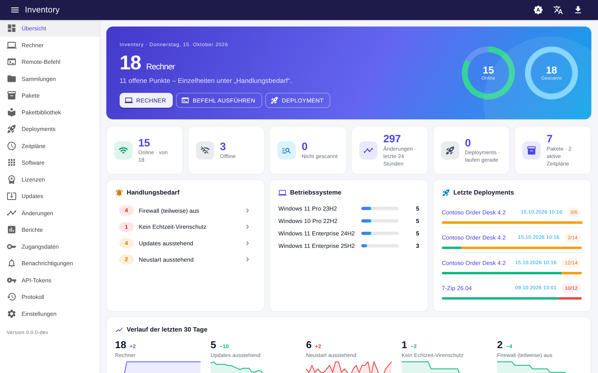

## Funktionen

Zu jeder Funktion gehört unten ein Bild der passenden Seite. Die Bilder stammen aus dem Simulationsmodus
(`Inventory:Simulate`), der ohne echte Rechner eine Beispielumgebung zeigt.

- [Übersicht und Verläufe](#übersicht-und-verläufe) · [Rechnerliste](#rechnerliste) ·
  [Inventar je Rechner](#inventar-je-rechner) · [Sicherheit und Konfiguration](#sicherheit-und-konfiguration) ·
  [Updates und Patch-Stand](#updates-und-patch-stand) · [Software und Apps](#software-und-apps) ·
  [Änderungsverlauf](#änderungsverlauf) · [Netzwerkgeräte](#netzwerkgeräte) · [Netzwerkkarte](#netzwerkkarte)
- [Sammlungen und Wartungsfenster](#sammlungen-und-wartungsfenster) · [Pakete und Schritte](#pakete-und-schritte) ·
  [Erkennung, Voraussetzungen und Hinweis an den Benutzer](#erkennung-voraussetzungen-und-hinweis-an-den-benutzer) ·
  [Fertige Pakete](#fertige-pakete)
- [Ein Paket bereitstellen](#ein-paket-bereitstellen) · [Pilotgruppe zuerst](#pilotgruppe-zuerst) ·
  [Zeitpläne und Pflicht-Verteilungen](#zeitpläne-und-pflicht-verteilungen) ·
  [Remote-Befehl und Fernzugriff](#remote-befehl-und-fernzugriff)
- [Gespeicherte Berichte](#gespeicherte-berichte) · [Alarme und Benachrichtigungskanäle](#alarme-und-benachrichtigungskanäle) ·
  [Lizenzzählung](#lizenzzählung) · [Nachvollziehbarkeit](#nachvollziehbarkeit)

### Übersicht und Verläufe

Die Startseite (Bild ganz oben) zeigt, wie viele Rechner online und gescannt sind, was Aufmerksamkeit braucht
(Firewall aus, kein Echtzeit-Virenschutz, ausstehende Updates und Neustarts, Garantien, die innerhalb von 90 Tagen
enden …), die Betriebssysteme und die letzten Deployments. Für die Kennzahlen wird je Tag ein Wert festgehalten; so
zeigt die Übersicht auch 30-Tage-Verläufe, Verteilungen je Woche und das Alter der letzten Scans.

### Rechnerliste

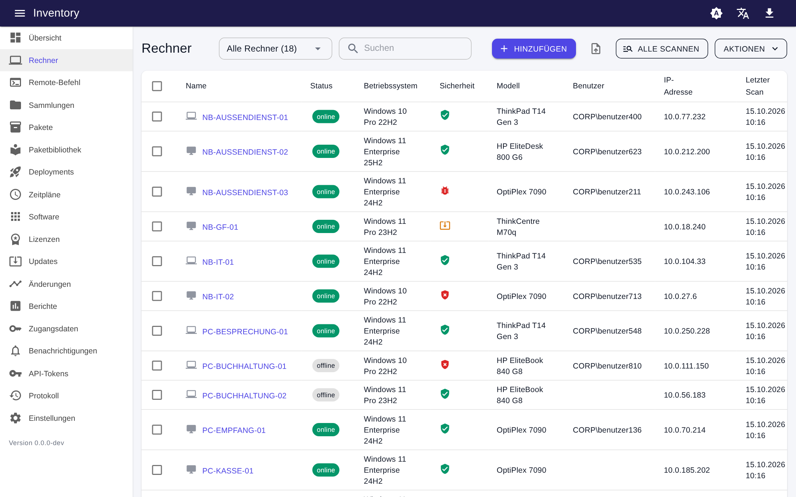

Rechner werden von Hand angelegt, aus dem Active Directory importiert oder melden sich über den [Agent](#agent) selbst
an. Die Liste zeigt Erreichbarkeit, letzten Scan und Sicherheitsampel und bietet Aktionen für die Auswahl: scannen, bereitstellen, Befehl ausführen, wecken, Agent
installieren. Die Erreichbarkeit lässt sich regelmäßig per Heartbeat prüfen (Rechner mit Namensauffälligkeiten
ausgenommen).

Filter lassen sich kombinieren: eine Sammlung, beliebig viele Bedingungen (online, Updates ausstehend, Firewall aus …),
die ein Rechner alle erfüllen muss, ein oder mehrere Gerätetypen und dazu ein Suchbegriff. Die Auswahl steht in der
Adresse (`computers?collection=3&filter=online,updates&type=laptop`); eine Ansicht lässt sich so als Lesezeichen
speichern oder weitergeben.

### Inventar je Rechner

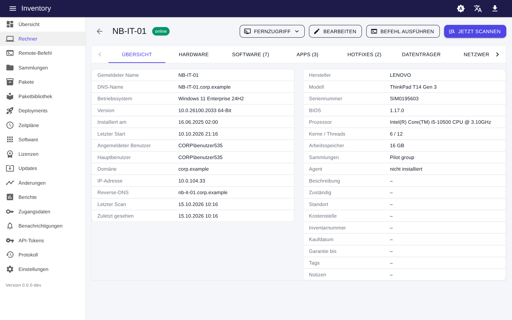

Der Inventar-Scan liest System, Betriebssystem, Prozessor, Software, Hotfixes, Datenträger, Netzwerk, Dienste, lokale
Benutzer und Administratoren. **Bestandsdaten** – Zuständig, Standort, Kostenstelle, Inventarnummer, Kaufdatum,
Garantieende, Tags und Notizen – werden auf der Seite gepflegt, über die API oder per Import einer CSV-Tabelle (der
Rechner-Export lässt sich bearbeiten und wieder einlesen). **Hauptbenutzer** ist, wer bei den Scans der letzten 30
Tage an den meisten Tagen eine interaktive Sitzung hatte (Konsole oder Remotedesktop); als Zugangsdaten hinterlegte
Konten, Dienste und geplante Aufgaben zählen nie. Der Reiter *Profile* listet die Benutzerprofile.

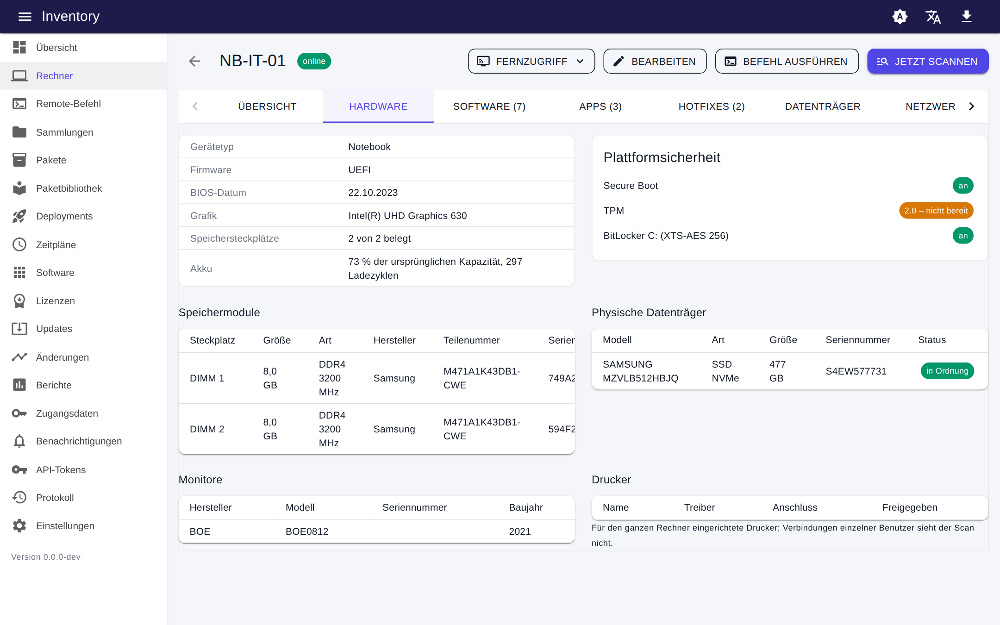

**Hardware und Plattformsicherheit**: Gerätetyp (Desktop, Notebook, Server, virtuelle Maschine), UEFI und Secure Boot,
TPM, BitLocker je Laufwerk, Grafik, Speichermodule und freie Steckplätze, physische Datenträger mit Typ und Zustand,
Akkuzustand, Monitore und Drucker.

**Lizenzangaben** (Reiter *Lizenzierung*): Prozessorsockel und physische Kerne je Sockel, Windows-Edition und
Lizenzkanal (OEM, Retail, MAK, KMS), Serverrollen und -features, SQL-Server-Instanzen mit Edition und Version und bei
virtuellen Maschinen der Host, auf dem sie laufen. Ein Hyper-V-Host listet seine virtuellen Maschinen; jede wird über
die BIOS-UUID dem inventarisierten Gast zugeordnet, sonst über den Hostnamen, den die Integrationsdienste des Gasts
melden, und der Failover-Cluster wird festgehalten. Alles wird nur gelesen; was sich nicht lesen lässt, bleibt vom
vorigen Scan erhalten. Die Felder stehen auch in dynamischen Sammlungen und im Rechnerbericht zur Verfügung.

### Sicherheit und Konfiguration

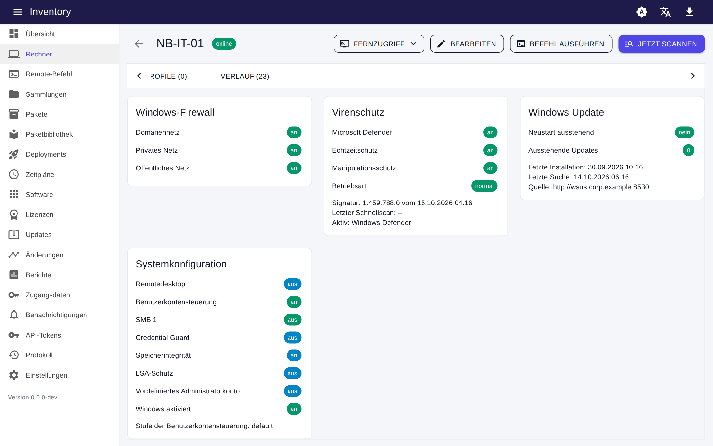

Firewall, Virenschutz und Windows-Update-Status, dazu die Systemkonfiguration: Remotedesktop und Authentifizierung auf
Netzwerkebene, Benutzerkontensteuerung, SMB 1, Credential Guard, Speicherintegrität, LSA-Schutz, vordefiniertes
Administratorkonto (aktiv, Kennwortalter), Windows-Aktivierung, letzte Anmeldung und Kennwortalter lokaler Konten.
Alles steht auch als Regel für Sammlungen bereit – „Rechner mit aktivem SMB 1“ ist eine Regel.

### Updates und Patch-Stand

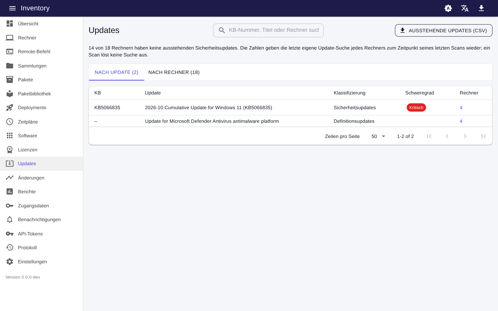

Ausstehende Updates je Rechner mit KB-Nummer, Klassifizierung und Schweregrad; Übersicht je Update (auf welchen
Rechnern es fehlt) und je Rechner (wer keine offenen Sicherheitsupdates hat), CSV-Export und Regeln für Sammlungen auf
installierte Hotfixes und ausstehende Updates. *Installieren …* startet eine Verteilung des Updates auf die Rechner,
denen es fehlt, mit dem Schritt **Windows Update**: Er sucht, lädt und installiert aus der auf dem Rechner
eingestellten Quelle (WSUS oder Microsoft Update) – alle Updates, nur Sicherheits- und kritische oder bestimmte
KB-Nummern. Funktioniert über SMB + Dienst oder Agent, nicht über WinRM. Für bestimmte Rechner verteilen *Installieren …*
auf der Rechnerseite (Abschnitt *Ausstehende Updates*) und *Ausstehende Updates installieren* in den Aktionen der
Rechnerliste alle ausstehenden Updates oder nur Sicherheits- und kritische, danach einen Neustart nur, wenn einer
aussteht (mit fünf Minuten Vorwarnung für den angemeldeten Benutzer) – oder ganz ohne Neustart: Dann werden die Updates
beim nächsten Neustart fertig. Inventory startet in diesem Fall nie neu; Neustartregeln, denen Windows Update selbst
folgt (Gruppenrichtlinie, Nutzungszeit), gelten weiterhin.

### Software und Apps

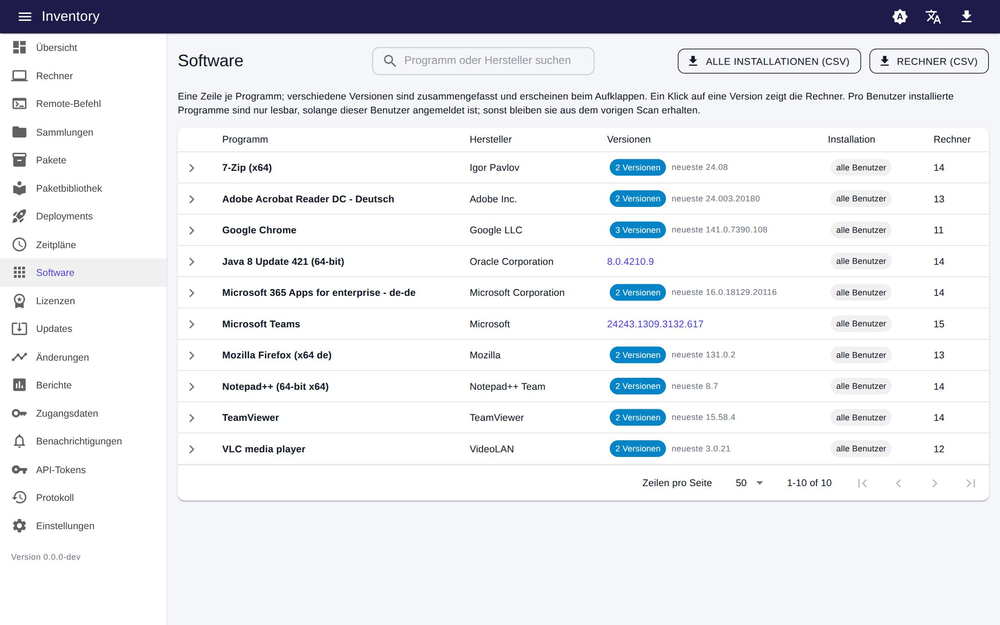

Die Software-Übersicht zählt jedes Programm über alle Rechner, nach Name und Version, und führt zu den Rechnern, die es
haben. *Deinstallieren …* entfernt ein Programm dort: still bei MSI-, Inno-Setup- und NSIS-Setups sowie bei Programmen
mit eingetragenem stillen Befehl, danach mit der Prüfung, dass es wirklich weg ist.

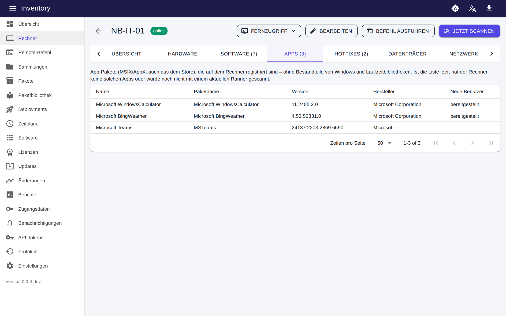

**Apps (MSIX/AppX, Store)**: Der Scan erfasst die App-Pakete des Rechners samt der Angabe, ob sie für neue Benutzer
bereitgestellt sind; Sammlungen können danach filtern, und ein Schritt *App entfernen* entfernt eine App für alle
Benutzer und auf Wunsch auch für künftige. Bestandteile von Windows und Laufzeitbibliotheken bleiben unberührt, und ein
zu weit gefasster Name entfernt nichts.

### Änderungsverlauf

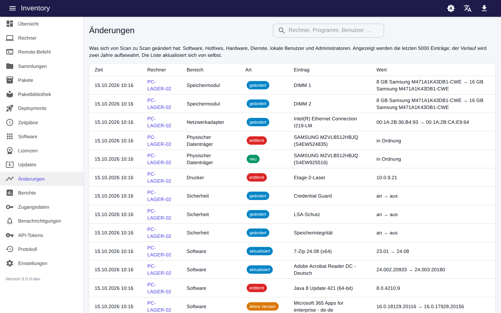

Jeder Scan wird mit dem vorigen verglichen: installierte, entfernte und aktualisierte Software, Hotfixes, Dienste,
lokale Administratoren, Hardware und Systemkonfiguration erscheinen als Änderungen mit Zeitpunkt – je Rechner im Reiter
*Verlauf* und für alle Rechner unter *Änderungen*.

### Netzwerkgeräte

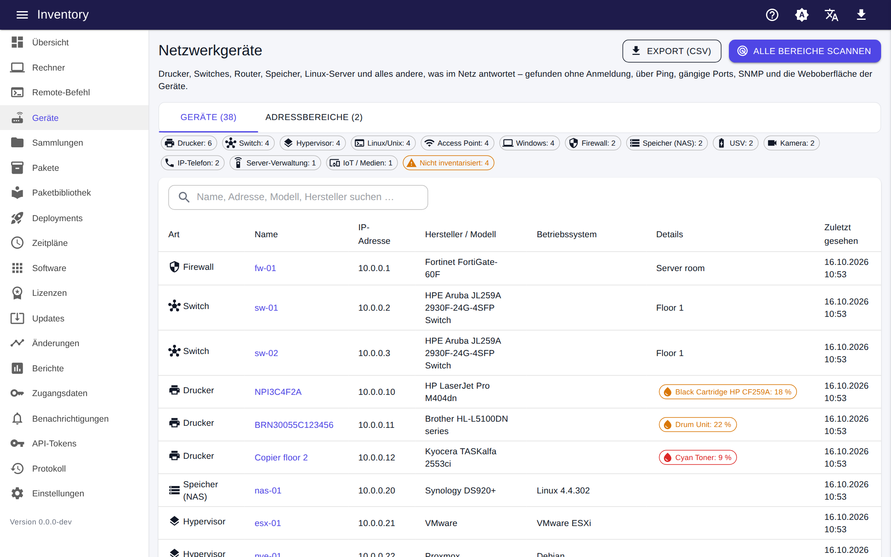

Drucker, Switches, Router, Firewalls, Access Points, Speicher, Linux-Server, Hypervisoren, Kameras, IP-Telefone und
USVs: Der Server durchsucht die eingetragenen Adressbereiche (CIDR, von–bis oder einzelne Adressen, höchstens 4096 je
Bereich) und stellt fest, was antwortet – ohne Anmeldung an den Geräten und ohne Agent:

- **Ping und gängige Ports** (30 TCP-Ports wie SSH, HTTP/HTTPS, SMB, RDP, IPP, JetDirect 9100, RTSP, SIP).
- **SNMP v1/v2c** mit den hinterlegten Communities (verschlüsselt gespeichert; ohne Eintrag `public`): Name,
  Beschreibung, Standort, Kontakt, Laufzeit, Modell, Seriennummer und Firmware (ENTITY-MIB), Erkennung von Routern und
  Switches (IP-Forwarding, Bridge-MIB) und die ARP-Tabelle von Routern, aus der die MAC-Adressen von Geräten in anderen
  Subnetzen kommen. Drucker melden **Verbrauchsmaterial und Seitenzähler** (Drucker-MIB), USVs ihr Modell (USV-MIB).
- **Banner und Weboberfläche**: das SSH-Banner (verrät Ubuntu, Debian, RouterOS …), Titel und Server-Kopfzeile der
  Webseite, der Realm ihrer Anmeldung und das Subjekt ihres TLS-Zertifikats.
- **MAC-Hersteller** aus dem öffentlichen IEEE-Register, für Geräte im eigenen Subnetz des Servers oder hinter einem
  Router, der auf SNMP antwortet.
- **Windows-Rechner** nennen ihren Namen über SMB und werden mit der Rechnerliste verknüpft; fehlen sie dort, sind sie
  als *Nicht inventarisiert* markiert und lassen sich mit *In Rechnerliste übernehmen* übernehmen – einzeln auf der
  Detailseite oder mehrere auf einmal in der Liste (auswählen, oder nach *Nicht inventarisiert* filtern, um alle zu
  übernehmen). Der neue Rechner heißt so, wie er sich über SMB nennt (sonst nach DNS-Name oder Adresse), und ist sofort
  mit dem Gerät verknüpft; gibt es schon einen Rechner dieses Namens, wird das Gerät nur verknüpft. Linux-Server werden
  ebenfalls erkannt, die Rechnerliste inventarisiert aber nur Windows.

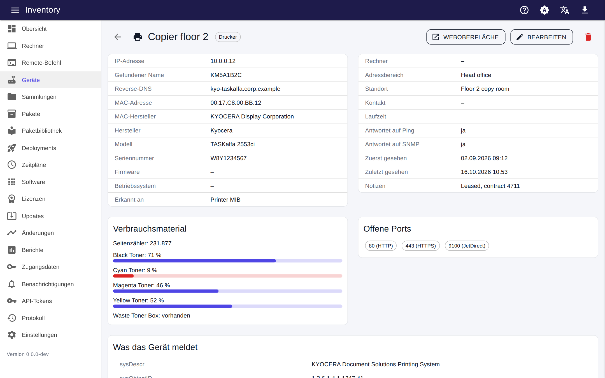

Die Detailseite zeigt, was jeder Hinweis ergeben hat, und verlinkt die Weboberfläche des Geräts. Eine falsch erkannte
Art lässt sich von Hand korrigieren; Name und Notizen bleiben beim nächsten Scan erhalten. Ein Zeitplan mit der Aktion
*Gerätescan im Netzwerk* hält die Liste aktuell, die Alarmregel *Ein neues Gerät taucht im Netz auf* meldet
Neuzugänge, und die Liste gibt es als CSV und über die API (`/api/devices`).

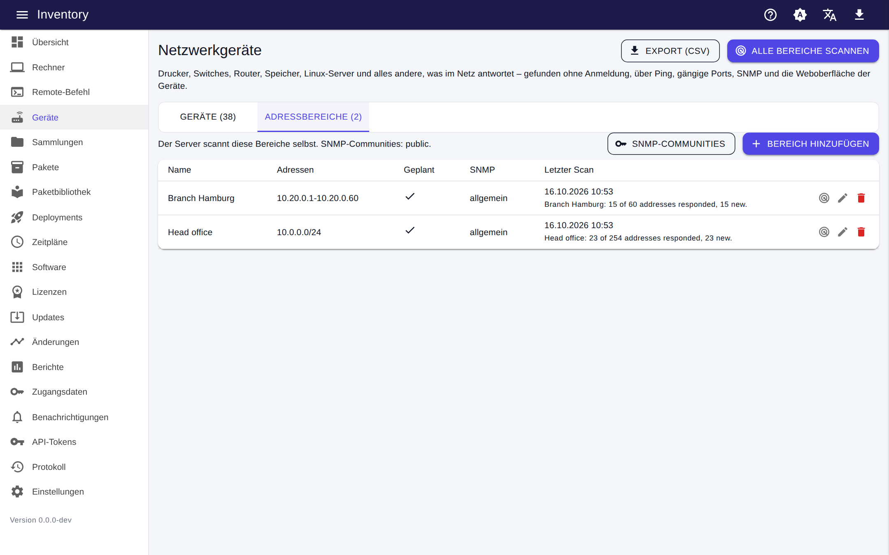

Der Scan spricht jede Adresse eines Bereichs auf 30 Ports an; ein Intrusion-Detection-System kann das als Portscan
melden – also vorher dem Netzwerkteam Bescheid geben. Geroutete Subnetze müssen vom Server aus erreichbar sein (ICMP, die
genannten Ports, UDP 161 für SNMP).

### Netzwerkkarte

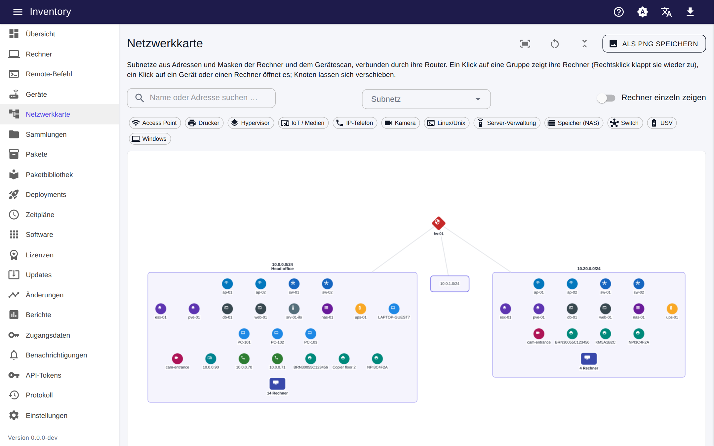

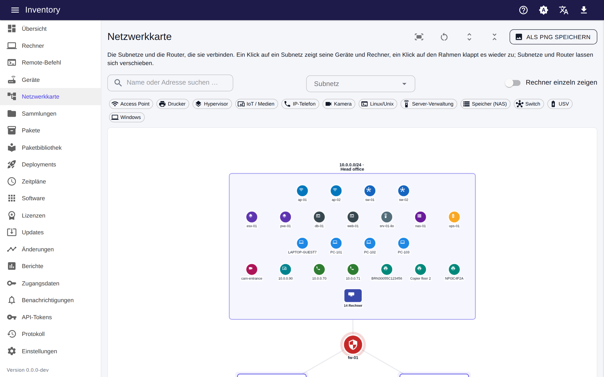

Subnetze, Router, Netzwerkgeräte und Rechner als interaktives Diagramm, abgeleitet aus dem, was ohnehin bekannt ist:
Adresse und Maske der Netzwerkadapter jedes Rechners, die Schnittstellen, die Router per SNMP melden (`ipAddrTable`),
die CIDR-Bereiche des Gerätescans und die Standard-Gateways der Rechner. Der Gerätescan aller Bereiche prüft auch diese
Gateways; stellen sie sich als dasselbe Gerät heraus (gemeinsame Schnittstellen, MAC-Adresse, Seriennummer oder
SNMP-Name), werden sie ein Knoten – typischerweise die zentrale Firewall in der Mitte, die Subnetze darum. Außerdem verfolgt der
Scan den Weg vom Server zu je einem Ziel in jedem Subnetz (ICMP mit steigender TTL, wie `tracert`): aufeinanderfolgende
Hops verbinden Router untereinander, der letzte Router vor einem Subnetz gilt als dessen Gateway (so finden
Gateway-Adressen auch ohne SNMP zu ihrem Router), und ein Knoten für den Inventory-Server zeigt, wo er im Netz steht. Die Karte
beginnt mit dieser Übersicht, jedes Subnetz als Karte mit seinen Gerätearten und deren Anzahl. Ein Klick öffnet ein
Subnetz: zuerst die Netzinfrastruktur, dann Server und Speicher, dann Peripherie, zuletzt die Rechner als Gruppe, die
sich mit einem weiteren Klick öffnet. Die Suche öffnet die Subnetze ihrer Treffer, Subnetz-Filter und Gerätearten
grenzen die Ansicht ein, beim Überfahren werden die Verbindungen hervorgehoben, Subnetze und Router lassen sich
verschieben (die Anordnung merkt sich der Browser), und das Diagramm lässt sich als PNG speichern. Subnetze ohne bekannte Maske werden als /24 angenommen und gestrichelt gezeichnet.
Unter „Relevante Netze“ legen Administratoren fest, welche Netze zum Unternehmen gehören (CIDR beliebiger Größe
oder `192.168.10.x`, etwa das Firmennetz und die VPN-Pools). Die Karte zeichnet dann nur diese; die Heimnetze der Notebooks
zählen gesammelt unter „Heim- und Fremdnetze“, und Traceroute und Gateway-Prüfung bleiben innerhalb dieser Netze. Ein Gateway mehrerer Subnetze heißt einfach „Gateway“; Operatoren können ihm per Klick einen Namen geben.
Das Diagramm nutzt [Cytoscape.js](https://js.cytoscape.org/) (MIT-Lizenz), das mit dem Server ausgeliefert wird.

### Sammlungen und Wartungsfenster

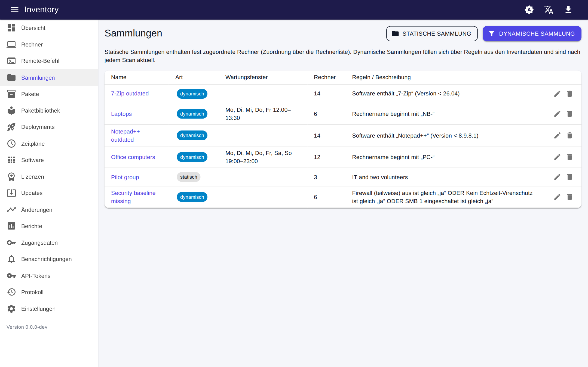

Sammlungen sind statisch (von Hand gewählt) oder dynamisch über Regeln wie „Chrome installiert mit Version unter 141“.
Regeln gibt es für Software, Apps, Hardware, Sicherheitszustand, Updates, Active Directory, Bestandsdaten, Dienste,
Netzwerk und Scan-Alter; `*` dient bei „ist gleich“ als Platzhalter, und „Mitglied der Sammlung“ kombiniert Sammlungen
(bis zu drei Ebenen tief).

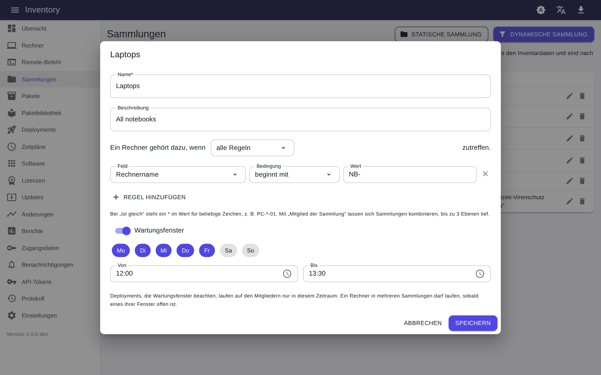

Eine Sammlung kann ein **Wartungsfenster** tragen (Wochentage und Uhrzeit); dazu gibt es ein Standardfenster.
Deployments und Zeitpläne mit der Option „Nur im Wartungsfenster“ halten Rechner zurück, deren Fenster geschlossen ist,
und starten sie, sobald es beginnt. Ein Rechner in mehreren Sammlungen darf laufen, sobald eines seiner Fenster offen
ist.

### Pakete und Schritte

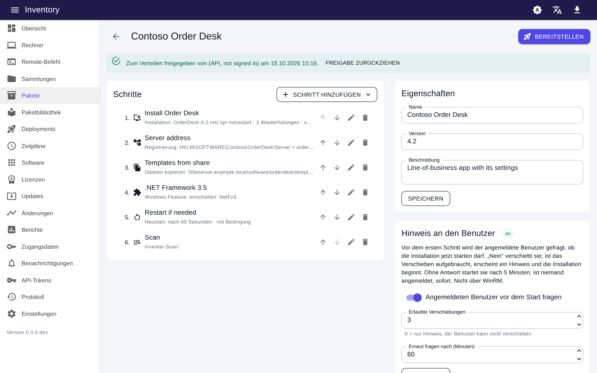

Ein Paket ist eine Folge von Schritten, jeder mit Bedingungen und Fehlerverhalten:

- **Installation** einer MSI oder EXE aus den Paketdateien, **Befehl**, **PowerShell**, **Dateien kopieren**,
  **Dienst** (starten/stoppen/neu starten), **Warten**, **Neustart**, **Scan**, **eingebettetes Paket**
- **Registrierung**: einen Wert setzen oder löschen oder einen Schlüssel löschen, ohne Skript – typisiert
  (Zeichenfolge, DWORD, QWORD, mehrteilige Zeichenfolge, binär), in der 64- oder 32-Bit-Ansicht und bei `HKCU` in den
  Einstellungen des angemeldeten Benutzers
- **Windows-Feature**: optionale Features ein- oder ausschalten (DISM); ein ausstehender Neustart wird gemeldet
- **Kopieren von einer Freigabe**: sehr große Dateien kommen von einer Freigabe oder einem Pfad auf dem Rechner, statt
  über den Server zu laufen (das Computerkonto braucht Leserechte auf die Freigabe)
- **Deinstallation**, **App entfernen** und **Windows Update** (siehe oben)

Schritte nach einem Neustart laufen automatisch weiter, sobald der Rechner wieder da ist. Jeder Schritt läuft als
Lokales System oder in der Sitzung des angemeldeten Benutzers ([Ausführungskontext](#ausführungskontext)) und kann mit
Pause wiederholen (automatisch, wenn gerade eine andere Installation läuft), vorher den freien Speicherplatz prüfen und
benannte Programme schließen – auf Wunsch nach einem Hinweis an den Benutzer.

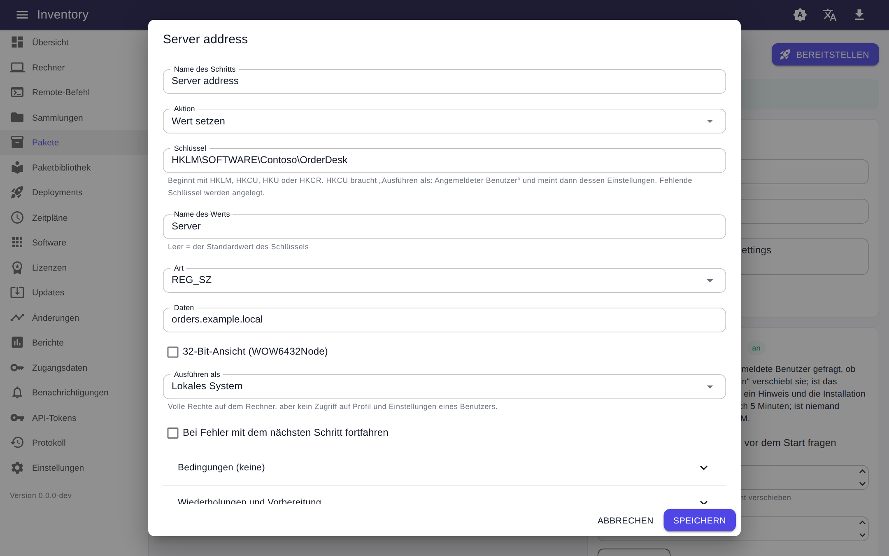

Ein Paket ist „in Arbeit“, bis ein Administrator es **freigibt**; Operatoren und Zeitpläne verteilen nur freigegebene
Pakete, und jede Änderung an Schritten, Erkennung oder Dateien hebt die Freigabe auf.

### Erkennung, Voraussetzungen und Hinweis an den Benutzer

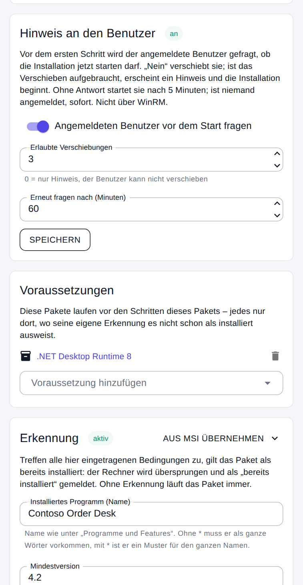

- **Erkennung**: woran zu erkennen ist, dass das Paket schon installiert ist (Programmname mit Mindestversion,
  MSI-Produktcode, Datei oder Registry-Schlüssel). Solche Rechner werden übersprungen und als „bereits installiert“
  gemeldet; auf Wunsch läuft dieselbe Prüfung nach dem letzten Schritt noch einmal, sodass ein Setup, das Erfolg meldet,
  ohne zu installieren, als fehlgeschlagen gilt.
- **Voraussetzungen**: die Pakete, die dieses braucht („benötigt die .NET-Runtime“). Sie laufen vor seinen Schritten,
  jedes nur dort, wo seine eigene Erkennung es nicht schon findet, und müssen danach erkennbar sein, wenn das Paket die
  Überprüfung verlangt.
- **Hinweis an den Benutzer mit Aufschub**: Der angemeldete Benutzer wird vor dem Start gefragt und darf eine
  einstellbare Zahl von Malen verschieben (Vorgabe: dreimal um 60 Minuten); danach erscheint nur noch ein Hinweis und
  die Installation beginnt. Ohne Antwort startet sie nach fünf Minuten, ohne angemeldeten Benutzer sofort. Funktioniert
  über SMB + Dienst und Agent, nicht über WinRM.

### Fertige Pakete

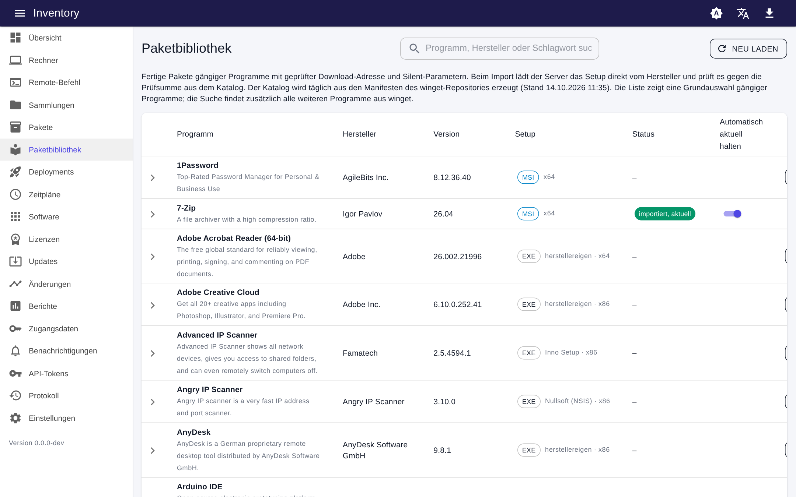

Die [Paketbibliothek](#paketbibliothek) bietet Pakete gängiger Programme, täglich aus den winget-Manifesten erzeugt:
Import per Klick, automatische Übernahme neuer Versionen und eine mitwandernde dynamische Sammlung „… veraltet“ – so
hält ein Zeitplan „Chrome auf *Chrome veraltet*“ jeden Rechner aktuell.

### Ein Paket bereitstellen

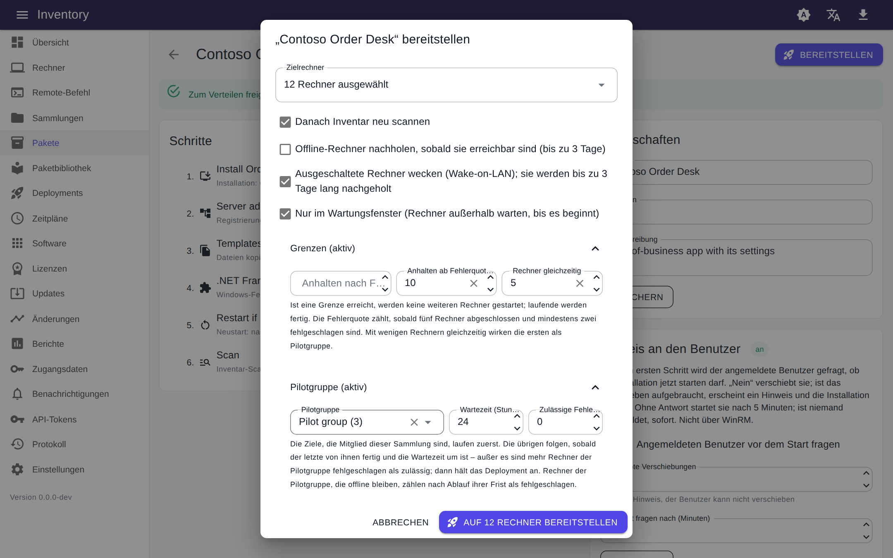

Ein Deployment zielt auf Rechner oder eine Sammlung und läuft parallel. Optionen:

- danach **neu scannen**, **Offline-Rechner nachholen**, sobald sie antworten (bis zu drei Tage)
- **Wake-on-LAN**: ausgeschaltete Rechner wecken und nachholen, sobald sie antworten; *Wecken* auf der Rechnerseite tut
  dasselbe von Hand ([Details](#wake-on-lan))
- **Nur im Wartungsfenster**
- **Grenzen**: nach einer Anzahl oder Quote von Fehlern keine weiteren Rechner mehr starten und begrenzen, wie viele
  Rechner gleichzeitig laufen – ein kaputtes Paket erreicht nicht alle Rechner
- **Pilotgruppe** (siehe nächster Abschnitt)

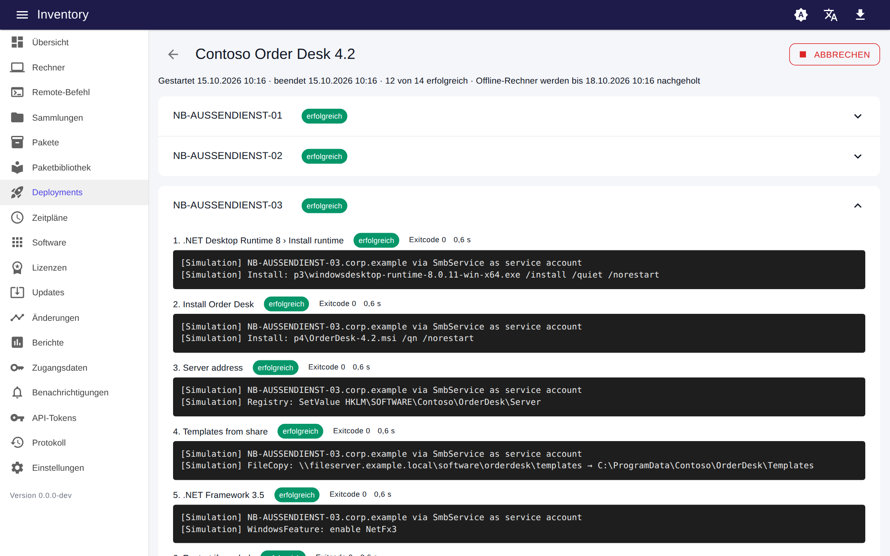

Die Deployment-Seite zeigt den Stand je Rechner live, mit der Ausgabe jedes Schritts; sie lässt sich abbrechen, und
fehlgeschlagene Rechner lassen sich wiederholen. Rechner, die warten – offline, außerhalb ihres Wartungsfensters, im
Neustart oder vom Benutzer verschoben –, zeigen, warum. Ein Rechner, der auf den Abbruch nicht mehr reagiert (etwa weil
er mitten im Job neu gestartet ist), wird nach wenigen Sekunden trotzdem beendet und als abgebrochen geführt; so blockiert
ein hängendes Deployment nie ein Update des Servers. Agentlose Jobs über SMB geben außerdem von selbst auf, wenn nach den
Zeitlimits der Schritte plus zehn Minuten kein Ergebnis da ist.

### Pilotgruppe zuerst

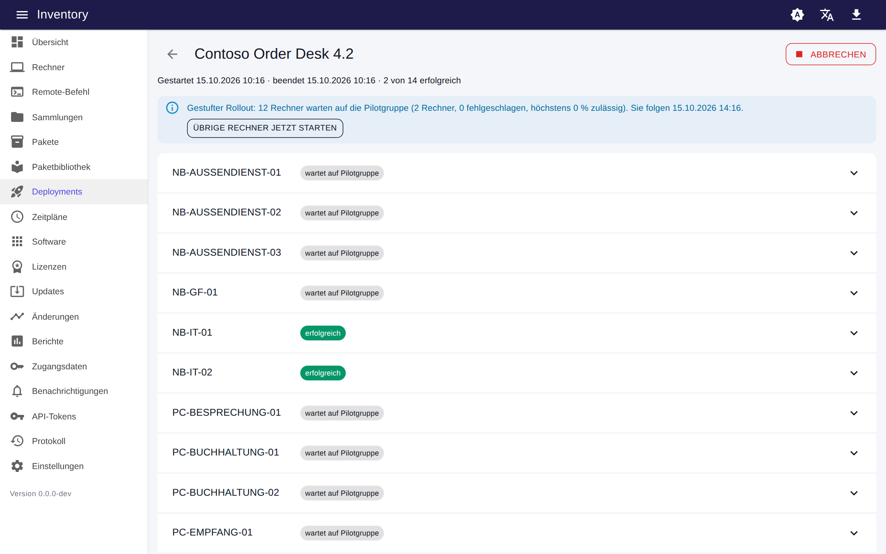

Ein Deployment oder Zeitplan kann eine Pilotgruppe nennen. Ihre Rechner laufen zuerst; die übrigen folgen nach einer
Wartezeit – oder gar nicht, wenn zu viele der Pilotgruppe fehlgeschlagen sind. *Übrige Rechner jetzt starten*
überspringt die Wartezeit. Details unter [Gestufter Rollout](#gestufter-rollout).

### Zeitpläne und Pflicht-Verteilungen

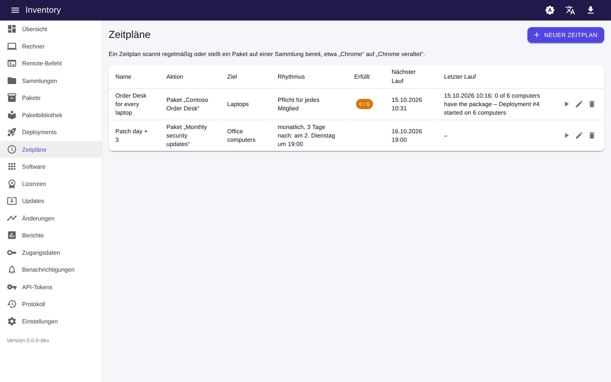

Zeitpläne scannen, verteilen ein Paket auf eine Sammlung oder verschicken einen Bericht: täglich, wöchentlich,
monatlich (ein Tag des Monats oder z. B. „drei Tage nach dem zweiten Dienstag“), in festen Abständen oder einmalig,
auf Wunsch mit Enddatum. Ein Lauf, der wegen eines ausgeschalteten Servers ausfiel, wird binnen eines Tages nachgeholt
oder ausgelassen. **Pflicht-Verteilungen** halten eine Sammlung versorgt: Jedes Mitglied bekommt das Paket einmal,
später hinzukommende Rechner folgen von selbst, und der Zeitplan zeigt, wie viele Mitglieder es schon haben.

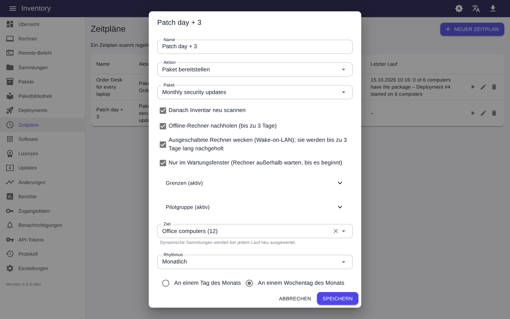

### Remote-Befehl und Fernzugriff

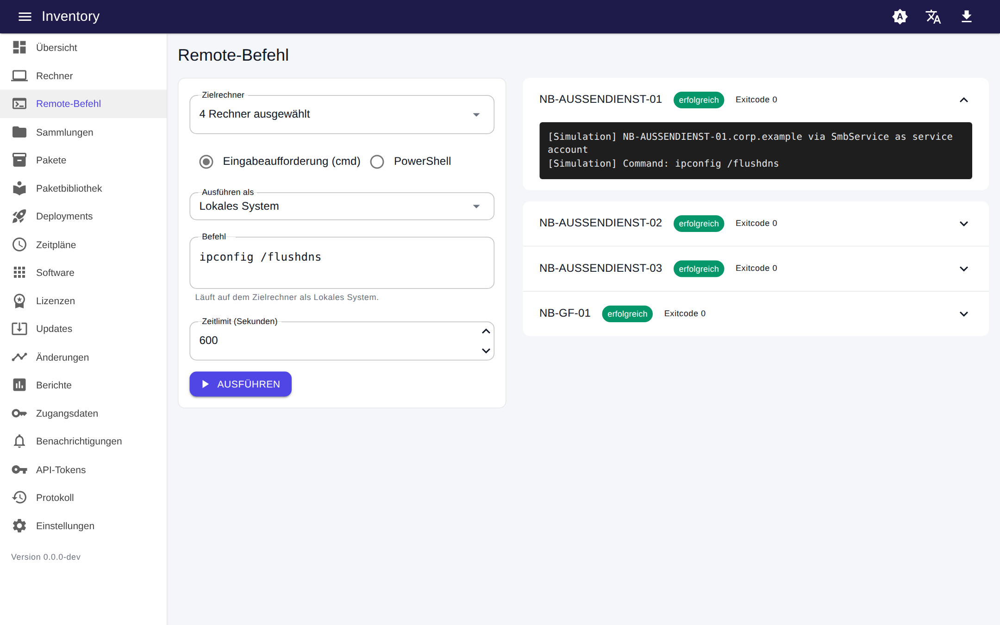

Ein Befehl (cmd oder PowerShell) läuft auf mehreren Rechnern zugleich, als Lokales System oder als angemeldeter
Benutzer, mit Live-Ausgabe je Rechner. Je Rechner bietet das Menü *Fernzugriff* Remoteunterstützung, das Spiegeln einer
Sitzung, Remotedesktop und TeamViewer/AnyDesk ([Details](#fernzugriff)).

### Gespeicherte Berichte

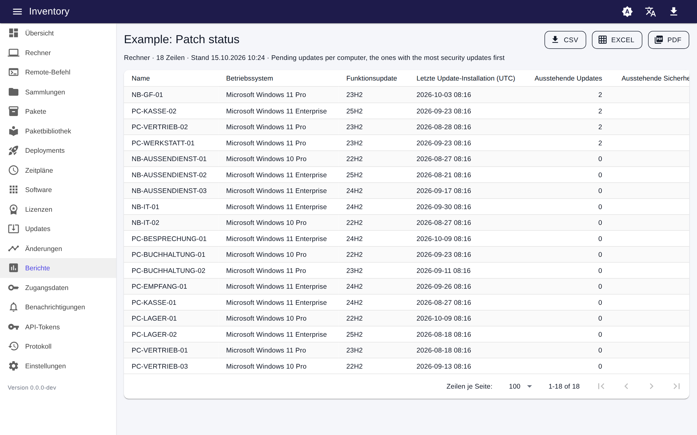

Gespeicherte Listen von Rechnern, Software, ausstehenden Updates, Verteilungen oder Änderungen – auf eine Sammlung
beschränkt, mit gewählten Spalten und Sortierung; im Browser, als CSV, Excel oder PDF, oder per Zeitplan als E-Mail.
Elf fertige Beispiele (Hardware, Sicherheitsstatus, Patch-Stand, Bestandsliste …) dienen unverändert oder als Vorlage
([Details](#berichte)).

### Alarme und Benachrichtigungskanäle

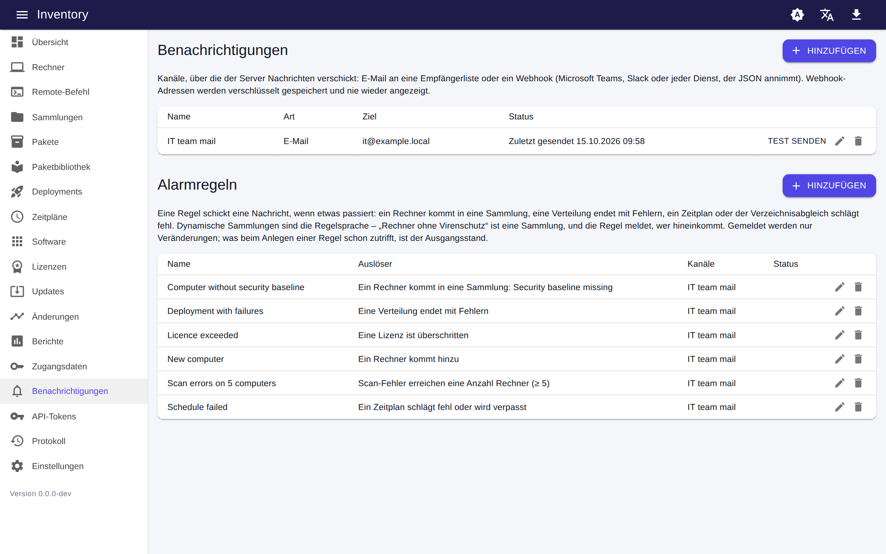

Kanäle für E-Mail (SMTP mit STARTTLS/TLS, auf Wunsch Anmeldung mit gespeicherten Zugangsdaten) und Webhooks (Microsoft
Teams, Slack oder schlichtes JSON), jeweils mit Testknopf. **Alarmregeln** schicken eine Nachricht, wenn ein Rechner in
eine Sammlung kommt, eine Sammlung oder die Scan-Fehler eine Anzahl erreichen, eine Verteilung mit Fehlern endet, ein
Rechner hinzukommt, eine Lizenz überschritten ist oder ein Zeitplan, der Verzeichnisabgleich, die Sicherung oder die
Server-Aktualisierung fehlschlägt – mit Pause je Regel und Wahl der Kanäle ([Details](#benachrichtigungen)).

### Lizenzzählung

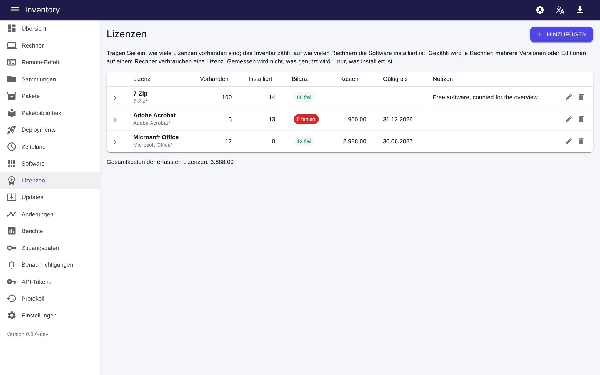

Je Produkt eintragen, wie viele Lizenzen vorhanden sind; das Inventar zählt die Rechner, auf denen die Software
installiert ist, und zeigt, was fehlt oder frei ist, mit Kosten und Ablaufdatum. Eine Alarmregel meldet überschrittene
Lizenzen.

### Nachvollziehbarkeit

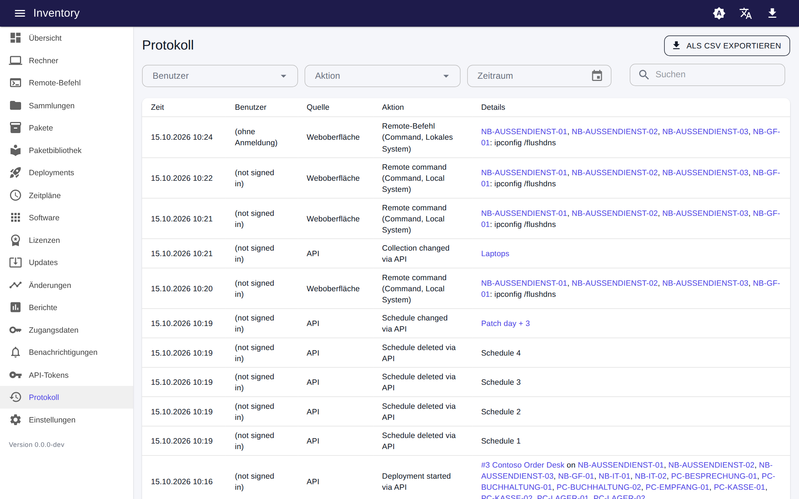

Anmeldungen, Befehle, Deployments und jede Änderung mit Benutzer, Rolle und Herkunft (Weboberfläche, API, API-Token);
Filter, CSV-Export und Aufbewahrungsfrist ([Details](#protokoll)). Außerdem dabei: CSV-Export der Rechnerliste,
tägliche Datensicherung und eine REST-API mit interaktiver Dokumentation ([API](#api)).

## So funktioniert der Zugriff

Auf dem Zielrechner führt immer derselbe kleine **Runner** (`InventoryRunner.exe`, .NET Framework 4.8) einen Job aus.
Rechner ohne .NET Framework 4.8 (Windows Server 2012 bis 2016, frühe Windows-10-Stände) bekommen stattdessen denselben
Runner als eine eigenständige .NET-10-Datei (rund 40 MB, einmal je Runner-Version kopiert); das wählt der Server selbst.
Windows 7 und Server 2008 R2 führen nur den kleinen Runner aus: **Rechner → .NET Framework 4.8 installieren** installiert es
dort mit dem Offline-Installer von Microsoft – ohne Runner, über ADMIN$ und den Dienststeuer-Manager. Den Installer lädt
der Server einmal (Signatur geprüft) in den Ordner `netfx` seines Datenverzeichnisses; ohne Internetzugang
`ndp48-x86-x64-allos-enu.exe` selbst dorthin kopieren. Meist ist ein Neustart nötig, den Inventory nicht auslöst.
Wie er dorthin kommt, bestimmt der Transport – einstellbar global und je Rechner:

| Transport | Voraussetzung auf dem Ziel | Job läuft als |
|---|---|---|
| SMB + Dienst (Standard) | Freigabe `ADMIN$`, Port 445, Konto mit lokalen Adminrechten | Lokales System |
| WinRM | PowerShell-Remoting aktiv, Port 5985, PowerShell im vollen Sprachmodus | hinterlegtes Konto |
| Agent (optional) | Dienst „Inventory Agent“, ausgehende Verbindung zum Server | Lokales System |

Auf dem Zielrechner entsteht `%SystemRoot%\Inventory` (nur SYSTEM und Administratoren): der Runner bleibt dort unter
`Runner\<Versions-Hash>` liegen, Job-Verzeichnisse unter `Jobs` werden nach jedem Lauf entfernt. Der SMB-Transport
richtet einmalig den Dienst `InventoryRunner` ein (Start manuell) und startet ihn für jeden Job mit der Job-ID; der
Dienst endet, sobald der Job fertig ist. Je Rechner läuft ein Job zur Zeit – ein zweiter wartet auf den ersten.

Um alles von einem Rechner zu entfernen: `sc delete InventoryRunner` und `%SystemRoot%\Inventory` löschen.

### Konto für den agentenlosen Zugriff

Scans, Deployments und die Agent-Installation über SMB oder WinRM verbinden sich mit einem hinterlegten Konto
(*Zugangsdaten*; eines ist der Standard, ein Rechner kann ein eigenes haben). Der Agent braucht kein solches Konto.
Alles Folgende gilt für die Rechner, die der Server agentenlos erreicht, nicht für den Server selbst.

**Was das Konto auf jedem Zielrechner braucht**

| Voraussetzung | Warum |
|---|---|
| Mitglied der lokalen Gruppe *Administratoren* (empfohlen) | Schreiben nach `ADMIN$` (`%SystemRoot%\Inventory`) und Anlegen, Ändern und Starten des Dienstes `InventoryRunner` über den Dienststeuerungs-Manager; über WinRM Anlegen desselben Ordners und Starten des Runners. Eine engere Delegation über Zugriffslisten (Dienststeuerungs-Manager, Freigabe, Ordner, WinRM-Sitzungskonfiguration) ist denkbar, aber nicht getestet und muss alle diese Rechte abdecken – unterstützt ist die Einrichtung über die lokalen Administratoren. |
| Netzwerkanmeldung erlaubt | „Auf diesen Computer vom Netzwerk aus zugreifen“ muss es einschließen (Standard: *Administratoren*), „Zugriff vom Netzwerk auf diesen Computer verweigern“ darf es nicht – Vorsicht bei Sicherheits-Baselines, die *Lokales Konto und Mitglied der Gruppe „Administratoren“* sperren. |
| Volles Administrator-Token über das Netzwerk | Domänenkonten bekommen es von Haus aus. **Lokalen** Konten filtert Windows die Adminrechte bei Netzwerkanmeldungen heraus (UAC-Remoteeinschränkungen); sie funktionieren nur mit `LocalAccountTokenFilterPolicy = 1` oder als integrierter Administrator – beides schwächt das Ziel, also besser ein Domänenkonto. |
| Nur WinRM: voller Sprachmodus | PowerShell darf für dieses Konto auf dem Ziel nicht im eingeschränkten Sprachmodus laufen (AppLocker/WDAC); dasselbe gilt auf dem Server für dessen Dienstkonto. |

Es braucht **keine** domänenweiten Rechte: nicht *Domänen-Admins*, keine Rechte auf dem Server, keine lokale oder
Remotedesktop-Anmeldung, keine Anmeldung als Dienst oder Stapelverarbeitungsauftrag. Mit welcher Identität ein Job
läuft, hängt vom Transport ab:

- **SMB + Dienst**: Der Server nutzt das Konto nur für den Netzwerkzugriff (`LOGON32_LOGON_NEW_CREDENTIALS` – Kopieren
  nach `ADMIN$`, Dienststeuerung). Auf dem Ziel läuft der Runner als Lokales System; Schritte mit *angemeldeter
  Benutzer* laufen in der Sitzung des dort angemeldeten Benutzers, nie als dieses Konto.
- **WinRM**: PowerShell-Remoting meldet sich mit dem Konto an, und der Runner läuft als dieses Konto in dieser
  Remote-Sitzung.

So oder so meldet sich das Konto nie interaktiv an und erscheint nie als Hauptbenutzer (als Zugangsdaten hinterlegte
Konten sind ohnehin ausgenommen).

**Was die Zielrechner brauchen**

| Transport | Einstellungen |
|---|---|
| SMB + Dienst | Eingehend TCP 445 vom Server (Firewall-Gruppe *Datei- und Druckerfreigabe*), Dienst *Server* (`LanmanServer`) läuft, administrative Freigabe `ADMIN$` vorhanden (nicht per `AutoShareWks = 0` auf Clients oder `AutoShareServer = 0` auf Windows Server abgeschaltet). Den Dienststeuerungs-Manager erreicht der Server über RPC: zuerst direkt (TCP 135 und dynamische Ports, Firewall-Gruppe *Remotedienstverwaltung*), sonst über die Named Pipe auf Port 445 – 445 zu öffnen reicht, die RPC-Gruppe zu öffnen spart eine Verzögerung. |
| WinRM | PowerShell-Remoting aktiviert (`Enable-PSRemoting` oder die Gruppenrichtlinie *Remoteserververwaltung über WinRM zulassen*), eingehend TCP 5985 vom Server. Der Server verbindet sich per Name mit Kerberos; für Adressen oder Rechner außerhalb der Domäne bräuchte der Server *TrustedHosts*, das nicht für dich eingerichtet wird. |
| Beide | .NET Framework 4.8 für den kleinen Runner. Vor jedem Job prüft der Server die Version auf dem Rechner; ohne 4.8 nimmt er den eigenständigen .NET-10-Runner (64 Bit, ab Windows Server 2012 bzw. Windows 10 1607), sonst meldet er das fehlende Framework, statt den Runner zu starten. Die Erreichbarkeitsprüfung versucht zuerst TCP 445 und nur wenn der nicht antwortet 5985; „erreichbar“ heißt also nicht, dass WinRM offen ist. |

**Empfohlene Einrichtung**

1. Einen eigenen Domänenbenutzer anlegen, z. B. `svc-inventory-scan`, mit langem Zufallskennwort. Kein persönliches
   Konto und keines, von dem andere Systeme abhängen: Endpunktschutz mit automatischer Reaktion kann es sperren (siehe
   [Endpunktschutz](#endpunktschutz)).
2. Es in eine Domänengruppe aufnehmen, z. B. `Inventory-Clients-Admins`, und diese Gruppe per Gruppenrichtlinie in die
   lokalen *Administratoren* der Zielrechner eintragen (*Computerkonfiguration → Einstellungen →
   Systemsteuerungseinstellungen → Lokale Benutzer und Gruppen*, Aktion *Aktualisieren*, oder *Eingeschränkte Gruppen*
   / „Mitglied von“). Die Richtlinie nur mit den OUs der zu verwaltenden Rechner verknüpfen – nicht mit den
   Domänencontrollern und nicht mit dem Inventory-Server.
3. In einer zweiten Richtlinie für dieselben OUs verweigern, was es nicht braucht: *Lokal anmelden verweigern* und
   *Anmelden über Remotedesktopdienste verweigern*. Die Netzwerkanmeldung bleibt erlaubt.
4. Die Firewall-Regeln aus der Tabelle oben nur für den Inventory-Server öffnen (*Remote-IP-Adresse* = der Server).
5. Das Konto unter *Zugangsdaten* als `DOMÄNE\svc-inventory-scan` hinterlegen und zum Standard machen. Zum
   Kennwortwechsel es im Verzeichnis und danach unter *Zugangsdaten* (oder über die API) ändern.
6. Mit *Scannen* an einem Rechner prüfen; die Fehlermeldungen nennen die Ursache (Zugriff verweigert = keine lokalen
   Adminrechte, Anmeldung fehlgeschlagen = Kennwort, RPC-Server nicht erreichbar = Firewall).

Sind gar keine Zugangsdaten hinterlegt, verbindet sich der Server mit seinem eigenen Dienstkonto. Auf einem
Domänenmitglied, das als Lokales System läuft, ist das das Computerkonto `DOMÄNE\SERVER$`, das dann die Rechte oben
bräuchte; auf einem Server außerhalb der Domäne gibt es kein Konto, dem die Ziele Rechte geben könnten. In beiden
Fällen besser ein Konto hinterlegen.

Die Active-Directory-Synchronisierung ist davon getrennt: Sie liest Computerkonten per LDAP mit dem Dienstkonto des
Servers oder den dort gewählten Zugangsdaten. Computerobjekte zu lesen braucht keine zusätzlichen Rechte – das darf
jeder Domänenbenutzer. Wake-on-LAN, der Fernzugriff (mit dem eigenen Konto des Operators von seinem PC aus) und der
Agent nutzen dieses Konto nicht.

### Endpunktschutz

Endpunktschutz-Produkte werten agentenlose Administration gern als laterale Bewegung, denn auf der Leitung sieht sie
genauso aus: Dateien nach `ADMIN$` kopiert, ein Dienst aus der Ferne gesteuert, PowerShell von einem Dienst gestartet.
Drei Dinge halten die Sicherheitskonsole ruhig, ohne echte Angriffe zu verdecken:

1. **Den Agenten bevorzugen**, wo Meldungen stören. Er verbindet sich ausgehend und braucht weder `ADMIN$` noch
   Dienststeuerung aus der Ferne. Rechner auswählen und *Agent installieren* wählen; nur diese eine Installation läuft
   noch über den agentenlosen Weg.
   Unter *Einstellungen → Agentenloser Zugriff* lässt sich das erzwingen: auf die Installation des Agenten beschränkt
   oder ganz abgeschaltet erreichen Scans, Verteilungen und Zeitpläne keine Rechner ohne Agent mehr.
2. **Ein fester Fußabdruck.** Dienstname (`InventoryRunner`), Pfad (`%SystemRoot%\Inventory\Runner\`) und Dateiname
   (`InventoryRunner.exe`) ändern sich nie, und der Dienst wird einmal je Rechner angelegt statt einmal je Job. Der
   erste Job auf einem Rechner und der erste nach einem Server-Update (neuer Runner) können weiterhin eine Meldung
   auslösen.
3. **Eine eng gefasste Freigabe** im eigenen Produkt, beschränkt auf alles zusammen: den Inventory-Server als
   Quellgerät, den Ordner `%SystemRoot%\Inventory\` und den Dienstnamen `InventoryRunner`. In Microsoft Defender for
   Endpoint ist das eine Regel zur Warnungsunterdrückung, angelegt aus einer der Meldungen, mit diesen Bedingungen.
   Nicht das Anlegen von Diensten aus der Ferne allgemein unterdrücken und den Ordner nicht vom Virenscan ausnehmen –
   dort landen Paketdateien.

Produkte mit automatischer Reaktion belassen es nicht bei Meldungen: sie können das für den Zugriff verwendete Konto
deaktivieren und die beteiligten Rechner isolieren. Solange keine Freigabe eingerichtet ist, agentenlose Jobs nicht
mit einem Konto ausführen, von dem andere Systeme abhängen, und das Werkzeug zuerst an wenigen Rechnern ausprobieren.

[docs/defender.de.md](docs/defender.de.md) enthält die Schritte für Microsoft Defender for Endpoint: was die
Meldungen bedeuten, ein PowerShell-Skript, das die Runner-Datei über ihren Hash freigibt (er steht unter
*Einstellungen*), und wie sich die Verhaltensmeldungen im Portal abstimmen lassen.

Releases, die mit einem Release-Zertifikat gebaut wurden, sind mit dem selbstsignierten Zertifikat des Projekts
signiert (siehe [Aktualisieren](#aktualisieren)); frühere sind unsigniert. Eine Regel nach Zertifikat greift erst, wenn die eigenen Rechner diesem Zertifikat
vertrauen; bis dahin den Runner über seinen Hash freigeben. PowerShell-Schritte laufen als
`powershell.exe -ExecutionPolicy Bypass -File <Skript im Job-Verzeichnis>`; Regeln, die auf den Bypass-Schalter
anspringen, melden sie weiterhin.

### Agent

Für Rechner, die der Server nicht direkt erreicht (Notebooks unterwegs, andere Netze, kein SMB-/WinRM-Weg), gibt es
denselben Runner als dauerhaften Windows-Dienst. Er spricht immer nur *zum* Server – der Server verbindet sich nie zum
Agenten.

Das Ergebnis eines Jobs geht nicht verloren, wenn der Server in dem Moment nicht erreichbar ist: der Agent behält es
und liefert es nach, sobald der Server wieder antwortet – bis zu sieben Tage lang. Wurde der Server neu gestartet,
während der Job lief, zeigt das Deployment den Rechner zunächst als fehlgeschlagen („der Server wurde während der
Ausführung beendet“), bis das Ergebnis eintrifft und das ersetzt.

Ein Paket mit einem **Neustart** mittendrin hängt ebenfalls nicht vom Server ab: Der Agent behält die restlichen
Schritte samt Dateien und macht selbst weiter, sobald der Rechner neu gestartet ist – auch auf einem Notebook, das
ohne Verbindung zum Server wieder hochfährt. Das Deployment zeigt „Neustart – der Agent setzt … selbst fort“, bis das
Ergebnis eintrifft. Wird das Deployment in der Zwischenzeit abgebrochen, macht das eine bereits gelaufene Fortsetzung
nicht rückgängig; ihr Ergebnis wird verworfen.

**So funktioniert er**

| | |
|---|---|
| Dienst | `InventoryAgent` („Inventory Agent“), läuft als **Lokales System**, Starttyp Automatisch, Wiederherstellung: Neustart nach 5 s / 60 s / 5 min |
| Dateien | `%ProgramFiles%\Inventory Agent` – der Runner (`InventoryRunner.exe`, .NET Framework 4.8 oder die eigenständige .NET-10-Datei, je nachdem, welcher ihn installiert hat), `agent.json` (Server-Adresse + Anmeldegeheimnis), `agent.key` (eigener Schlüssel des Agenten), `agent.version` (Hash der installierten Runner-Dateien), `agent.log`; der Ordner ist nur für SYSTEM und Administratoren lesbar |
| Anmeldung | Beim ersten Start schickt der Agent Anmeldegeheimnis und Rechnernamen an `POST /api/agent/enroll`. Der Server prüft das Geheimnis, legt den Rechner an, falls unbekannt (Abgleich über den Kurznamen, ein unter FQDN eingetragener Rechner wird wiederverwendet), erzeugt einen zufälligen 256-Bit-Schlüssel, speichert nur dessen SHA-256-Hash und gibt den Schlüssel einmalig zurück. Der Agent legt ihn in `agent.key` ab und schickt das Geheimnis nie wieder. |
| Authentifizierung | Jede weitere Anfrage trägt den Kopf `X-Agent-Key: <Schlüssel>`. Der Server sucht den Hash; ein unbekannter Schlüssel (Rechner gelöscht, Agent entfernt) ergibt 401, der Agent löscht `agent.key` und meldet sich mit dem Geheimnis neu an. |
| Abfrage | `POST /api/agent/poll` ist ein Long-Poll: Der Server hält die Anfrage bis zu 50 s offen und antwortet `204`, wenn kein Job kam; der Agent fragt sofort erneut. Ein Job wird so innerhalb einer Sekunde abgeholt, mit einer offenen HTTP-Anfrage je Rechner statt Dauerfeuer. Jede Abfrage aktualisiert „letzter Kontakt“; die Oberfläche zeigt den Agenten als verbunden, solange der letzte Kontakt keine 5 Minuten zurückliegt. |
| Job-Ausführung | Das Job-Manifest kommt mit der Antwort der Abfrage; Paketdateien werden einzeln geholt (`GET /api/agent/jobs/{id}/files/{n}`) in einen Job-Ordner unterhalb des Agentenordners. Derselbe `JobExecutor` wie im agentenlosen Betrieb führt die Schritte als Lokales System aus (bzw. in der Sitzung des angemeldeten Benutzers, wenn so eingestellt). Fortschrittszeilen gehen jede Sekunde an den Server (`POST …/progress`), das Ergebnis am Ende (`POST …/result`, bis 64 MB für große Scans), danach wird der Job-Ordner gelöscht. |
| Zeitlimits | Holt kein Agent den Job innerhalb von 2 Minuten ab, gilt der Rechner als nicht erreichbar (Deployments mit „Offline-Rechner nachholen“ versuchen es später erneut). Während ein Job läuft, wartet der Server die Summe der Schritt-Zeitlimits plus Reserve ab. |
| Selbstaktualisierung | Die Abfrage enthält den Hash der installierten Runner-Dateien. Liefert der Server einen anderen Runner aus (nach einem Server-Update), kommt statt eines Jobs ein Update-Angebot: Der Agent lädt erst alle Dateien in einen Zwischenordner, tauscht sie dann aus (laufende Dateien werden zu `*.old` umbenannt und beim nächsten Start gelöscht), schreibt den neuen Hash und beendet sich mit Code 3 – die Wiederherstellung des Dienstes startet ihn binnen Sekunden mit den neuen Dateien neu. Wartende Jobs bleiben so lange in der Warteschlange. |
| Fehler | Bei jedem Fehler (Server nicht erreichbar, ungültige Antwort) protokolliert der Agent in `agent.log` und versucht es nach 30 s erneut, beliebig oft. |

**Was die Kommunikation braucht**

- **Richtung und Ports:** nur ausgehend, vom Client zur Server-Adresse aus *Einstellungen → Agenten*
  (z. B. `https://inventory.firma.local:5100`). Kein eingehender Port, keine Firewall-Regel und kein SMB/WinRM auf dem
  Client. Der Port des Servers (Standard 5100) muss aus den Client-Netzen erreichbar sein (Firewall-Regel auf dem
  Server; das Setup kann sie anlegen).
- **HTTPS:** dringend empfohlen – über diesen Kanal erhält der Agent Befehle, die er als Lokales System ausführt. Der
  Agent nutzt den Windows-Zertifikatspeicher; das Serverzertifikat muss also auf dem Client vertrauenswürdig sein
  (interne CA oder öffentliches Zertifikat), einen Schalter „jedes Zertifikat akzeptieren“ gibt es nicht. TLS 1.2 wird
  erzwungen. Kestrel-HTTPS: siehe [Konfiguration](#konfiguration-cprogramdatainventoryappsettingsjson).
- **Proxy:** Der Agent läuft als Lokales System und nutzt die WinHTTP-Proxyeinstellungen des Rechners (`netsh winhttp
  set proxy …`), nicht den Browser-Proxy eines Benutzers. Ein direkter Weg zum Server ist am einfachsten.
- **Namensauflösung:** Der Client muss den Hostnamen der Server-Adresse auflösen (DNS oder `hosts`). Der Server muss den
  Client gar nicht auflösen.
- **Anmeldegeheimnis:** steht unter *Einstellungen → Agenten* und wird vom Installationsjob in `agent.json`
  geschrieben. *Geheimnis erneuern* sperrt nur neue Anmeldungen – bereits angemeldete Agenten arbeiten mit ihren
  Schlüsseln weiter. `agent.json` und `agent.key` sind wie ein Passwort zu behandeln; deshalb ist der Agentenordner
  abgeschottet.
- **Die Agenten-Schnittstelle ist von der Benutzeranmeldung unabhängig** (Windows/OIDC/API-Tokens): `/api/agent/*`
  prüft allein den Schlüssel und ist der einzige Teil der API, der das tut.

**Einrichtung**

1. Unter *Einstellungen → Agenten* die Adresse eintragen, unter der die Rechner den Server erreichen (HTTPS
   empfohlen), und speichern.
2. Unter *Rechner* die Ziele auswählen und *Aktionen → Agent installieren* wählen. Die Installation selbst läuft
   agentenlos (SMB oder WinRM): Runner kopieren, `agent.json` und `agent.version` schreiben, Dienst anlegen und
   starten.
   **Ohne agentenlosen Weg:** *Einstellungen → Agenten → Agent-Setup herunterladen* liefert ein ZIP mit dem Runner,
   seiner Konfiguration und `Install-Agent.cmd`. Auf eine Freigabe entpacken und `Install-Agent.cmd` als
   Computer-Startskript einer Gruppenrichtlinie oder über eine vorhandene Softwareverteilung ausführen (als
   Administrator oder Local System). Auf einem Rechner, der den Agenten schon hat, kehrt das Skript sofort zurück –
   der Agent aktualisiert sich selbst vom Server –, es kann also zugewiesen bleiben; `Install-Agent.cmd --force`
   installiert neu. Das ZIP enthält das Anmeldegeheimnis: die Freigabe nur für die Rechner lesbar machen, die es
   brauchen (z. B. *Domänencomputer*), und das Geheimnis unter *Einstellungen* erneuern, falls es in falsche Hände
   geraten ist.
   **Vom neuen Rechner aus:** unter *Einstellungen → Agenten → Download-Seite ohne Anmeldung* öffnet ein
   Administrator die Seite `<Server-Adresse>/agent` für eine Stunde, einen Tag, eine Woche oder dauerhaft. Im Browser
   eines neuen Rechners geöffnet bietet sie das Setup, fertig für diesen Server eingerichtet, und einen einzeiligen
   Befehl für eine PowerShell mit Administratorrechten (`irm <Server-Adresse>/agent/install.ps1 | iex`), der es
   herunterlädt, entpackt und installiert. Niemand muss sich anmelden. Solange die Seite offen ist, kann jeder, der
   den Server erreicht, das Setup mit dem Anmeldegeheimnis holen und einen Rechner anmelden – auch unter dem Namen
   eines vorhandenen, der dann dessen Jobs bekäme. Deshalb: nur so lange öffnen wie nötig, oder den Port des Servers
   per Firewall auf die Netze beschränken, die ihn brauchen; jeder Download steht mit der Herkunftsadresse im
   Protokoll, ebenso jede Anmeldung eines Agenten. Geschlossen antwortet die Seite mit 404.
3. Sobald sich der Dienst angemeldet hat, steht der Rechner auf Transport „Agent“ (grüner Chip „Agent“). Je Rechner
   lässt sich der Transport wieder auf SMB oder WinRM stellen; der Agent fragt trotzdem weiter ab.

**Agent entfernen:** `InventoryRunner.exe --uninstall-agent` aus einer Kopie außerhalb des Agent-Ordners ausführen
(z. B. von der Setup-Freigabe), oder den Dienst von Hand beenden und löschen (`sc stop InventoryAgent`, `sc delete
InventoryAgent`, Ordner löschen), danach in *Rechner bearbeiten* „Agent vergessen“ wählen – das verwirft den Schlüssel
auf dem Server und setzt den Transport zurück. Umgekehrt würde sich der noch laufende Agent mit dem Geheimnis einfach
neu anmelden.

Nach einem Server-Update aktualisieren sich die Agenten selbst (siehe oben); nichts muss neu verteilt werden.

**Fehlersuche:** `agent.log` im Agentenordner zeigt Anmeldung, Fehler und Updates. `InventoryRunner.exe --agent-console`
dort (als Administrator, bei gestopptem Dienst) führt dieselbe Schleife in der Konsole aus. Das Protokoll des Servers
hält jede Anmeldung mit Rechnername, Version und Absenderadresse fest.

### Fernzugriff

In der Rechnerliste und auf der Detailseite gibt es das Menü *Fernzugriff*:

| Weg | Was gestartet wird | Voraussetzung auf den Rechnern |
|---|---|---|
| Remoteunterstützung anbieten | `msra.exe /offerRA <Rechner>` | Richtlinie „Remoteunterstützung anbieten konfigurieren“, Firewall-Gruppe „Remoteunterstützung“ |
| Sitzung spiegeln | `mstsc.exe /v:<Rechner> /shadow:<Sitzung> /control`; die Sitzungsnummer stammt aus dem letzten Scan | Richtlinie „Regeln für Remotesteuerung von Remotedesktopdienste-Benutzersitzungen festlegen“, Firewall-Regeln „Remotedesktop – Schatten“ |
| Remotedesktop | `mstsc.exe /v:<Rechner>` | Remotedesktop aktiviert |
| TeamViewer / AnyDesk | das Programm über dessen eigenen Link mit der beim Scan erfassten Geräte-ID | Programm auf beiden Seiten installiert |

Damit die ersten drei per Klick starten, braucht der Admin-PC einmalig den **Starter** (`InventoryLauncher.exe`, wenige
Kilobyte): im Menü unter „Starter einrichten“ herunterladen, an einem festen Ort ablegen und einmal doppelklicken. Er
trägt sich für das Benutzerkonto als Ziel für `inventory://`-Links ein (ohne Adminrechte). Für mehrere Admin-PCs gibt
es unter *Rechner → Aktionen* „Starter für Fernzugriff installieren“ (nach `%ProgramFiles%\Inventory Launcher`, für
alle Benutzer). Der Starter nimmt nur diese drei Aktionen an, prüft Rechnername und Sitzungsnummer und startet
ausschließlich `msra.exe` und `mstsc.exe` aus System32 – andere Webseiten können über den Link nichts anderes auslösen.

Ohne Starter zeigt derselbe Dialog die Befehle zum Kopieren und bietet Remotedesktop als `.rdp`-Datei an.

Jeder Aufruf steht im Protokoll. Antwortet unter dem eingetragenen Namen ein anderer Rechner, warnt das Menü.

### Active Directory

Die Synchronisation (*Einstellungen → Active Directory*) legt Computerkonten als Rechner an und gleicht vorhandene ab:

- **DNS-Name**: jeder Lauf speichert den vollen DNS-Namen (`dNSHostName`) des Kontos. Scans, Erreichbarkeitsprüfung,
  Deployments und Fernzugriff verbinden sich über diesen Namen – `pc-01.corp.example` –, auch wenn der Eintrag als
  `pc-01` geführt wird; er wird auch dort aufgelöst, wo kurze Namen es nicht werden, z. B. über VPN oder aus dem
  Homeoffice. Ohne Verzeichnis stammt der Name vom Agenten (bei der Anmeldung) oder aus dem ersten Scan eines
  Domänenmitglieds. Ein Eintrag, der selbst als DNS-Name oder Adresse eingetragen wurde, gilt wie eingetragen, und ein
  DNS-Name, dessen Rechnerteil nicht zum Rechner passt, wird ignoriert. Die Rechnerseite zeigt den verwendeten Namen
  als „DNS-Name“.
- **Deaktivierte Computerkonten ausschließen** (Standard: an): deaktivierte Konten werden nicht angelegt; ist ein
  vorhandener Rechner im Verzeichnis deaktiviert, gilt er als nicht mehr gefunden.
- **Ausschlüsse**: eine Regel je Zeile – eine Organisationseinheit (`OU=Test,OU=Clients,DC=corp,DC=example`, samt allen
  Einheiten darunter) oder ein Namensmuster mit `*` und `?` (`KIOSK-*`). Passende Konten werden wie deaktivierte
  behandelt: Sie werden nicht angelegt, und Rechner, die schon in der Liste stehen, gelten als nicht mehr gefunden. Die
  Vorschau zeigt, wie viele Konten die Regeln ausschließen.
- **Vermutlich außer Betrieb**: Rechner, deren Konto sich eine einstellbare Zeit nicht an der Domäne angemeldet hat
  (Standard 90 Tage, mindestens 30, weil das Verzeichnis die letzte Anmeldung nur etwa alle zwei Wochen abgleicht;
  0 = aus) und die das Inventory in dieser Zeit auch selbst nicht gesehen hat – nicht online, kein Scan, keine
  Agent-Meldung –, werden markiert: Chip in der Rechnerliste, Ansicht *Vermutlich außer Betrieb*, Kachel in der
  Übersicht, Hinweis auf der Rechnerseite, Regelfeld für Sammlungen und Berichtsspalte. Gelöscht wird nichts; die
  Markierung verschwindet, sobald der Rechner wieder antwortet.
- **Angaben aus dem Verzeichnis**: jeder Lauf speichert auch die Organisationseinheit, die Gruppen, in denen das
  Computerkonto direkt Mitglied ist, seine Beschreibung und seine letzte Anmeldung an der Domäne (das Verzeichnis
  gleicht diesen Wert nur etwa alle zwei Wochen ab). Sie stehen auf der Rechnerseite und im CSV-Export und lassen sich
  als Regeln für Sammlungen verwenden, z. B. „AD-Organisationseinheit enthält Laptops“ oder „AD-Gruppe ist gleich
  Pilot-Updates“.
- **Nicht mehr gefundene Rechner** werden als „nicht im AD“ gekennzeichnet (Filter in der Rechnerliste, Regelfeld für
  dynamische Sammlungen). Wahlweise löscht die Synchronisation sie, nachdem sie eine einstellbare Frist lang
  ununterbrochen gefehlt haben – samt Inventardaten und Verlauf.
- Von Hand angelegte Rechner, die das Verzeichnis nie gekannt hat, bleiben unberührt. Liefert das Verzeichnis gar keine
  Konten oder wären auffällig viele Rechner auf einmal zu löschen, ändert bzw. löscht der Lauf nichts und meldet das.

### Gestufter Rollout

Unter *Pilotgruppe* nimmt ein Deployment oder Zeitplan eine Sammlung, eine Wartezeit in Stunden und den Anteil an
Fehlern auf, der noch hinnehmbar ist. Von den gewählten Zielen laufen die Mitglieder dieser Sammlung zuerst; die
übrigen zeigen „wartet auf Pilotgruppe“.

- **Freigabe:** Sobald der letzte Rechner der Pilotgruppe fertig und die Wartezeit um ist, starten die übrigen von
  selbst. Die Fristen für Offline-Rechner und Wartungsfenster beginnen für sie neu.
- **Halt:** Sind mehr Rechner der Pilotgruppe fehlgeschlagen als zulässig, hält das Deployment an, sobald die
  Pilotgruppe fertig ist; die übrigen werden mit diesem Grund abgebrochen. Eine Alarmregel „Eine Verteilung endet mit
  Fehlern“ meldet das.
- **Pilotrechner offline:** Die Pilotgruppe gilt erst als fertig, wenn keiner ihrer Rechner mehr wartet. Einer, der
  aus bleibt, zählt nach Ablauf seiner Frist als fehlgeschlagen (drei Tage, mit Wartungsfenstern acht) – in die
  Pilotgruppe gehören also Rechner, die verlässlich an sind.
- **Von Hand:** Die Seite des Deployments zeigt den Stand und bietet „Übrige Rechner jetzt starten“, unabhängig von
  Wartezeit und Fehlern; „Abbrechen“ verwirft sie.

Gehört keines oder jedes der Ziele zur Pilotgruppe, startet alles zugleich. Ein Zeitplan, dessen Pilot-Sammlung
gelöscht wurde, läuft nicht und meldet den Fehler, statt an alle zu verteilen. Pflicht-Verteilungen (Auslöser „für
jedes Mitglied“) stufen nicht. Es gibt zwei Stufen, nicht mehr.

### Wake-on-LAN

Mit der Option „Ausgeschaltete Rechner wecken“ schickt ein Deployment oder Zeitplan jedem Ziel, das nicht
antwortet, ein Magic Packet und versucht es etwa zwei Minuten später erneut, danach bei jedem regulären Nachholen
(bis zu drei Tage lang). Ein Rechner, der aus bleibt, wird höchstens einmal je Stunde erneut geweckt – und nur,
solange sein Wartungsfenster offen ist, wenn das Deployment Fenster beachtet.

Das Paket geht an UDP-Port 9: als Broadcast in jedes Netz, an das der Server angeschlossen ist, an die
Broadcast-Adresse des zuletzt bekannten Subnetzes des Rechners und an seine zuletzt bekannte Adresse. Die
MAC-Adressen stammen aus dem letzten Scan (alle Adapter, die eine Adresse hatten); *Bearbeiten* auf der Rechnerseite
nimmt eine feste auf, für einen Rechner, der noch nie gescannt wurde oder über einen anderen Adapter aufwacht.

**Andere Subnetze.** Ein Broadcast des Servers endet meist am Router. Der Server bittet deshalb zusätzlich Rechner
mit Agent, das Paket in ihrem eigenen Netz zu senden: bis zu zwei je Ziel, ausgewählt unter den Agenten, die sich in
den letzten drei Minuten gemeldet haben und eine Adresse in dem Subnetz haben, in dem das Ziel zuletzt gesehen wurde.
Wecken funktioniert damit in jedem Subnetz, in dem mindestens ein Rechner mit Agent eingeschaltet ist – ein Server
oder ein PC, der an bleibt, genügt. Ein Agent, der länger als eine Minute mit einem Job beschäftigt ist, sendet
nicht; die Bitte verfällt dann, statt den Rechner später zu wecken. Einzurichten ist nichts.

Was außerhalb von Inventory stimmen muss:

- Wake-on-LAN ist in der Firmware und in den Treibereinstellungen des Adapters eingeschaltet. Ist der Schnellstart
  von Windows eingeschaltet, wachen viele Geräte nur aus Standby oder Ruhezustand auf, nicht nach dem Herunterfahren.
- Der Rechner hängt am Kabel. Laptops im WLAN oder im Akkubetrieb wachen selten auf.
- In einem Subnetz ohne laufenden Agenten erhalten Rechner das Paket des Servers nur, wenn der Router gerichtete
  Broadcasts für dieses Subnetz weiterleitet (bei den meisten Routern ab Werk aus) oder solange der Router die
  Adresse des Rechners noch in seiner ARP-Tabelle hat. Die Subnetzmaske ist nach einem Scan mit dem aktuellen Runner
  bekannt; bis dahin wird /24 angenommen.

Gesendet heißt nicht aufgewacht: Wake-on-LAN kennt keine Antwort. Ob der Rechner gestartet ist, zeigt die
Erreichbarkeitsprüfung.

### Paketbibliothek

Die Action `.github/workflows/catalog.yml` liest täglich die Manifeste der in `catalog/apps.txt` aufgeführten Programme
aus dem [winget-Repository](https://github.com/microsoft/winget-pkgs) und schreibt `catalog.json` in den Branch
`catalog`: je Programm aktuelle Version, Download-Adresse des Herstellers, SHA-256 und Silent-Parameter. Der Server
lädt diese Datei (`Inventory:Catalog:Url`), zeigt sie unter *Paketbibliothek* an und lädt beim Import das Setup direkt
vom Hersteller; stimmt die Prüfsumme nicht, wird nichts übernommen.

`catalog/apps.txt` ist die Grundauswahl gängiger Programme, die für alle Benutzer installieren. Daneben erzeugt die Action
`winget.json`, einen Suchindex über das gesamte winget-Repository mit allen Programmen, die ein unbeaufsichtigt
installierbares MSI- oder EXE-Setup haben (`Inventory:Catalog:IndexUrl`). Die Suche der Paketbibliothek zeigt Treffer daraus
unter „Weitere Treffer aus winget“; sie lassen sich genauso importieren und aktuell halten. Diese Einträge sind unverändert
aus den Manifesten übernommen – vor dem Verteilen an einem einzelnen Rechner testen. Setups, die nur ins Benutzerprofil
installieren, erhalten beim Import den Kontext „angemeldeter Benutzer“.

Ältere Versionen: Der Import-Dialog bietet alle Versionen an, die das winget-Repository noch führt (je Programm höchstens
die 60 neuesten, `Inventory:Catalog:VersionsUrl`). Eine ältere Version wird als eigenständiges Paket „Name Version“
angelegt, das nie automatisch aktualisiert wird und neben dem aktuellen Paket bestehen kann. Nimmt der Hersteller ein
altes Setup vom Server, schlägt der Download fehl.

- Weitere Programme in die Grundauswahl: winget-ID in `catalog/apps.txt` ergänzen.
- Eigener Katalog: `Inventory:Catalog:Url` auf eine eigene Datei oder Adresse zeigen lassen (gleiches Format).
- Programme automatisch aktuell halten: beim Import die Sammlung „… veraltet“ anlegen lassen und einen Zeitplan
  einrichten, der das Paket regelmäßig auf diese Sammlung bereitstellt.

### Ausführungskontext

Befehle, PowerShell-Skripte und Installationen laufen standardmäßig als **Lokales System**. Für alles, was das
Benutzerprofil betrifft (HKCU, AppData, Netzlaufwerke), lässt sich je Schritt **Angemeldeter Benutzer** wählen: Der
Runner startet den Prozess dann in der aktiven Sitzung mit den Rechten dieses Benutzers. Ist niemand angemeldet, wird
der Schritt übersprungen. Das setzt voraus, dass der Runner als Lokales System läuft (SMB + Dienst oder Agent, nicht
WinRM). Skript und Paketdateien liegen dafür während des Laufs in einem für Benutzer lesbaren Ordner unter
`%ProgramData%\InventoryRunner` – in solche Schritte gehören deshalb keine Geheimnisse.

## Sprachen

Die Oberfläche folgt der Browsersprache (Deutsch oder Englisch) und lässt sich in der Kopfleiste umschalten; die Wahl
bleibt in einem Cookie. `Inventory:Language` legt die Standardsprache des Servers fest, die auch für Einträge aus
Hintergrundläufen gilt (Protokoll). Runner und Agent sprechen nur Englisch – ihre Meldungen sind technisch und werden
als Daten gespeichert.

**Eine Übersetzung ergänzen:** Alle Texte stehen englisch im Quelltext und werden über
`IStringLocalizer<SharedResource>` (Microsoft.Extensions.Localization) übersetzt. Für eine neue Sprache
`src/Inventory.Core/Resources/SharedResource.de.resx` nach `SharedResource.<kultur>.resx` kopieren (z. B.
`SharedResource.fr.resx`), die `<value>`-Elemente übersetzen und die `name`-Attribute (die englischen Texte) sowie die
Platzhalter `{0}` unverändert lassen. Nach dem Bauen erscheint die Sprache von selbst im Umschalter.
`tests/Inventory.Tests/LocalizationTests.cs` prüft, dass jeder im Code verwendete Text eine deutsche Übersetzung hat und
Platzhalter erhalten bleiben; für eine weitere Sprache lässt sich der Test entsprechend erweitern.

## Aufbau

| Projekt | Inhalt |
|---|---|
| `Inventory.Contracts` | Job-Manifest und Ergebnisformat (von Server und Runner genutzt) |
| `Inventory.Core` | Modell, Regeln, Schnittstellen, Übersetzungen (`Resources`) |
| `Inventory.Data` | EF Core/SQLite, Dienste (Scan, Pakete, Deployments, Zeitpläne …) |
| `Inventory.Remoting` | Transporte (SMB, WinRM, Simulation), Erreichbarkeit, LDAP |
| `Inventory.Runner` | Programm für den Zielrechner (net48) |
| `Inventory.Launcher` | Starter für den Admin-PC: öffnet Fernzugriffe aus `inventory://`-Links (net48) |
| `Inventory.Server` | ASP.NET Core: Blazor-Oberfläche, REST-API unter `/api`, Zeitplaner |

## Entwicklung unter WSL2

Das .NET 10 SDK liegt benutzerlokal unter `~/.dotnet` (`export PATH="$HOME/.dotnet:$PATH"`).

```bash
dotnet build && dotnet test          # baut auch den net48-Runner
dotnet run --project src/Inventory.Server --launch-profile http   # Simulation, http://localhost:5101
./scripts/run-win.sh                 # echter Windows-Prozess mit echten Transporten
```

- Unter Linux läuft der Server automatisch im **Simulationsmodus**: Transporte, Erreichbarkeit und AD liefern
  Beispieldaten. Schritte, deren Name „fail“ enthält, schlagen in der Simulation fehl.
- Echte Zugriffe (SMB, Dienststeuerung, Kerberos) gehen nur als Windows-Prozess. `run-win.sh` veröffentlicht
  nach `%LOCALAPPDATA%\InventoryDev` und startet dort; Datenbank und Paketdateien liegen damit auf NTFS.
- Umgebungsspezifisches (z. B. die erlaubte Gruppe) gehört in `scripts/local.env`, das nicht eingecheckt wird;
  `run-win.sh` liest die Datei ein. Beispiel: `Inventory__AllowedGroups__0='FIRMA\Domänen-Admins'`
- Der Server selbst taugt nicht als SMB-Testziel: lokale Zugriffe nutzen immer das Konto des Server-Prozesses.

## Installation

1. Von der [Release-Seite](https://github.com/erSitzt/inventory/releases/latest) `Inventory-Setup-x.y.z.exe` laden.
2. Auf dem Windows-Server als Administrator ausführen. Der Assistent fragt nach Port, erlaubten Windows-Gruppen und
   Dienstkonto, legt den Dienst „Inventory“ an und gibt auf Wunsch den Port in der Firewall frei.
3. Die Oberfläche unter `http://<server>:5100` öffnen.

Programmdateien liegen unter `C:\Program Files\Inventory`, Daten und Einstellungen unter `C:\ProgramData\Inventory`.
Auf dem Server muss nichts weiter installiert sein (.NET ist enthalten).

Unbeaufsichtigt:

```
Inventory-Setup-x.y.z.exe /VERYSILENT /SUPPRESSMSGBOXES /NORESTART /PORT=5100 /GROUPS="FIRMA\Domänen-Admins"
```

Weitere Schalter: `/SERVICEACCOUNT="FIRMA\svc-inventory" /SERVICEPASSWORD=…`, `/NOFIREWALL`, `/LOG=setup.log`.
Zu jeder Datei eines Releases steht die SHA-256-Prüfsumme in `SHA256SUMS.txt`.

## Aktualisieren

- **In der Oberfläche:** Der Server fragt alle paar Stunden bei GitHub nach. Gibt es eine neuere Version, erscheint oben
  ein Hinweis; unter *Einstellungen → Updates* stehen die Änderungen und der Knopf „Jetzt aktualisieren“. Dort lässt sich
  auch die automatische Aktualisierung in einem nächtlichen Wartungsfenster einschalten (Standard: aus).
- **Von Hand:** das neue Setup über die vorhandene Installation ausführen. Einstellungen und Daten bleiben erhalten.

Vor jeder Aktualisierung über die Oberfläche wird die Datenbank gesichert, laufende Deployments werden abgewartet, und
das Ergebnis steht im Protokoll. Agenten aktualisieren sich danach selbst. Ein Zurück auf eine ältere Version geht nur
über die Sicherung (`backups`), weil neuere Versionen das Datenbankschema erweitern.

Die Selbstaktualisierung setzt voraus, dass der Dienst als Lokales System oder mit lokalen Administratorrechten läuft.
Abschalten lässt sich die Update-Prüfung mit `Inventory:Update:Enabled = false`.

> **Zur Vertrauenskette:** Über Updates gelangt neuer Programmcode auf den Server und über die Agenten auf alle
> verwalteten Rechner. Releases werden mit einem eigenen, selbstsignierten Zertifikat des Projekts signiert,
> sobald eines unter `installer/signing` eingecheckt ist; sein öffentlicher Teil wird dann mit jeder Version
> ausgeliefert. Eine solche Version spielt nur ein Setup ein, dessen Signatur unversehrt ist und von einem der Zertifikate der *installierten* Version
> stammt – eine veränderte oder anders signierte Datei wird verworfen. *Einstellungen → Updates* zeigt, ob die eigene
> Version Signaturen prüft; eine ohne Zertifikat gebaute Version (von vor dem Zertifikat oder aus einem Fork) prüft
> nur die Prüfsumme, und die sichert die Übertragung, nicht die Herkunft.
>
> Selbstsigniert heißt: die Signatur belegt, dass ein Update vom selben Schlüssel stammt wie die bereits laufende
> Version, nicht, wer dahintersteht. Windows, SmartScreen und Endpunktschutz vertrauen dem Zertifikat von sich aus
> nicht. Wer das möchte, verteilt die `.cer`-Datei per Gruppenrichtlinie in *Vertrauenswürdige
> Stammzertifizierungsstellen* und *Vertrauenswürdige Herausgeber* der eigenen Rechner – erst nach der Entscheidung,
> den Releases zu vertrauen.
>
> `Inventory:Update:TrustedThumbprints` ergänzt Zertifikate (eigene Builds), `Inventory:Update:RequiredPublisher`
> lässt zusätzlich einen Herausgeber zu, dem Windows vertraut, `Inventory:Update:AllowUnsigned` schaltet die Prüfung ab.

### Release erstellen (für Maintainer)

Ein Tag `vX.Y.Z` startet die Pipeline (`.github/workflows/release.yml`): Tests, Veröffentlichung, Setup, ZIP,
Prüfsummen, GitHub-Release mit automatisch erzeugten Notizen. Tags mit Zusatz (`v1.2.0-rc1`) werden als Vorabversion
markiert und von der Update-Prüfung ignoriert.

Signatur: `scripts/new-signing-cert.sh --set-secrets` erzeugt ein selbstsigniertes Code-Signing-Zertifikat, hinterlegt
es als Secrets `SIGNING_CERT_PFX` (Base64 der PFX-Datei) und `SIGNING_CERT_PASSWORD` und schreibt das öffentliche
Zertifikat nach `installer/signing/`; dieses wird eingecheckt. Die Pipeline signiert dann Server, Runner, Starter und
Setup und verweigert ein Release, dessen Signaturzertifikat nicht unter den eingecheckten ist – Server könnten es
nicht einspielen. Für einen Zertifikatswechsel das neue dazulegen und das alte noch ein Release lang behalten (siehe
`installer/signing/README.md`).

### Konfiguration (`C:\ProgramData\Inventory\appsettings.json`)

| Schlüssel | Bedeutung |
|---|---|
| `Urls` | Adressen der Weboberfläche, z. B. `http://*:5100` |
| `Inventory:DataDirectory` | Datenbank, Schlüssel, Paketdateien (`repository`), Sicherungen (`backups`) |
| `Inventory:Language` | Standardsprache der Oberfläche und der Hintergrundläufe (`en` oder `de`); Benutzer schalten in der Kopfleiste um |
| `Inventory:Authentication` | `Windows` (Standard auf Windows), `Oidc`, beides (`Windows,Oidc`) oder `None` |
| `Inventory:AllowedGroups` | Windows-Gruppen der **Administratoren**, als Name (`FIRMA\IT-Admins`) oder SID. Standard: lokale Administratoren (`S-1-5-32-544`) |
| `Inventory:Roles:Admin`, `Operator`, `Viewer` | Windows-Gruppen je Rolle (siehe [Rollen](#rollen)); `Roles:Admin` ergänzt `AllowedGroups` |
| `Inventory:Oidc:TenantId` | Entra-Mandant (GUID oder Domäne); für andere Anbieter stattdessen `Inventory:Oidc:Authority` |
| `Inventory:Oidc:ClientId`, `ClientSecret` | Aus der App-Registrierung |
| `Inventory:Oidc:AllowedGroups` | Objekt-IDs der Administratorgruppen oder Namen von App-Rollen |
| `Inventory:Oidc:Roles:Admin`, `Operator`, `Viewer` | Gruppen oder App-Rollen je Rolle; ohne jeden Eintrag hier oder in `AllowedGroups` startet der Server nicht |
| `Inventory:Update:Enabled`, `Repository`, `RequiredPublisher`, `TrustedThumbprints`, `AllowUnsigned` | Update-Prüfung, Quelle der Releases, erwarteter Herausgeber der Signatur |
| `Inventory:Catalog:Url` | Adresse oder Pfad der `catalog.json` der Paketbibliothek |
| `Inventory:Catalog:VersionsUrl` | Ordner mit den Versionslisten (`<winget-ID>.json`); leer = nur die aktuelle Version anbieten |
| `Inventory:Catalog:IndexUrl` | Adresse oder Pfad des Suchindex `winget.json`; leer = Suche in ganz winget abschalten |
| `Inventory:Simulate` | `true` = keine echten Zugriffe |

### Anmeldung

Windows-Anmeldung und OIDC lassen sich einzeln oder gemeinsam aktivieren. Sind beide aktiv, erscheint eine Auswahlseite;
beide Wege führen zur selben Sitzung. Die Agenten-Schnittstelle ist davon unabhängig (eigene Schlüssel).

#### Rollen

Jede Anmeldung bekommt die höchste Rolle, die ihre Gruppen hergeben; ein Konto ohne Rolle wird abgewiesen.

| Rolle | Darf |
|---|---|
| **Betrachter** (Viewer) | alles ansehen: Rechner, Software, Änderungen, Deployments, Pakete, Sammlungen, Zeitpläne, Berichte |
| **Operator** | zusätzlich scannen und Erreichbarkeit prüfen, freigegebene Pakete verteilen, Deployments abbrechen und wiederholen, Fernzugriff nutzen, das Protokoll lesen |
| **Administrator** | alles Übrige: Pakete anlegen und ändern (sie laufen als Lokales System auf jedem Rechner), Paketbibliothek, Deinstallation, Fernbefehle, Sammlungen, Zeitpläne, Rechner, Zugangsdaten, API-Tokens, Einstellungen |

Die Gruppen werden je Anmeldeweg eingetragen (`Inventory:Roles:…` für Windows, `Inventory:Oidc:Roles:…` für OIDC). Die
bisherigen Einstellungen `AllowedGroups` gelten weiter als Administratoren; eine Installation ohne `Roles` verhält sich
also wie bisher. API-Tokens tragen eine eigene Rolle, die beim Anlegen gewählt wird; Tokens aus der Zeit vor den
Rollen sind Administrator-Tokens. Für Oberfläche und API gelten dieselben Regeln: ohne die Rolle werden Schaltflächen
nicht angeboten, und API-Aufrufe antworten mit `403`.

```json
"Inventory": {
  "AllowedGroups": [ "FIRMA\\IT-Admins" ],
  "Roles": { "Operator": [ "FIRMA\\Helpdesk" ], "Viewer": [ "FIRMA\\IT-Audit" ] }
}
```

**Operator-Bereiche.** Ein Operator lässt sich auf die Rechner bestimmter Sammlungen beschränken („darf nur Standort B“):
`Inventory:OperatorScopes` nennt Gruppen (Windows-Gruppen bzw. bei OIDC Gruppen-IDs oder App-Rollen) und die
Sammlungen, auf denen deren Mitglieder handeln dürfen. Solche Operatoren *sehen* weiterhin alles, aber Scannen, Wecken,
Bereitstellen, Abbrechen, Wiederholen und Fernzugriff gehen nur auf Rechnern, die gerade Mitglied dieser Sammlungen
sind – dynamische Sammlungen zählen so, wie sie in dem Moment sind. Mehrere passende Einträge addieren sich; ein Operator
ohne passenden Eintrag ist nicht beschränkt, Administratoren sind es nie. Ein Sammlungsname, den es nicht gibt, gibt
nichts frei. Die Bereiche werden bei der Anmeldung gelesen, eine Änderung gilt also ab der nächsten Anmeldung.
API-Tokens sind nicht beschränkt (nur Administratoren legen sie an). Fernzugriff startet vom PC des Operators mit dessen
eigenen Windows-Rechten; der Bereich bestimmt nur, was Inventory anbietet.

```json
"Inventory": {
  "Roles": { "Operator": [ "FIRMA\\Helpdesk" ] },
  "OperatorScopes": [
    { "Groups": [ "FIRMA\\Helpdesk-StandortB" ], "Collections": [ "Standort B" ] },
    { "Groups": [ "FIRMA\\Aussendienst" ], "Collections": [ "Notebooks" ] }
  ]
}
```

**Microsoft Entra ID einrichten**

1. Im Entra Admin Center unter *App-Registrierungen* eine neue Registrierung anlegen, Plattform **Web**, Umleitungs-URI
   `https://<server>:<port>/signin-oidc`. Entra akzeptiert nur HTTPS (Ausnahme: `http://localhost`).
2. Unter *Zertifikate & Geheimnisse* einen geheimen Clientschlüssel erzeugen.
3. Berechtigung in das Token bringen – eine der beiden Varianten:
   - *Tokenkonfiguration → Gruppenanspruch hinzufügen → Sicherheitsgruppen* (ID-Token, Gruppen-ID). In
     `Inventory:Oidc:AllowedGroups` kommen dann die **Objekt-IDs** der Gruppen. Bei Benutzern mit mehr als 200 Gruppen
     lässt Entra den Anspruch weg; dann die zweite Variante nehmen.
   - *App-Rollen* anlegen und Benutzern oder Gruppen zuweisen (Unternehmensanwendung → Benutzer und Gruppen). In
     `AllowedGroups` kommt der **Wert** der Rolle.
4. Konfiguration ergänzen (das Geheimnis gehört nicht ins Repository, sondern in `C:\ProgramData\Inventory\appsettings.json`
   auf dem Server bzw. für die Entwicklung in `scripts/local.env`):

```json
{
  "Inventory": {
    "Authentication": "Windows,Oidc",
    "Oidc": {
      "TenantId": "<Mandanten-ID>",
      "ClientId": "<Anwendungs-ID>",
      "ClientSecret": "<Geheimnis>",
      "AllowedGroups": [ "<Objekt-ID der Gruppe oder Name der App-Rolle>" ]
    }
  }
}
```

HTTPS für Kestrel: `"Kestrel": { "Endpoints": { "Https": { "Url": "https://*:5100", "Certificate": { "Subject": "<server>", "Store": "My", "Location": "LocalMachine" } } } }`.

**API-Tokens** für Skripte werden in der Oberfläche unter *API-Tokens* angelegt und funktionieren in jedem Anmeldemodus:

```bash
curl -H "Authorization: Bearer inv_…" https://<server>:<port>/api/computers
```

Mit aktiver Windows-Anmeldung geht weiterhin auch `curl --negotiate -u : …`.

### Benachrichtigungen

Unter *Benachrichtigungen* richten Administratoren die Kanäle ein, über die der Server Nachrichten verschickt.

| Kanal | Einstellungen |
|---|---|
| E-Mail | Mailserver und Port, Verschlüsselung (STARTTLS auf 587, SSL/TLS auf 465 oder keine für ein Relay im eigenen Netz auf 25), auf Wunsch Anmeldung mit gespeicherten Zugangsdaten, Absenderadresse und Empfänger (mehrere, durch Komma oder Zeilenumbruch getrennt). Die Nachrichten sind reiner Text; der Betreff beginnt mit `[Inventory]`. |
| Webhook | Adresse und Format: *Microsoft Teams* (eine Adaptive Card, für einen per Teams-Workflow angelegten Webhook), *Slack* (Blöcke, auch von kompatiblen Diensten verstanden) oder *Allgemein* – ein JSON-Objekt `{"source":"Inventory","title":…,"text":…,"severity":"info"\|"warning"\|"error","link":…,"timeUtc":…}`. |

Eine Webhook-Adresse enthält meist das Geheimnis, das das Schreiben erlaubt; sie wird deshalb wie Passwörter
verschlüsselt gespeichert und nie wieder angezeigt, und Fehlermeldungen wiederholen sie nicht. *Test senden* schickt
eine Probenachricht über einen Kanal, auch über einen abgeschalteten. Je Kanal steht das Ergebnis des letzten Versands.

**Alarmregeln** auf derselben Seite legen fest, was gemeldet wird:

| Auslöser | Meldet |
|---|---|
| Ein Rechner kommt in eine Sammlung | die Rechner, die seit der letzten Prüfung neu in der Sammlung sind. Dynamische Sammlungen sind die Regelsprache: „Virenschutz aus“, „seit 60 Tagen nicht im AD gesehen“ oder „Platte fast voll“ sind Sammlungen, die Regel meldet, wer hineinkommt. |
| Eine Sammlung erreicht eine Mitgliederzahl / Scan-Fehler erreichen eine Anzahl Rechner | einmal, wenn die Zahl die Schwelle erreicht, und erst wieder, nachdem sie darunter gefallen war. |
| Eine Verteilung endet mit Fehlern | jede abgeschlossene Verteilung mit fehlgeschlagenen Rechnern, mit Link dorthin. |
| Eine Lizenz ist überschritten | eine Lizenz, für die mehr Installationen gefunden als Lizenzen erfasst sind, einmal beim Eintreten. |
| Ein Rechner kommt hinzu | neue Rechner, gleich auf welchem Weg (von Hand, Import, Verzeichnisabgleich, Agent). |
| Ein Zeitplan schlägt fehl oder wird verpasst, der Active-Directory-Abgleich, die Datenbanksicherung oder die Server-Aktualisierung schlägt fehl | den Fehler mit seinem Grund. |

Gemeldet werden nur Veränderungen: was beim Anlegen einer Regel schon zutrifft, ist ihr Ausgangsstand, und frühere
Verteilungen werden nicht nachgemeldet. Sammlungen und Bestand werden alle fünf Minuten geprüft, Fehler von Diensten
binnen einer Minute gemeldet. *Pause nach einer Nachricht* hält eine Regel eine Weile still; was in der Pause
geschieht, wird nicht nachgereicht. Nimmt kein Kanal eine Nachricht an (Mailserver nicht erreichbar), geht nichts
verloren: die Regel findet die Veränderung bei der nächsten Prüfung wieder, und Fehler von Diensten werden etwa zehn
Minuten lang erneut versucht. Eine Regel schickt an alle eingeschalteten Kanäle oder an die gewählten. Links in
Nachrichten verwenden die Adresse aus *Einstellungen → Agenten* (die Adresse, unter der der Server erreichbar ist).

Der Server braucht eine ausgehende Verbindung zum Mailserver bzw. zum Webhook-Dienst. Webhooks nutzen den Proxy aus
den Systemeinstellungen des Dienstkontos; E-Mail geht direkt.

### Berichte

Ein Bericht ist eine gespeicherte Liste. Administratoren richten ihn unter *Berichte* ein; öffnen kann ihn jeder, der
die Oberfläche nutzen darf.

| Einstellung | Bedeutung |
|---|---|
| Quelle | *Rechner* (eine Zeile je Rechner, rund 60 Spalten aus Inventar, Sicherheit, Verzeichnis und Bestandsdaten), *Installierte Software* und *Ausstehende Updates* (eine Zeile je Rechner und Eintrag), *Verteilungen* (je eine Zeile mit den Zahlen erfolgreicher, fehlgeschlagener, abgebrochener und offener Rechner) oder *Änderungen* (der Verlauf des Inventars) |
| Sammlung | beschränkt die Zeilen auf die Rechner einer Sammlung – dynamische Sammlungen werden bei jedem Lauf des Berichts ausgewertet |
| Zeitraum | bei Verteilungen und Änderungen: die Zahl der Tage zurück (Standard 30) |
| Spalten und Sortierung | welche Spalten erscheinen und nach welcher sortiert wird. Zahlen werden als Zahlen sortiert; leere Werte stehen am Ende. |

Jeder Bericht lässt sich im Browser öffnen und in drei Formaten herunterladen, auch über die API
(`/api/reports/saved`). Ein Bericht liefert höchstens 100.000 Zeilen.

| Format | |
|---|---|
| CSV | Semikolon-getrennt, UTF-8 mit BOM |
| Excel | ein Blatt mit fixierter, filterbarer Kopfzeile; Zahlenspalten sind Zahlen, alles andere Text, sodass nie etwas als Formel ausgewertet wird |
| PDF | A4 quer: Kopf mit Titel, Quelle, Stand und – falls unter *Einstellungen → Berichte* hinterlegt – Name und Logo der Organisation; die Beschreibung über der Tabelle; die farbige Kopfzeile auf jeder Seite; Seitenzahlen im Fuß. Lange Werte brechen auf bis zu drei Zeilen um, erst dann werden sie gekürzt. Eine Tabelle, die nicht auf eine Seite passt, macht zuerst ihre breitesten Spalten schmaler und läuft dann auf weiteren Seiten weiter, jeweils mit der ersten Spalte davor. Höchstens 5.000 Zeilen – für längere Listen Excel nehmen. Zeichen außerhalb des westeuropäischen Zeichenvorrats erscheinen als `?`. |

**Beispiele:** beim ersten Start legt der Server elf Berichte namens „Beispiel: …“ an: Hardware-Übersicht,
Sicherheitsstatus, Patch-Stand, Bestandsliste, Betriebssysteme, Windows-11-Voraussetzungen, installierte Software,
ausstehende Updates, Verteilungen der letzten 30 Tage, Änderungen der letzten 7 Tage und *möglicherweise außer Betrieb*.
Letzterer listet die Rechner, die vermutlich außer Betrieb sind oder nicht mehr im AD stehen, die am längsten stillen
zuerst, mit letzter AD-Anmeldung, letzter Sichtung durch das Inventory und OU; er filtert über die dynamische Sammlung
„Beispiel: Möglicherweise außer Betrieb“, die mit ihm entsteht. Bestehende Installationen bekommen diesen Bericht mit dem
Update einmalig dazu. Unverändert verwenden oder
einen *Duplizieren* und die Kopie anpassen. Gelöschte Beispiele kommen nicht wieder. Ihre Namen folgen der Sprache
des Servers (`Inventory:Language`).

**Per E-Mail nach Zeitplan:** ein Zeitplan mit der Aktion *Bericht versenden* führt den Bericht täglich, wöchentlich,
monatlich oder in Abständen aus und verschickt ihn über einen Benachrichtigungskanal oder alle eingeschalteten.
E-Mail-Kanäle bekommen ihn als Anhang im gewählten Format (Excel, PDF oder CSV), Webhooks einen Hinweis mit der Zeilenzahl und einem Link. Nimmt
kein Kanal ihn an, steht der Grund am Zeitplan, und eine Alarmregel für fehlgeschlagene Zeitpläne meldet ihn. Mit
einem Bericht oder einem Kanal werden auch die Zeitpläne gelöscht, die darüber verschicken.

### Protokoll

Jeder Eintrag hält den Benutzer, dessen Rolle zu diesem Zeitpunkt und die Herkunft fest (Weboberfläche, API, API-Token,
Agent oder Server). Anmeldungen, Abmeldungen und abgelehnte Anmeldungen stehen ebenfalls im Protokoll. Die direkte
Windows-Anmeldung authentifiziert jede Verbindung neu; sie erzeugt deshalb je Benutzer einen Eintrag alle zehn Stunden
statt einen pro Anfrage. Anfragen mit unbekanntem API-Token landen nicht im Protokoll, sondern im Server-Log.

Einträge bleiben standardmäßig 730 Tage erhalten; die Frist steht unter *Einstellungen* (0 behält alles). Die Seite
filtert nach Benutzer, Aktion, Zeitraum und Text und exportiert das Ergebnis als CSV – der Export selbst wird
protokolliert.

### API

Die REST-Schnittstelle ist unter `/api/docs` dokumentiert (interaktiv, mit Beispielaufrufen für curl und andere
Clients); die OpenAPI-Beschreibung liegt unter `/api/openapi.json` und lässt sich in Postman, PowerShell oder
Code-Generatoren einlesen. Beide Adressen verlangen dieselbe Anmeldung wie die übrige API.

| Bereich | Endpunkte |
|---|---|
| Rechner | anlegen, abfragen, löschen, Erreichbarkeit prüfen, wecken (Wake-on-LAN), Inventar-Scan, installierte Software, Hardware-Details, RDP-Datei, Befehl oder PowerShell-Skript ausführen |
| Pakete | auflisten, anlegen, ändern, löschen; Schritte hinzufügen, ändern, verschieben und löschen; Dateien hochladen und löschen (`curl -T setup.msi …/api/packages/<id>/files/setup.msi`); Erkennung festlegen (`detection`, `verifyAfterInstall`) und Name, Version und Produktcode einer hochgeladenen MSI lesen (`…/api/packages/<id>/msi/setup.msi`) |
| Deployments | starten (auch mit Pilotgruppe), auflisten, Fortschritt je Rechner abfragen, abbrechen, die auf die Pilotgruppe wartenden Rechner freigeben |
| Sammlungen | auflisten, anlegen, ändern, löschen; Mitglieder statischer Sammlungen hinzufügen und entfernen; Wartungsfenster je Sammlung (`maintenanceWindow`) und das Standardfenster (`/api/settings/maintenance-window`) |
| Zeitpläne | auflisten, anlegen, ändern, löschen, sofort ausführen |
| API-Tokens | auflisten, mit einer Rolle anlegen (das Geheimnis wird einmal gezeigt), löschen – nur Administratoren |
| Zugangsdaten | auflisten (nie mit Passwort), anlegen, ändern (z. B. das Passwort wechseln), als Standard setzen, löschen – nur Administratoren |
| Berichte | Rechner und Software als CSV oder JSON |
| Protokoll | Einträge als JSON (`/api/audit`) oder CSV (`/api/audit/export.csv`), gefiltert nach Benutzer, Aktion, Zeitraum und Text – Operatoren und Administratoren |

Das Protokoll zwischen Agent und Server (`/api/agent/…`) ist nicht Teil der dokumentierten API.

**Sicherung und Aufräumen.** Einmal täglich schreibt der Server eine konsistente Kopie der Datenbank nach `backups`
und daneben die Schlüssel als `…-keys.zip` – ohne sie sind die gespeicherten Passwörter einer Sicherung nicht lesbar;
14 Stände bleiben erhalten. Unter Windows sind die Schlüssel an den Server gebunden (DPAPI), sie lassen sich also auf
demselben Rechner zurückspielen. Paketdateien (`repository`) sind nicht Teil der Sicherung: wer sie braucht, nimmt
diesen Ordner in die Sicherung des Servers auf.

Nach der Sicherung entfernt der Server, was seine Aufbewahrungsfrist überschritten hat – Protokolleinträge und
abgeschlossene Deployments (*Einstellungen*, Vorgabe je 730 Tage, 0 = alles behalten), Inventaränderungen nach zwei
Jahren – und räumt die Datenbank auf; ist ein großer Teil der Datei frei geworden, wird sie neu geschrieben, sobald
kein Deployment läuft. Deployments von Pflicht-Zeitplänen bleiben, weil der Zeitplan an ihnen erkennt, wo das Paket
schon ist.

## Roadmap

[ROADMAP.md](ROADMAP.md) (englisch) beschreibt, was für die nächsten Versionen geplant ist – robustere Verteilung (Neustart mit Fortsetzung, Erkennungsregeln, Deinstallation, Wartungsfenster), Rollen, tieferes Inventar und Compliance, Alarme und Berichte – jeweils mit Begründung und dem, was bewusst wegbleibt. Jeder Punkt ist ein GitHub-Issue in den Meilensteinen [v0.2](https://github.com/erSitzt/inventory/milestone/1), [v0.3](https://github.com/erSitzt/inventory/milestone/2) und [v0.4](https://github.com/erSitzt/inventory/milestone/3).

## Lizenz

[MIT](LICENSE). Inventory verwendet unter anderem MudBlazor (MIT), Cytoscape.js (MIT), Entity Framework Core und ASP.NET Core (MIT) sowie
SQLite (Public Domain).
