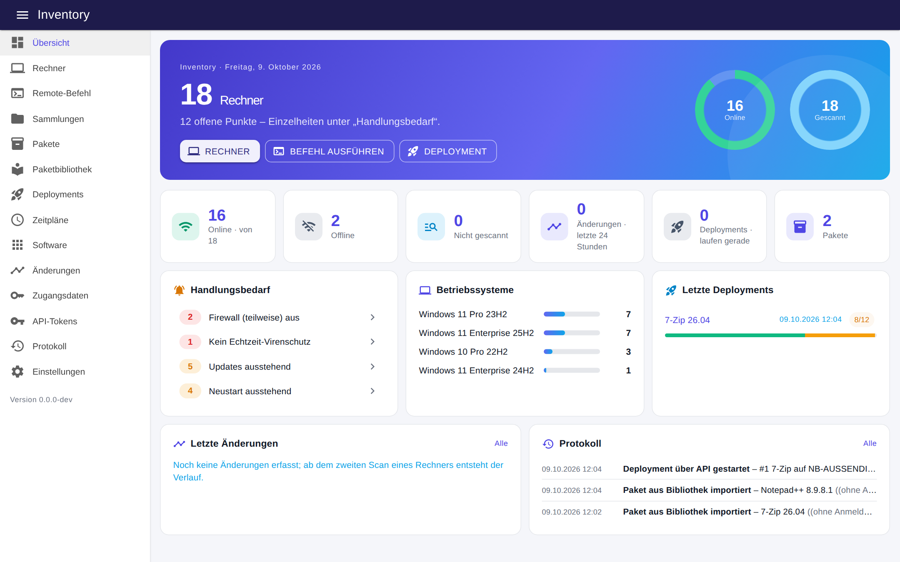
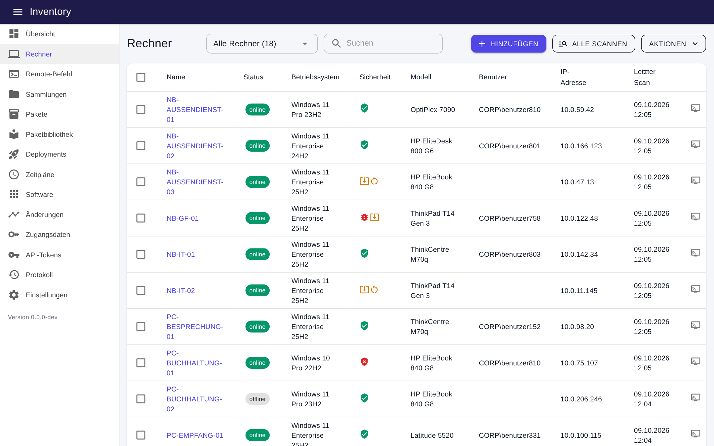
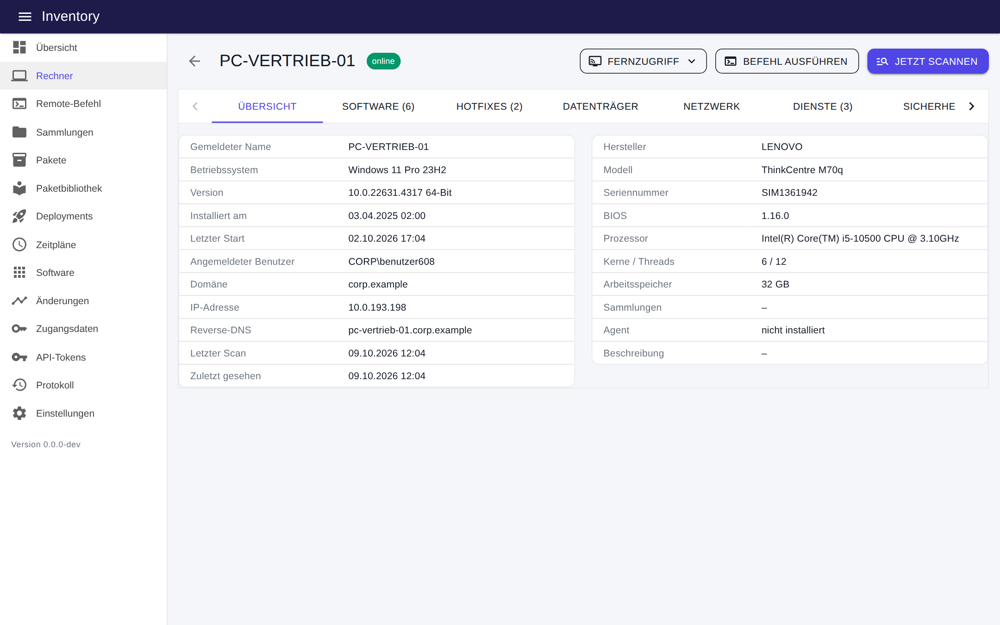
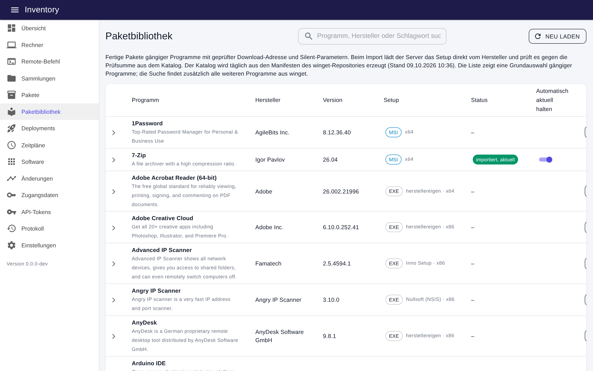
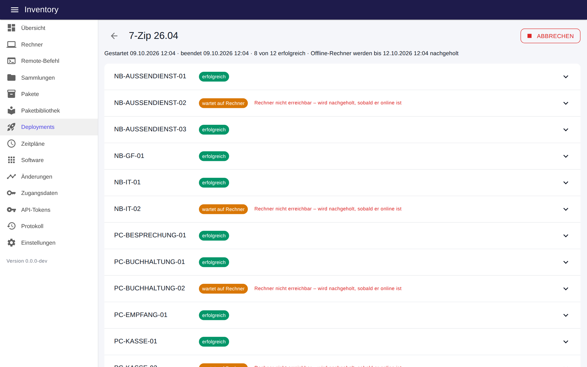
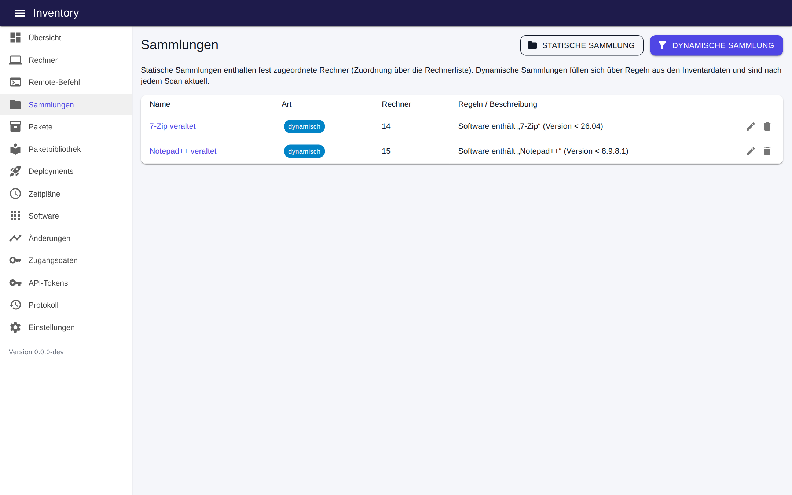
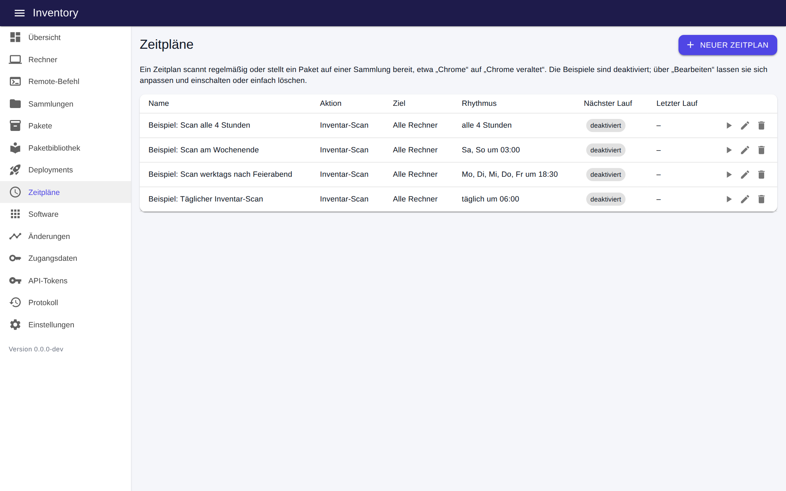

# Inventory

[English](README.md) · **Deutsch**

Inventarisierung und Softwareverteilung für Windows-Rechner in einer Anwendung – agentenlos über hinterlegte
Zugangsdaten. Die Oberfläche gibt es auf Deutsch und Englisch; Übersetzungen in weitere Sprachen sind willkommen
(siehe [Sprachen](#sprachen)).



## Funktionen

- **Rechner** anlegen, aus dem Active Directory importieren, Erreichbarkeit prüfen – auf Wunsch regelmäßig per Heartbeat (Rechner mit Namensauffälligkeiten ausgenommen)
- **Inventar-Scan**: System, Betriebssystem, Prozessor, Software, Hotfixes, Datenträger, Netzwerk, Dienste
- **Systemkonfiguration**: Remotedesktop und Authentifizierung auf Netzwerkebene, Benutzerkontensteuerung, SMB 1,
  Credential Guard, Speicherintegrität, LSA-Schutz, vordefiniertes Administratorkonto (aktiv, Kennwortalter),
  Windows-Aktivierung, letzte Anmeldung und Kennwortalter lokaler Konten – alles auch als Regel für Sammlungen
- **Updates**: ausstehende Updates je Rechner mit KB-Nummer, Klassifizierung und Schweregrad; Übersicht je Update
  (auf welchen Rechnern es fehlt) und je Rechner (wer keine offenen Sicherheitsupdates hat), CSV-Export, Regeln für
  Sammlungen auf installierte Hotfixes und ausstehende Updates
- **Bestandsdaten**: Zuständig, Standort, Kostenstelle, Inventarnummer, Kaufdatum, Garantieende, Tags und Notizen je
  Rechner – gepflegt in der Oberfläche, über die API oder per Import einer CSV-Tabelle (der Rechner-Export lässt sich
  bearbeiten und wieder einlesen); die Übersicht weist auf Garantien hin, die innerhalb von 90 Tagen enden
- **Hauptbenutzer**: wer bei den Scans der letzten 30 Tage an den meisten Tagen eine interaktive Sitzung hatte
  (Konsole oder Remotedesktop) – als Zugangsdaten hinterlegte Konten, Dienste und geplante Aufgaben zählen nie –,
  dazu die Liste der Benutzerprofile je Rechner
- **Hardware und Plattformsicherheit**: Gerätetyp (Desktop/Notebook/Server/virtuelle Maschine), UEFI und Secure Boot,
  TPM, BitLocker je Laufwerk, Grafik, Speichermodule und freie Steckplätze, physische Datenträger mit Typ und Zustand,
  Akkuzustand, Monitore und Drucker
- **Sammlungen**: statisch oder dynamisch über Regeln (z. B. „Chrome installiert mit Version unter 141“). Regeln gibt
  es für Software, Hardware, Sicherheitszustand, Updates, Active Directory, Bestandsdaten, Dienste, Netzwerk und
  Scan-Alter; `*` dient bei „ist gleich“ als Platzhalter, und „Mitglied der Sammlung“ kombiniert Sammlungen (bis zu
  drei Ebenen tief)
- **Remote-Befehl** (cmd/PowerShell) mit Live-Ausgabe
- **Pakete** aus mehreren Schritten: Installation, Befehl, PowerShell, Dateien kopieren, Dienst, Warten, Neustart,
  Scan, eingebettetes Paket – jeweils mit Bedingungen und Fehlerverhalten; Schritte nach einem Neustart laufen
  automatisch weiter, sobald der Rechner wieder da ist
- **Freigabe**: Ein Paket ist „in Arbeit“, bis ein Administrator es freigibt; Operatoren und Zeitpläne verteilen nur
  freigegebene Pakete, und jede Änderung an Schritten, Erkennung oder Dateien hebt die Freigabe auf
- **Grenzen je Deployment**: nach einer Anzahl oder Quote von Fehlern keine weiteren Rechner mehr starten und
  begrenzen, wie viele Rechner gleichzeitig laufen – so erreicht ein kaputtes Paket nicht alle Rechner, und die ersten
  wirken als Pilotgruppe
- **Robuste Schritte**: Wiederholungen mit Pause (automatisch, wenn gerade eine andere Installation läuft), Prüfung
  des freien Speicherplatzes vor dem Schritt und vorheriges Schließen benannter Programme – auf Wunsch nach einem
  Hinweis an den angemeldeten Benutzer
- **Wartungsfenster**: Wochentage und Uhrzeit je Sammlung sowie ein Standardfenster; Deployments und Zeitpläne mit
  der Option „Nur im Wartungsfenster“ halten Rechner zurück, deren Fenster geschlossen ist, und starten sie, sobald es
  beginnt
- **Windows Update**: ein Schritt-Typ, der ausstehende Updates aus der auf dem Rechner eingestellten Quelle (WSUS
  oder Microsoft Update) sucht, lädt und installiert – alle, nur Sicherheits- und kritische oder bestimmte KB-Nummern;
  ein nachfolgender Schritt „Neustart“ lässt sich auf „nur wenn ein Neustart aussteht“ beschränken. Die
  Update-Übersicht bietet „Installieren …“ für die Rechner, denen ein Update fehlt. Funktioniert über SMB + Dienst
  oder Agent, nicht über WinRM
- **Deinstallation**: ein Schritt-Typ, der ein Programm über Name oder MSI-Produktcode entfernt – still bei MSI-,
  Inno-Setup- und NSIS-Setups sowie bei Programmen mit eingetragenem stillen Befehl – und prüft, dass es wirklich weg
  ist; die Software-Übersicht bietet „Deinstallieren …“ für die Rechner an, die ein Programm haben
- **Erkennung**: Ein Paket kann angeben, woran zu erkennen ist, dass es schon installiert ist (Programmname mit
  Mindestversion, MSI-Produktcode, Datei oder Registry-Schlüssel) – solche Rechner werden übersprungen und als
  „bereits installiert“ gemeldet; auf Wunsch läuft dieselbe Prüfung nach dem letzten Schritt noch einmal, sodass ein
  Setup, das Erfolg meldet, ohne zu installieren, als fehlgeschlagen gilt
- **Paketbibliothek**: fertige Pakete gängiger Programme (täglich aus den winget-Manifesten erzeugt), Import per
  Klick, automatische Übernahme neuer Versionen und eine mitwandernde Sammlung „… veraltet“
- **Ausführungskontext** je Schritt: als Lokales System oder in der Sitzung des angemeldeten Benutzers
- **Fernzugriff** je Rechner: Remoteunterstützung anbieten, Sitzung spiegeln, Remotedesktop, TeamViewer/AnyDesk
- **Deployments** parallel mit Live-Status, Abbruch, Wiederholung und Nachholen von Offline-Rechnern
- **Protokoll**: Anmeldungen, Befehle, Deployments und jede Änderung mit Benutzer, Rolle und Herkunft (Weboberfläche,
  API, API-Token); Filter, CSV-Export und Aufbewahrungsfrist
- **Zeitpläne**: täglich, wöchentlich, monatlich (ein Tag des Monats oder z. B. „drei Tage nach dem zweiten
  Dienstag“), in festen Abständen oder einmalig, auf Wunsch mit Enddatum; ein Lauf, der wegen eines ausgeschalteten
  Servers ausfiel, wird binnen eines Tages nachgeholt oder ausgelassen. **Pflicht-Verteilungen** halten eine Sammlung
  versorgt: jedes Mitglied bekommt das Paket einmal, später hinzukommende Rechner folgen von selbst, und der Zeitplan
  zeigt, wie viele Mitglieder es schon haben
- Software-Übersicht, CSV-Export, tägliche Datensicherung, REST-API mit interaktiver Dokumentation

## Screenshots

| | |
|---|---|
| **Rechnerliste** mit Status, Sicherheitsampel und Filtern  | **Rechner im Detail** – Inventar, Software, Hotfixes, Dienste, Sicherheit, Verlauf  |
| **Paketbibliothek** – fertige Pakete aus winget, Setup-Art auf einen Blick  | **Deployment** – Fortschritt je Rechner, Offline-Rechner werden nachgeholt  |
| **Dynamische Sammlungen** – z. B. alle Rechner mit veralteter Version  | **Zeitpläne** für Scans und Verteilungen  |

Die Bilder stammen aus dem Simulationsmodus (`Inventory:Simulate`), der ohne echte Rechner eine Beispielumgebung zeigt.

## So funktioniert der Zugriff

Auf dem Zielrechner führt immer derselbe kleine **Runner** (`InventoryRunner.exe`, .NET Framework 4.8) einen Job aus.
Wie er dorthin kommt, bestimmt der Transport – einstellbar global und je Rechner:

| Transport | Voraussetzung auf dem Ziel | Job läuft als |
|---|---|---|
| SMB + Dienst (Standard) | Freigabe `ADMIN$`, Port 445, Konto mit lokalen Adminrechten | Lokales System |
| WinRM | PowerShell-Remoting aktiv, Port 5985, PowerShell im vollen Sprachmodus | hinterlegtes Konto |

| Agent (optional) | Dienst „Inventory Agent“, ausgehende Verbindung zum Server | Lokales System |

Auf dem Zielrechner entsteht `%SystemRoot%\Inventory` (nur SYSTEM und Administratoren): der Runner bleibt dort unter
`Runner\<Versions-Hash>` liegen, Job-Verzeichnisse unter `Jobs` werden nach jedem Lauf entfernt. Der SMB-Transport
richtet einmalig den Dienst `InventoryRunner` ein (Start manuell) und startet ihn für jeden Job mit der Job-ID; der
Dienst endet, sobald der Job fertig ist. Je Rechner läuft ein Job zur Zeit – ein zweiter wartet auf den ersten.

Um alles von einem Rechner zu entfernen: `sc delete InventoryRunner` und `%SystemRoot%\Inventory` löschen.

### Endpunktschutz

Endpunktschutz-Produkte werten agentenlose Administration gern als laterale Bewegung, denn auf der Leitung sieht sie
genauso aus: Dateien nach `ADMIN$` kopiert, ein Dienst aus der Ferne gesteuert, PowerShell von einem Dienst gestartet.
Drei Dinge halten die Sicherheitskonsole ruhig, ohne echte Angriffe zu verdecken:

1. **Den Agenten bevorzugen**, wo Meldungen stören. Er verbindet sich ausgehend und braucht weder `ADMIN$` noch
   Dienststeuerung aus der Ferne. Rechner auswählen und *Agent installieren* wählen; nur diese eine Installation läuft
   noch über den agentenlosen Weg.
   Unter *Einstellungen → Agentenloser Zugriff* lässt sich das erzwingen: auf die Installation des Agenten beschränkt
   oder ganz abgeschaltet erreichen Scans, Verteilungen und Zeitpläne keine Rechner ohne Agent mehr.
2. **Ein fester Fußabdruck.** Dienstname (`InventoryRunner`), Pfad (`%SystemRoot%\Inventory\Runner\`) und Dateiname
   (`InventoryRunner.exe`) ändern sich nie, und der Dienst wird einmal je Rechner angelegt statt einmal je Job. Der
   erste Job auf einem Rechner und der erste nach einem Server-Update (neuer Runner) können weiterhin eine Meldung
   auslösen.
3. **Eine eng gefasste Freigabe** im eigenen Produkt, beschränkt auf alles zusammen: den Inventory-Server als
   Quellgerät, den Ordner `%SystemRoot%\Inventory\` und den Dienstnamen `InventoryRunner`. In Microsoft Defender for
   Endpoint ist das eine Regel zur Warnungsunterdrückung, angelegt aus einer der Meldungen, mit diesen Bedingungen.
   Nicht das Anlegen von Diensten aus der Ferne allgemein unterdrücken und den Ordner nicht vom Virenscan ausnehmen –
   dort landen Paketdateien.

Produkte mit automatischer Reaktion belassen es nicht bei Meldungen: sie können das für den Zugriff verwendete Konto
deaktivieren und die beteiligten Rechner isolieren. Solange keine Freigabe eingerichtet ist, agentenlose Jobs nicht
mit einem Konto ausführen, von dem andere Systeme abhängen, und das Werkzeug zuerst an wenigen Rechnern ausprobieren.

[docs/defender.de.md](docs/defender.de.md) enthält die Schritte für Microsoft Defender for Endpoint: was die
Meldungen bedeuten, ein PowerShell-Skript, das die Runner-Datei über ihren Hash freigibt (er steht unter
*Einstellungen*), und wie sich die Verhaltensmeldungen im Portal abstimmen lassen.

Die veröffentlichten Programmdateien sind mit dem selbstsignierten Zertifikat des Projekts signiert (siehe
[Aktualisieren](#aktualisieren)). Eine Regel nach Zertifikat greift erst, wenn die eigenen Rechner diesem Zertifikat
vertrauen; bis dahin den Runner über seinen Hash freigeben. PowerShell-Schritte laufen als
`powershell.exe -ExecutionPolicy Bypass -File <Skript im Job-Verzeichnis>`; Regeln, die auf den Bypass-Schalter
anspringen, melden sie weiterhin.

### Agent

Für Rechner, die der Server nicht direkt erreicht (Notebooks unterwegs, andere Netze, kein SMB-/WinRM-Weg), gibt es
denselben Runner als dauerhaften Windows-Dienst. Er spricht immer nur *zum* Server – der Server verbindet sich nie zum
Agenten.

**So funktioniert er**

| | |
|---|---|
| Dienst | `InventoryAgent` („Inventory Agent“), läuft als **Lokales System**, Starttyp Automatisch, Wiederherstellung: Neustart nach 5 s / 60 s / 5 min |
| Dateien | `%ProgramFiles%\Inventory Agent` – der Runner (`InventoryRunner.exe`, .NET Framework 4.8), `agent.json` (Server-Adresse + Anmeldegeheimnis), `agent.key` (eigener Schlüssel des Agenten), `agent.version` (Hash der installierten Runner-Dateien), `agent.log`; der Ordner ist nur für SYSTEM und Administratoren lesbar |
| Anmeldung | Beim ersten Start schickt der Agent Anmeldegeheimnis und Rechnernamen an `POST /api/agent/enroll`. Der Server prüft das Geheimnis, legt den Rechner an, falls unbekannt (Abgleich über den Kurznamen, ein unter FQDN eingetragener Rechner wird wiederverwendet), erzeugt einen zufälligen 256-Bit-Schlüssel, speichert nur dessen SHA-256-Hash und gibt den Schlüssel einmalig zurück. Der Agent legt ihn in `agent.key` ab und schickt das Geheimnis nie wieder. |
| Authentifizierung | Jede weitere Anfrage trägt den Kopf `X-Agent-Key: <Schlüssel>`. Der Server sucht den Hash; ein unbekannter Schlüssel (Rechner gelöscht, Agent entfernt) ergibt 401, der Agent löscht `agent.key` und meldet sich mit dem Geheimnis neu an. |
| Abfrage | `POST /api/agent/poll` ist ein Long-Poll: Der Server hält die Anfrage bis zu 50 s offen und antwortet `204`, wenn kein Job kam; der Agent fragt sofort erneut. Ein Job wird so innerhalb einer Sekunde abgeholt, mit einer offenen HTTP-Anfrage je Rechner statt Dauerfeuer. Jede Abfrage aktualisiert „letzter Kontakt“; die Oberfläche zeigt den Agenten als verbunden, solange der letzte Kontakt keine 5 Minuten zurückliegt. |
| Job-Ausführung | Das Job-Manifest kommt mit der Antwort der Abfrage; Paketdateien werden einzeln geholt (`GET /api/agent/jobs/{id}/files/{n}`) in einen Job-Ordner unterhalb des Agentenordners. Derselbe `JobExecutor` wie im agentenlosen Betrieb führt die Schritte als Lokales System aus (bzw. in der Sitzung des angemeldeten Benutzers, wenn so eingestellt). Fortschrittszeilen gehen jede Sekunde an den Server (`POST …/progress`), das Ergebnis am Ende (`POST …/result`, bis 64 MB für große Scans), danach wird der Job-Ordner gelöscht. |
| Zeitlimits | Holt kein Agent den Job innerhalb von 2 Minuten ab, gilt der Rechner als nicht erreichbar (Deployments mit „Offline-Rechner nachholen“ versuchen es später erneut). Während ein Job läuft, wartet der Server die Summe der Schritt-Zeitlimits plus Reserve ab. |
| Selbstaktualisierung | Die Abfrage enthält den Hash der installierten Runner-Dateien. Liefert der Server einen anderen Runner aus (nach einem Server-Update), kommt statt eines Jobs ein Update-Angebot: Der Agent lädt erst alle Dateien in einen Zwischenordner, tauscht sie dann aus (laufende Dateien werden zu `*.old` umbenannt und beim nächsten Start gelöscht), schreibt den neuen Hash und beendet sich mit Code 3 – die Wiederherstellung des Dienstes startet ihn binnen Sekunden mit den neuen Dateien neu. Wartende Jobs bleiben so lange in der Warteschlange. |
| Fehler | Bei jedem Fehler (Server nicht erreichbar, ungültige Antwort) protokolliert der Agent in `agent.log` und versucht es nach 30 s erneut, beliebig oft. |

**Was die Kommunikation braucht**

- **Richtung und Ports:** nur ausgehend, vom Client zur Server-Adresse aus *Einstellungen → Agenten*
  (z. B. `https://inventory.firma.local:5100`). Kein eingehender Port, keine Firewall-Regel und kein SMB/WinRM auf dem
  Client. Der Port des Servers (Standard 5100) muss aus den Client-Netzen erreichbar sein (Firewall-Regel auf dem
  Server; das Setup kann sie anlegen).
- **HTTPS:** dringend empfohlen – über diesen Kanal erhält der Agent Befehle, die er als Lokales System ausführt. Der
  Agent nutzt den Windows-Zertifikatspeicher; das Serverzertifikat muss also auf dem Client vertrauenswürdig sein
  (interne CA oder öffentliches Zertifikat), einen Schalter „jedes Zertifikat akzeptieren“ gibt es nicht. TLS 1.2 wird
  erzwungen. Kestrel-HTTPS: siehe [Konfiguration](#konfiguration-cprogramdatainventoryappsettingsjson).
- **Proxy:** Der Agent läuft als Lokales System und nutzt die WinHTTP-Proxyeinstellungen des Rechners (`netsh winhttp
  set proxy …`), nicht den Browser-Proxy eines Benutzers. Ein direkter Weg zum Server ist am einfachsten.
- **Namensauflösung:** Der Client muss den Hostnamen der Server-Adresse auflösen (DNS oder `hosts`). Der Server muss den
  Client gar nicht auflösen.
- **Anmeldegeheimnis:** steht unter *Einstellungen → Agenten* und wird vom Installationsjob in `agent.json`
  geschrieben. *Geheimnis erneuern* sperrt nur neue Anmeldungen – bereits angemeldete Agenten arbeiten mit ihren
  Schlüsseln weiter. `agent.json` und `agent.key` sind wie ein Passwort zu behandeln; deshalb ist der Agentenordner
  abgeschottet.
- **Die Agenten-Schnittstelle ist von der Benutzeranmeldung unabhängig** (Windows/OIDC/API-Tokens): `/api/agent/*`
  prüft allein den Schlüssel und ist der einzige Teil der API, der das tut.

**Einrichtung**

1. Unter *Einstellungen → Agenten* die Adresse eintragen, unter der die Rechner den Server erreichen (HTTPS
   empfohlen), und speichern.
2. Unter *Rechner* die Ziele auswählen und *Aktionen → Agent installieren* wählen. Die Installation selbst läuft
   agentenlos (SMB oder WinRM): Runner kopieren, `agent.json` und `agent.version` schreiben, Dienst anlegen und
   starten.
   **Ohne agentenlosen Weg:** *Einstellungen → Agenten → Agent-Setup herunterladen* liefert ein ZIP mit dem Runner,
   seiner Konfiguration und `Install-Agent.cmd`. Auf eine Freigabe entpacken und `Install-Agent.cmd` als
   Computer-Startskript einer Gruppenrichtlinie oder über eine vorhandene Softwareverteilung ausführen (als
   Administrator oder Local System). Auf einem Rechner, der den Agenten schon hat, kehrt das Skript sofort zurück –
   der Agent aktualisiert sich selbst vom Server –, es kann also zugewiesen bleiben; `Install-Agent.cmd --force`
   installiert neu. Das ZIP enthält das Anmeldegeheimnis: die Freigabe nur für die Rechner lesbar machen, die es
   brauchen (z. B. *Domänencomputer*), und das Geheimnis unter *Einstellungen* erneuern, falls es in falsche Hände
   geraten ist.
3. Sobald sich der Dienst angemeldet hat, steht der Rechner auf Transport „Agent“ (grüner Chip „Agent“). Je Rechner
   lässt sich der Transport wieder auf SMB oder WinRM stellen; der Agent fragt trotzdem weiter ab.

**Agent entfernen:** `InventoryRunner.exe --uninstall-agent` aus einer Kopie außerhalb des Agent-Ordners ausführen
(z. B. von der Setup-Freigabe), oder den Dienst von Hand beenden und löschen (`sc stop InventoryAgent`, `sc delete
InventoryAgent`, Ordner löschen), danach in *Rechner bearbeiten* „Agent vergessen“ wählen – das verwirft den Schlüssel
auf dem Server und setzt den Transport zurück. Umgekehrt würde sich der noch laufende Agent mit dem Geheimnis einfach
neu anmelden.

Nach einem Server-Update aktualisieren sich die Agenten selbst (siehe oben); nichts muss neu verteilt werden.

**Fehlersuche:** `agent.log` im Agentenordner zeigt Anmeldung, Fehler und Updates. `InventoryRunner.exe --agent-console`
dort (als Administrator, bei gestopptem Dienst) führt dieselbe Schleife in der Konsole aus. Das Protokoll des Servers
hält jede Anmeldung mit Rechnername, Version und Absenderadresse fest.

### Fernzugriff

In der Rechnerliste und auf der Detailseite gibt es das Menü *Fernzugriff*:

| Weg | Was gestartet wird | Voraussetzung auf den Rechnern |
|---|---|---|
| Remoteunterstützung anbieten | `msra.exe /offerRA <Rechner>` | Richtlinie „Remoteunterstützung anbieten konfigurieren“, Firewall-Gruppe „Remoteunterstützung“ |
| Sitzung spiegeln | `mstsc.exe /v:<Rechner> /shadow:<Sitzung> /control`; die Sitzungsnummer stammt aus dem letzten Scan | Richtlinie „Regeln für Remotesteuerung von Remotedesktopdienste-Benutzersitzungen festlegen“, Firewall-Regeln „Remotedesktop – Schatten“ |
| Remotedesktop | `mstsc.exe /v:<Rechner>` | Remotedesktop aktiviert |
| TeamViewer / AnyDesk | das Programm über dessen eigenen Link mit der beim Scan erfassten Geräte-ID | Programm auf beiden Seiten installiert |

Damit die ersten drei per Klick starten, braucht der Admin-PC einmalig den **Starter** (`InventoryLauncher.exe`, wenige
Kilobyte): im Menü unter „Starter einrichten“ herunterladen, an einem festen Ort ablegen und einmal doppelklicken. Er
trägt sich für das Benutzerkonto als Ziel für `inventory://`-Links ein (ohne Adminrechte). Für mehrere Admin-PCs gibt
es unter *Rechner → Aktionen* „Starter für Fernzugriff installieren“ (nach `%ProgramFiles%\Inventory Launcher`, für
alle Benutzer). Der Starter nimmt nur diese drei Aktionen an, prüft Rechnername und Sitzungsnummer und startet
ausschließlich `msra.exe` und `mstsc.exe` aus System32 – andere Webseiten können über den Link nichts anderes auslösen.

Ohne Starter zeigt derselbe Dialog die Befehle zum Kopieren und bietet Remotedesktop als `.rdp`-Datei an.

Jeder Aufruf steht im Protokoll. Antwortet unter dem eingetragenen Namen ein anderer Rechner, warnt das Menü.

### Active Directory

Die Synchronisation (*Einstellungen → Active Directory*) legt Computerkonten als Rechner an und gleicht vorhandene ab:

- **Deaktivierte Computerkonten ausschließen** (Standard: an): deaktivierte Konten werden nicht angelegt; ist ein
  vorhandener Rechner im Verzeichnis deaktiviert, gilt er als nicht mehr gefunden.
- **Angaben aus dem Verzeichnis**: jeder Lauf speichert auch die Organisationseinheit, die Gruppen, in denen das
  Computerkonto direkt Mitglied ist, seine Beschreibung und seine letzte Anmeldung an der Domäne (das Verzeichnis
  gleicht diesen Wert nur etwa alle zwei Wochen ab). Sie stehen auf der Rechnerseite und im CSV-Export und lassen sich
  als Regeln für Sammlungen verwenden, z. B. „AD-Organisationseinheit enthält Laptops“ oder „AD-Gruppe ist gleich
  Pilot-Updates“.
- **Nicht mehr gefundene Rechner** werden als „nicht im AD“ gekennzeichnet (Filter in der Rechnerliste, Regelfeld für
  dynamische Sammlungen). Wahlweise löscht die Synchronisation sie, nachdem sie eine einstellbare Frist lang
  ununterbrochen gefehlt haben – samt Inventardaten und Verlauf.
- Von Hand angelegte Rechner, die das Verzeichnis nie gekannt hat, bleiben unberührt. Liefert das Verzeichnis gar keine
  Konten oder wären auffällig viele Rechner auf einmal zu löschen, ändert bzw. löscht der Lauf nichts und meldet das.

### Paketbibliothek

Die Action `.github/workflows/catalog.yml` liest täglich die Manifeste der in `catalog/apps.txt` aufgeführten Programme
aus dem [winget-Repository](https://github.com/microsoft/winget-pkgs) und schreibt `catalog.json` in den Branch
`catalog`: je Programm aktuelle Version, Download-Adresse des Herstellers, SHA-256 und Silent-Parameter. Der Server
lädt diese Datei (`Inventory:Catalog:Url`), zeigt sie unter *Paketbibliothek* an und lädt beim Import das Setup direkt
vom Hersteller; stimmt die Prüfsumme nicht, wird nichts übernommen.

`catalog/apps.txt` ist die Grundauswahl gängiger Programme, die für alle Benutzer installieren. Daneben erzeugt die Action
`winget.json`, einen Suchindex über das gesamte winget-Repository mit allen Programmen, die ein unbeaufsichtigt
installierbares MSI- oder EXE-Setup haben (`Inventory:Catalog:IndexUrl`). Die Suche der Paketbibliothek zeigt Treffer daraus
unter „Weitere Treffer aus winget“; sie lassen sich genauso importieren und aktuell halten. Diese Einträge sind unverändert
aus den Manifesten übernommen – vor dem Verteilen an einem einzelnen Rechner testen. Setups, die nur ins Benutzerprofil
installieren, erhalten beim Import den Kontext „angemeldeter Benutzer“.

Ältere Versionen: Der Import-Dialog bietet alle Versionen an, die das winget-Repository noch führt (je Programm höchstens
die 60 neuesten, `Inventory:Catalog:VersionsUrl`). Eine ältere Version wird als eigenständiges Paket „Name Version“
angelegt, das nie automatisch aktualisiert wird und neben dem aktuellen Paket bestehen kann. Nimmt der Hersteller ein
altes Setup vom Server, schlägt der Download fehl.

- Weitere Programme in die Grundauswahl: winget-ID in `catalog/apps.txt` ergänzen.
- Eigener Katalog: `Inventory:Catalog:Url` auf eine eigene Datei oder Adresse zeigen lassen (gleiches Format).
- Programme automatisch aktuell halten: beim Import die Sammlung „… veraltet“ anlegen lassen und einen Zeitplan
  einrichten, der das Paket regelmäßig auf diese Sammlung bereitstellt.

### Ausführungskontext

Befehle, PowerShell-Skripte und Installationen laufen standardmäßig als **Lokales System**. Für alles, was das
Benutzerprofil betrifft (HKCU, AppData, Netzlaufwerke), lässt sich je Schritt **Angemeldeter Benutzer** wählen: Der
Runner startet den Prozess dann in der aktiven Sitzung mit den Rechten dieses Benutzers. Ist niemand angemeldet, wird
der Schritt übersprungen. Das setzt voraus, dass der Runner als Lokales System läuft (SMB + Dienst oder Agent, nicht
WinRM). Skript und Paketdateien liegen dafür während des Laufs in einem für Benutzer lesbaren Ordner unter
`%ProgramData%\InventoryRunner` – in solche Schritte gehören deshalb keine Geheimnisse.

## Sprachen

Die Oberfläche folgt der Browsersprache (Deutsch oder Englisch) und lässt sich in der Kopfleiste umschalten; die Wahl
bleibt in einem Cookie. `Inventory:Language` legt die Standardsprache des Servers fest, die auch für Einträge aus
Hintergrundläufen gilt (Protokoll). Runner und Agent sprechen nur Englisch – ihre Meldungen sind technisch und werden
als Daten gespeichert.

**Eine Übersetzung ergänzen:** Alle Texte stehen englisch im Quelltext und werden über
`IStringLocalizer<SharedResource>` (Microsoft.Extensions.Localization) übersetzt. Für eine neue Sprache
`src/Inventory.Core/Resources/SharedResource.de.resx` nach `SharedResource.<kultur>.resx` kopieren (z. B.
`SharedResource.fr.resx`), die `<value>`-Elemente übersetzen und die `name`-Attribute (die englischen Texte) sowie die
Platzhalter `{0}` unverändert lassen. Nach dem Bauen erscheint die Sprache von selbst im Umschalter.
`tests/Inventory.Tests/LocalizationTests.cs` prüft, dass jeder im Code verwendete Text eine deutsche Übersetzung hat und
Platzhalter erhalten bleiben; für eine weitere Sprache lässt sich der Test entsprechend erweitern.

## Aufbau

| Projekt | Inhalt |
|---|---|
| `Inventory.Contracts` | Job-Manifest und Ergebnisformat (von Server und Runner genutzt) |
| `Inventory.Core` | Modell, Regeln, Schnittstellen, Übersetzungen (`Resources`) |
| `Inventory.Data` | EF Core/SQLite, Dienste (Scan, Pakete, Deployments, Zeitpläne …) |
| `Inventory.Remoting` | Transporte (SMB, WinRM, Simulation), Erreichbarkeit, LDAP |
| `Inventory.Runner` | Programm für den Zielrechner (net48) |
| `Inventory.Launcher` | Starter für den Admin-PC: öffnet Fernzugriffe aus `inventory://`-Links (net48) |
| `Inventory.Server` | ASP.NET Core: Blazor-Oberfläche, REST-API unter `/api`, Zeitplaner |

## Entwicklung unter WSL2

Das .NET 10 SDK liegt benutzerlokal unter `~/.dotnet` (`export PATH="$HOME/.dotnet:$PATH"`).

```bash
dotnet build && dotnet test          # baut auch den net48-Runner
dotnet run --project src/Inventory.Server --launch-profile http   # Simulation, http://localhost:5101
./scripts/run-win.sh                 # echter Windows-Prozess mit echten Transporten
```

- Unter Linux läuft der Server automatisch im **Simulationsmodus**: Transporte, Erreichbarkeit und AD liefern
  Beispieldaten. Schritte, deren Name „fail“ enthält, schlagen in der Simulation fehl.
- Echte Zugriffe (SMB, Dienststeuerung, Kerberos) gehen nur als Windows-Prozess. `run-win.sh` veröffentlicht
  nach `%LOCALAPPDATA%\InventoryDev` und startet dort; Datenbank und Paketdateien liegen damit auf NTFS.
- Umgebungsspezifisches (z. B. die erlaubte Gruppe) gehört in `scripts/local.env`, das nicht eingecheckt wird;
  `run-win.sh` liest die Datei ein. Beispiel: `Inventory__AllowedGroups__0='FIRMA\Domänen-Admins'`
- Der Server selbst taugt nicht als SMB-Testziel: lokale Zugriffe nutzen immer das Konto des Server-Prozesses.

## Installation

1. Von der [Release-Seite](https://github.com/erSitzt/inventory/releases/latest) `Inventory-Setup-x.y.z.exe` laden.
2. Auf dem Windows-Server als Administrator ausführen. Der Assistent fragt nach Port, erlaubten Windows-Gruppen und
   Dienstkonto, legt den Dienst „Inventory“ an und gibt auf Wunsch den Port in der Firewall frei.
3. Die Oberfläche unter `http://<server>:5100` öffnen.

Programmdateien liegen unter `C:\Program Files\Inventory`, Daten und Einstellungen unter `C:\ProgramData\Inventory`.
Auf dem Server muss nichts weiter installiert sein (.NET ist enthalten).

Unbeaufsichtigt:

```
Inventory-Setup-x.y.z.exe /VERYSILENT /SUPPRESSMSGBOXES /NORESTART /PORT=5100 /GROUPS="FIRMA\Domänen-Admins"
```

Weitere Schalter: `/SERVICEACCOUNT="FIRMA\svc-inventory" /SERVICEPASSWORD=…`, `/NOFIREWALL`, `/LOG=setup.log`.
Zu jeder Datei eines Releases steht die SHA-256-Prüfsumme in `SHA256SUMS.txt`.

## Aktualisieren

- **In der Oberfläche:** Der Server fragt alle paar Stunden bei GitHub nach. Gibt es eine neuere Version, erscheint oben
  ein Hinweis; unter *Einstellungen → Updates* stehen die Änderungen und der Knopf „Jetzt aktualisieren“. Dort lässt sich
  auch die automatische Aktualisierung in einem nächtlichen Wartungsfenster einschalten (Standard: aus).
- **Von Hand:** das neue Setup über die vorhandene Installation ausführen. Einstellungen und Daten bleiben erhalten.

Vor jeder Aktualisierung über die Oberfläche wird die Datenbank gesichert, laufende Deployments werden abgewartet, und
das Ergebnis steht im Protokoll. Agenten aktualisieren sich danach selbst. Ein Zurück auf eine ältere Version geht nur
über die Sicherung (`backups`), weil neuere Versionen das Datenbankschema erweitern.

Die Selbstaktualisierung setzt voraus, dass der Dienst als Lokales System oder mit lokalen Administratorrechten läuft.
Abschalten lässt sich die Update-Prüfung mit `Inventory:Update:Enabled = false`.

> **Zur Vertrauenskette:** Über Updates gelangt neuer Programmcode auf den Server und über die Agenten auf alle
> verwalteten Rechner. Releases sind mit einem eigenen, selbstsignierten Zertifikat des Projekts signiert; sein
> öffentlicher Teil liegt in `installer/signing` und wird mit jeder Version ausgeliefert. Die Selbstaktualisierung
> spielt nur ein Setup ein, dessen Signatur unversehrt ist und von einem der Zertifikate der *installierten* Version
> stammt – eine veränderte oder anders signierte Datei wird verworfen. *Einstellungen → Updates* zeigt, ob die eigene
> Version Signaturen prüft (Versionen von vor dem Zertifikat oder aus einem Fork ohne Zertifikat prüfen nur die
> Prüfsumme).
>
> Selbstsigniert heißt: die Signatur belegt, dass ein Update vom selben Schlüssel stammt wie die bereits laufende
> Version, nicht, wer dahintersteht. Windows, SmartScreen und Endpunktschutz vertrauen dem Zertifikat von sich aus
> nicht. Wer das möchte, verteilt die `.cer`-Datei per Gruppenrichtlinie in *Vertrauenswürdige
> Stammzertifizierungsstellen* und *Vertrauenswürdige Herausgeber* der eigenen Rechner – erst nach der Entscheidung,
> den Releases zu vertrauen.
>
> `Inventory:Update:TrustedThumbprints` ergänzt Zertifikate (eigene Builds), `Inventory:Update:RequiredPublisher`
> lässt zusätzlich einen Herausgeber zu, dem Windows vertraut, `Inventory:Update:AllowUnsigned` schaltet die Prüfung ab.

### Release erstellen (für Maintainer)

Ein Tag `vX.Y.Z` startet die Pipeline (`.github/workflows/release.yml`): Tests, Veröffentlichung, Setup, ZIP,
Prüfsummen, GitHub-Release mit automatisch erzeugten Notizen. Tags mit Zusatz (`v1.2.0-rc1`) werden als Vorabversion
markiert und von der Update-Prüfung ignoriert.

Signatur: `scripts/new-signing-cert.sh --set-secrets` erzeugt ein selbstsigniertes Code-Signing-Zertifikat, hinterlegt
es als Secrets `SIGNING_CERT_PFX` (Base64 der PFX-Datei) und `SIGNING_CERT_PASSWORD` und schreibt das öffentliche
Zertifikat nach `installer/signing/`; dieses wird eingecheckt. Die Pipeline signiert dann Server, Runner, Starter und
Setup und verweigert ein Release, dessen Signaturzertifikat nicht unter den eingecheckten ist – Server könnten es
nicht einspielen. Für einen Zertifikatswechsel das neue dazulegen und das alte noch ein Release lang behalten (siehe
`installer/signing/README.md`).

### Konfiguration (`C:\ProgramData\Inventory\appsettings.json`)

| Schlüssel | Bedeutung |
|---|---|
| `Urls` | Adressen der Weboberfläche, z. B. `http://*:5100` |
| `Inventory:DataDirectory` | Datenbank, Schlüssel, Paketdateien (`repository`), Sicherungen (`backups`) |
| `Inventory:Language` | Standardsprache der Oberfläche und der Hintergrundläufe (`en` oder `de`); Benutzer schalten in der Kopfleiste um |
| `Inventory:Authentication` | `Windows` (Standard auf Windows), `Oidc`, beides (`Windows,Oidc`) oder `None` |
| `Inventory:AllowedGroups` | Windows-Gruppen der **Administratoren**, als Name (`FIRMA\IT-Admins`) oder SID. Standard: lokale Administratoren (`S-1-5-32-544`) |
| `Inventory:Roles:Admin`, `Operator`, `Viewer` | Windows-Gruppen je Rolle (siehe [Rollen](#rollen)); `Roles:Admin` ergänzt `AllowedGroups` |
| `Inventory:Oidc:TenantId` | Entra-Mandant (GUID oder Domäne); für andere Anbieter stattdessen `Inventory:Oidc:Authority` |
| `Inventory:Oidc:ClientId`, `ClientSecret` | Aus der App-Registrierung |
| `Inventory:Oidc:AllowedGroups` | Objekt-IDs der Administratorgruppen oder Namen von App-Rollen |
| `Inventory:Oidc:Roles:Admin`, `Operator`, `Viewer` | Gruppen oder App-Rollen je Rolle; ohne jeden Eintrag hier oder in `AllowedGroups` startet der Server nicht |
| `Inventory:Update:Enabled`, `Repository`, `RequiredPublisher`, `TrustedThumbprints`, `AllowUnsigned` | Update-Prüfung, Quelle der Releases, erwarteter Herausgeber der Signatur |
| `Inventory:Catalog:Url` | Adresse oder Pfad der `catalog.json` der Paketbibliothek |
| `Inventory:Catalog:VersionsUrl` | Ordner mit den Versionslisten (`<winget-ID>.json`); leer = nur die aktuelle Version anbieten |
| `Inventory:Catalog:IndexUrl` | Adresse oder Pfad des Suchindex `winget.json`; leer = Suche in ganz winget abschalten |
| `Inventory:Simulate` | `true` = keine echten Zugriffe |

### Anmeldung

Windows-Anmeldung und OIDC lassen sich einzeln oder gemeinsam aktivieren. Sind beide aktiv, erscheint eine Auswahlseite;
beide Wege führen zur selben Sitzung. Die Agenten-Schnittstelle ist davon unabhängig (eigene Schlüssel).

#### Rollen

Jede Anmeldung bekommt die höchste Rolle, die ihre Gruppen hergeben; ein Konto ohne Rolle wird abgewiesen.

| Rolle | Darf |
|---|---|
| **Betrachter** (Viewer) | alles ansehen: Rechner, Software, Änderungen, Deployments, Pakete, Sammlungen, Zeitpläne, Berichte |
| **Operator** | zusätzlich scannen und Erreichbarkeit prüfen, freigegebene Pakete verteilen, Deployments abbrechen und wiederholen, Fernzugriff nutzen, das Protokoll lesen |
| **Administrator** | alles Übrige: Pakete anlegen und ändern (sie laufen als Lokales System auf jedem Rechner), Paketbibliothek, Deinstallation, Fernbefehle, Sammlungen, Zeitpläne, Rechner, Zugangsdaten, API-Tokens, Einstellungen |

Die Gruppen werden je Anmeldeweg eingetragen (`Inventory:Roles:…` für Windows, `Inventory:Oidc:Roles:…` für OIDC). Die
bisherigen Einstellungen `AllowedGroups` gelten weiter als Administratoren; eine Installation ohne `Roles` verhält sich
also wie bisher. API-Tokens tragen eine eigene Rolle, die beim Anlegen gewählt wird; Tokens aus der Zeit vor den
Rollen sind Administrator-Tokens. Für Oberfläche und API gelten dieselben Regeln: ohne die Rolle werden Schaltflächen
nicht angeboten, und API-Aufrufe antworten mit `403`.

```json
"Inventory": {
  "AllowedGroups": [ "FIRMA\\IT-Admins" ],
  "Roles": { "Operator": [ "FIRMA\\Helpdesk" ], "Viewer": [ "FIRMA\\IT-Audit" ] }
}
```

**Microsoft Entra ID einrichten**

1. Im Entra Admin Center unter *App-Registrierungen* eine neue Registrierung anlegen, Plattform **Web**, Umleitungs-URI
   `https://<server>:<port>/signin-oidc`. Entra akzeptiert nur HTTPS (Ausnahme: `http://localhost`).
2. Unter *Zertifikate & Geheimnisse* einen geheimen Clientschlüssel erzeugen.
3. Berechtigung in das Token bringen – eine der beiden Varianten:
   - *Tokenkonfiguration → Gruppenanspruch hinzufügen → Sicherheitsgruppen* (ID-Token, Gruppen-ID). In
     `Inventory:Oidc:AllowedGroups` kommen dann die **Objekt-IDs** der Gruppen. Bei Benutzern mit mehr als 200 Gruppen
     lässt Entra den Anspruch weg; dann die zweite Variante nehmen.
   - *App-Rollen* anlegen und Benutzern oder Gruppen zuweisen (Unternehmensanwendung → Benutzer und Gruppen). In
     `AllowedGroups` kommt der **Wert** der Rolle.
4. Konfiguration ergänzen (das Geheimnis gehört nicht ins Repository, sondern in `C:\ProgramData\Inventory\appsettings.json`
   auf dem Server bzw. für die Entwicklung in `scripts/local.env`):

```json
{
  "Inventory": {
    "Authentication": "Windows,Oidc",
    "Oidc": {
      "TenantId": "<Mandanten-ID>",
      "ClientId": "<Anwendungs-ID>",
      "ClientSecret": "<Geheimnis>",
      "AllowedGroups": [ "<Objekt-ID der Gruppe oder Name der App-Rolle>" ]
    }
  }
}
```

HTTPS für Kestrel: `"Kestrel": { "Endpoints": { "Https": { "Url": "https://*:5100", "Certificate": { "Subject": "<server>", "Store": "My", "Location": "LocalMachine" } } } }`.

**API-Tokens** für Skripte werden in der Oberfläche unter *API-Tokens* angelegt und funktionieren in jedem Anmeldemodus:

```bash
curl -H "Authorization: Bearer inv_…" https://<server>:<port>/api/computers
```

Mit aktiver Windows-Anmeldung geht weiterhin auch `curl --negotiate -u : …`.

### Protokoll

Jeder Eintrag hält den Benutzer, dessen Rolle zu diesem Zeitpunkt und die Herkunft fest (Weboberfläche, API, API-Token,
Agent oder Server). Anmeldungen, Abmeldungen und abgelehnte Anmeldungen stehen ebenfalls im Protokoll. Die direkte
Windows-Anmeldung authentifiziert jede Verbindung neu; sie erzeugt deshalb je Benutzer einen Eintrag alle zehn Stunden
statt einen pro Anfrage. Anfragen mit unbekanntem API-Token landen nicht im Protokoll, sondern im Server-Log.

Einträge bleiben standardmäßig 730 Tage erhalten; die Frist steht unter *Einstellungen* (0 behält alles). Die Seite
filtert nach Benutzer, Aktion, Zeitraum und Text und exportiert das Ergebnis als CSV – der Export selbst wird
protokolliert.

### API

Die REST-Schnittstelle ist unter `/api/docs` dokumentiert (interaktiv, mit Beispielaufrufen für curl und andere
Clients); die OpenAPI-Beschreibung liegt unter `/api/openapi.json` und lässt sich in Postman, PowerShell oder
Code-Generatoren einlesen. Beide Adressen verlangen dieselbe Anmeldung wie die übrige API.

| Bereich | Endpunkte |
|---|---|
| Rechner | anlegen, abfragen, löschen, Erreichbarkeit prüfen, Inventar-Scan, installierte Software, Hardware-Details, RDP-Datei, Befehl oder PowerShell-Skript ausführen |
| Pakete | auflisten, anlegen, ändern, löschen; Schritte hinzufügen, ändern, verschieben und löschen; Dateien hochladen und löschen (`curl -T setup.msi …/api/packages/<id>/files/setup.msi`); Erkennung festlegen (`detection`, `verifyAfterInstall`) und Name, Version und Produktcode einer hochgeladenen MSI lesen (`…/api/packages/<id>/msi/setup.msi`) |
| Deployments | starten, auflisten, Fortschritt je Rechner abfragen, abbrechen |
| Sammlungen | auflisten, anlegen, ändern, löschen; Mitglieder statischer Sammlungen hinzufügen und entfernen; Wartungsfenster je Sammlung (`maintenanceWindow`) und das Standardfenster (`/api/settings/maintenance-window`) |
| Zeitpläne | auflisten, anlegen, ändern, löschen, sofort ausführen |
| API-Tokens | auflisten, mit einer Rolle anlegen (das Geheimnis wird einmal gezeigt), löschen – nur Administratoren |
| Berichte | Rechner und Software als CSV oder JSON |
| Protokoll | Einträge als JSON (`/api/audit`) oder CSV (`/api/audit/export.csv`), gefiltert nach Benutzer, Aktion, Zeitraum und Text – Operatoren und Administratoren |

Das Protokoll zwischen Agent und Server (`/api/agent/…`) ist nicht Teil der dokumentierten API.

Für eine vollständige Sicherung gehören neben `backups` auch die Ordner `keys` (ohne sie sind die gespeicherten
Passwörter nicht mehr lesbar) und `repository` dazu.

## Roadmap

[ROADMAP.md](ROADMAP.md) (englisch) beschreibt, was für die nächsten Versionen geplant ist – robustere Verteilung (Neustart mit Fortsetzung, Erkennungsregeln, Deinstallation, Wartungsfenster), Rollen, tieferes Inventar und Compliance, Alarme und Berichte – jeweils mit Begründung und dem, was bewusst wegbleibt. Jeder Punkt ist ein GitHub-Issue in den Meilensteinen [v0.2](https://github.com/erSitzt/inventory/milestone/1), [v0.3](https://github.com/erSitzt/inventory/milestone/2) und [v0.4](https://github.com/erSitzt/inventory/milestone/3).

## Lizenz

[MIT](LICENSE). Inventory verwendet unter anderem MudBlazor (MIT), Entity Framework Core und ASP.NET Core (MIT) sowie
SQLite (Public Domain).
