# Inventory

**English** · [Deutsch](README.de.md)

Inventory and software deployment for Windows computers in a single application – agentless, using stored
credentials. The user interface is available in English and German; translations into other languages are welcome
(see [Languages](#languages)).

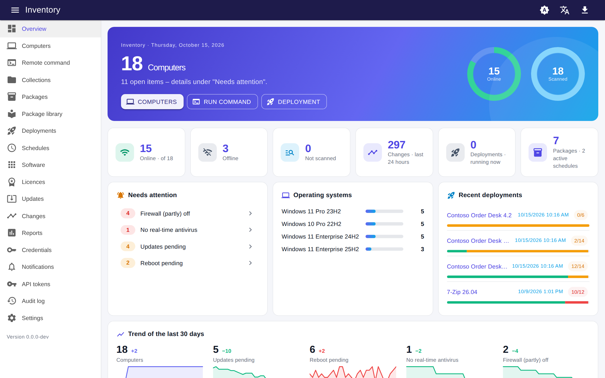

## Features

Every feature below comes with a picture of the page that belongs to it. The pictures come from simulation mode
(`Inventory:Simulate`), which shows a sample environment without real computers.

- [Overview and trends](#overview-and-trends) · [Computer list](#computer-list) ·
  [Inventory per computer](#inventory-per-computer) · [Security and configuration](#security-and-configuration) ·
  [Updates and patch status](#updates-and-patch-status) · [Software and apps](#software-and-apps) ·
  [Change history](#change-history) · [Network devices](#network-devices)
- [Collections and maintenance windows](#collections-and-maintenance-windows) · [Packages and steps](#packages-and-steps) ·
  [Detection, prerequisites and user notice](#detection-prerequisites-and-user-notice) ·
  [Ready-made packages](#ready-made-packages)
- [Deploying a package](#deploying-a-package) · [Pilot group first](#pilot-group-first) ·
  [Schedules and required deployments](#schedules-and-required-deployments) ·
  [Remote command and remote access](#remote-command-and-remote-access)
- [Saved reports](#saved-reports) · [Alerts and notification channels](#alerts-and-notification-channels) ·
  [Licence counting](#licence-counting) · [Audit trail](#audit-trail)

### Overview and trends

The start page (picture at the top) shows how many computers are online and scanned, what needs attention (firewall
off, no real-time antivirus, pending updates, pending reboots, warranties ending within 90 days …), the operating
systems and the latest deployments. One value per day is kept for the key figures, so the overview also shows 30-day
trends, deployments per week and the age of the last scans.

### Computer list

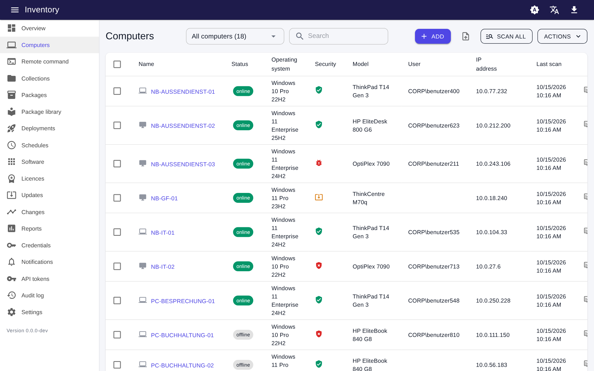

Computers are added by hand, imported from Active Directory or enrol themselves through the [agent](#agent). The list
shows reachability, the last scan and security indicators, filters by name, status and directory state, and offers
actions for the selection: scan, deploy, run a command, wake, install the agent. Reachability can be checked on a
regular heartbeat (computers with name anomalies are skipped).

### Inventory per computer

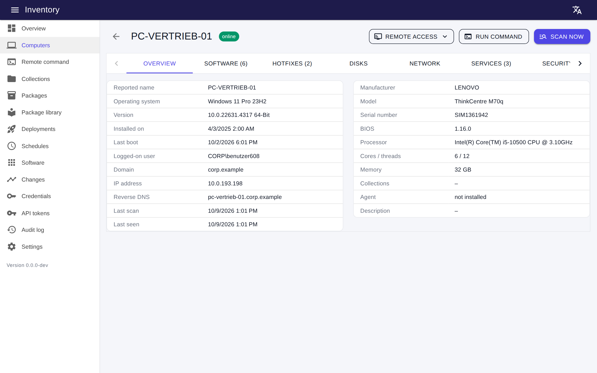

The inventory scan reads system, operating system, processor, software, hotfixes, disks, network, services, local
users and administrators. **Asset data** – owner, location, cost center, inventory number, purchase date, end of
warranty, tags and notes – is edited on the page, through the API or by importing a CSV table (the computer export can
be edited and read back in). The **primary user** is whoever had an interactive session (console or Remote Desktop) on
the most days during the scans of the last 30 days; accounts stored as credentials, services and scheduled tasks never
count. The *Profiles* tab lists the user profiles.

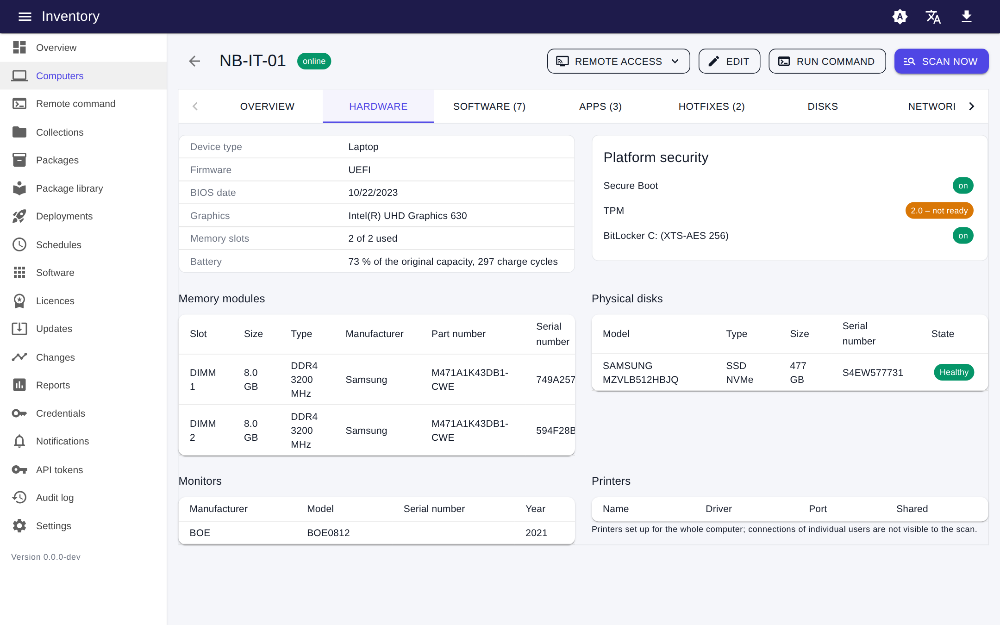

**Hardware and platform security**: device type (desktop, laptop, server, virtual machine), UEFI and Secure Boot, TPM,
BitLocker per volume, graphics, memory modules and free slots, physical disks with type and health, battery health,
monitors and printers.

### Security and configuration

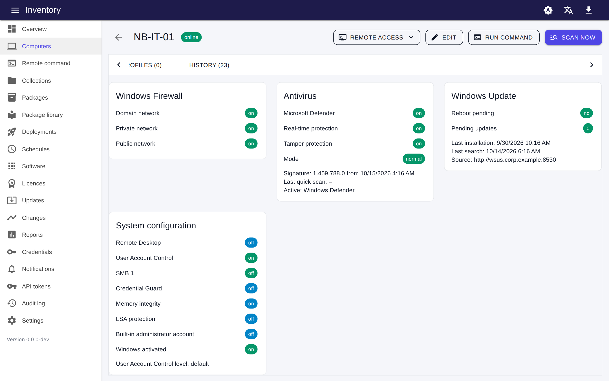

Firewall, antivirus and Windows Update status, plus the system configuration: Remote Desktop and network level
authentication, User Account Control, SMB 1, Credential Guard, memory integrity, LSA protection, the built-in
administrator account (active, password age), Windows activation, last logon and password age of local accounts. All
of it is available as collection rules – "computers with SMB 1 enabled" is one rule.

### Updates and patch status

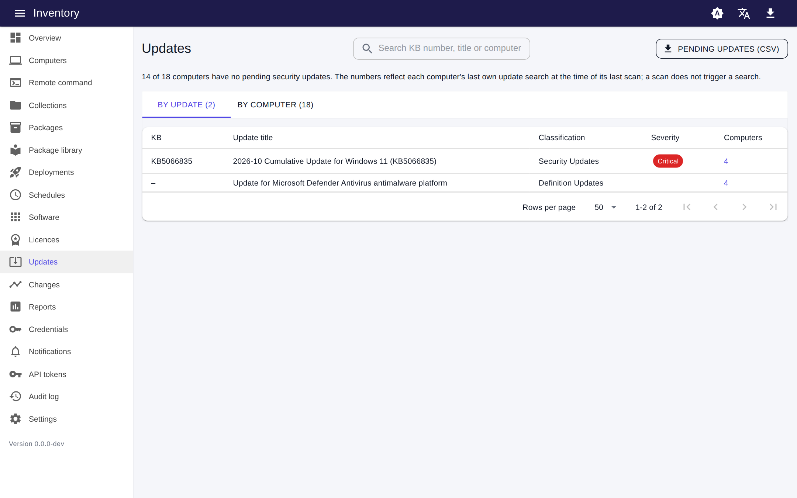

Pending updates per computer with KB number, classification and severity; an overview per update (which computers
miss it) and per computer (who has no pending security updates), CSV export and collection rules for installed
hotfixes and pending updates. *Install …* starts a deployment of the update to the computers that miss it, using the
**Windows Update** step: it searches, downloads and installs from the source configured on the computer (WSUS or
Microsoft Update) – all updates, only security and critical ones, or specific KB numbers. Works via SMB + service or
agent, not over WinRM. For particular computers, *Install …* on the computer page (section *Pending updates*) and
*Install pending updates* in the actions of the computer list deploy all pending updates, or only security and critical
ones, followed by a restart only if one is pending (with five minutes' notice to the logged-on user) – or without any
restart: then the updates finish with the next restart. Inventory never restarts in that case; restart policies that
Windows Update itself follows (group policy, active hours) still apply.

### Software and apps

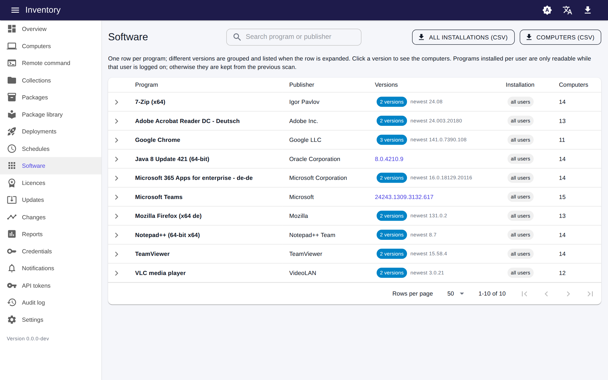

The software overview counts every program across all computers, by name and version, and leads to the computers that
have it. *Uninstall …* removes a program from them: silently for MSI, Inno Setup and NSIS setups and for programs with
a registered silent command, followed by a check that it is really gone.

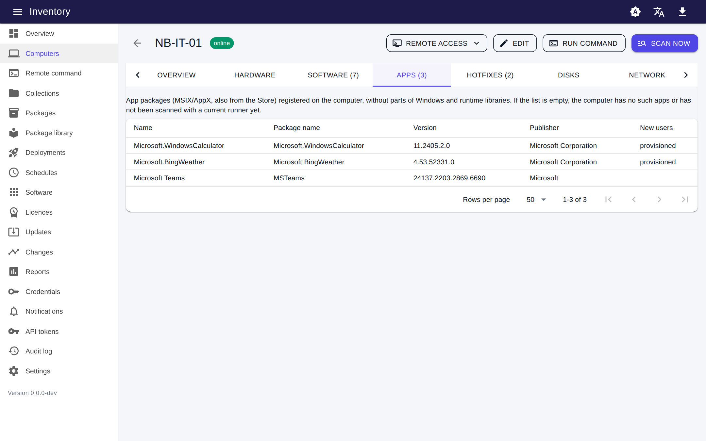

**Apps (MSIX/AppX, Store)**: the scan records the computer's app packages and whether they are provisioned for new
users; collections can filter on them, and a *remove app* step removes an app for all users and, if wanted, for future
ones. Parts of Windows and runtime libraries are left alone, and a name that matches too much removes nothing.

### Change history

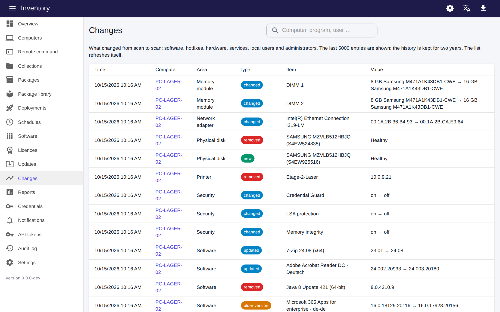

Every scan is compared with the previous one: installed, removed and updated software, hotfixes, services, local
administrators, hardware and system configuration appear as changes with time – per computer on its *History* tab and
for all computers on *Changes*.

### Network devices

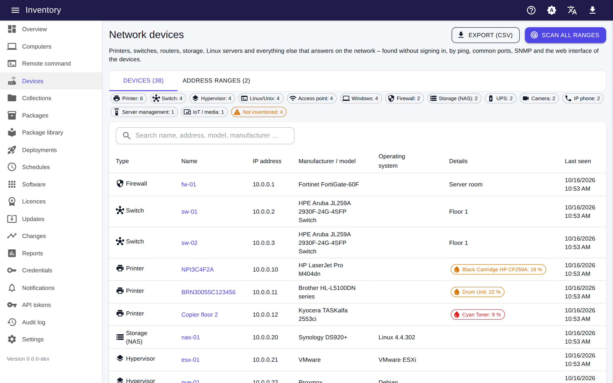

Printers, switches, routers, firewalls, access points, storage, Linux servers, hypervisors, cameras, IP phones and UPS
units: the server scans the address ranges you enter (CIDR, from–to or single addresses, at most 4096 per range) and
finds out what answers – without signing in to the devices and without an agent:

- **Ping and common ports** (29 TCP ports such as SSH, HTTP/HTTPS, SMB, RDP, IPP, JetDirect 9100, RTSP, SIP).
- **SNMP v1/v2c** with the communities you store (encrypted; `public` if none): name, description, location, contact,
  uptime, model, serial number and firmware (ENTITY MIB), router and switch detection (IP forwarding, bridge MIB) and
  the ARP table of routers, which supplies MAC addresses for devices in other subnets. Printers report their **supplies
  and page count** (printer MIB), UPS units their model (UPS MIB).
- **Banners and web interface**: the SSH banner (gives away Ubuntu, Debian, RouterOS …), the title and server header of
  the web page, the realm of its sign-in prompt and the subject of its TLS certificate.
- **MAC vendor** from the public IEEE registry, for devices in the server's own subnet or behind a router that answers
  SNMP.
- **Windows computers** name themselves over SMB and are linked to the computer list; those missing from it are marked
  *Not inventoried*.

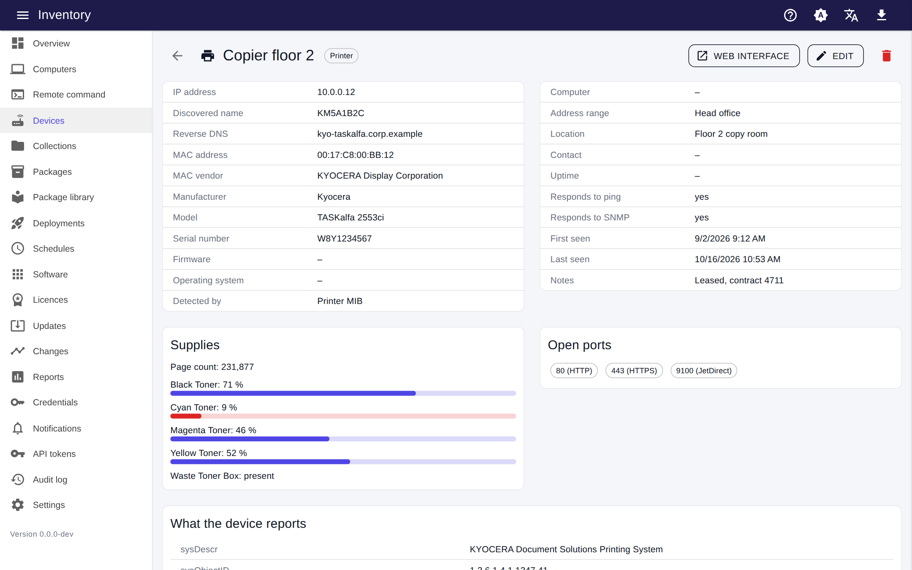

The detail page shows what each clue revealed and links to the device's web interface. A wrongly detected type can be
corrected by hand, and name and notes survive the next scan. A schedule with the action *Network device scan* keeps the
list current, the alert rule *A new device appears on the network* reports newcomers, and the list exports as CSV and
through the API (`/api/devices`).

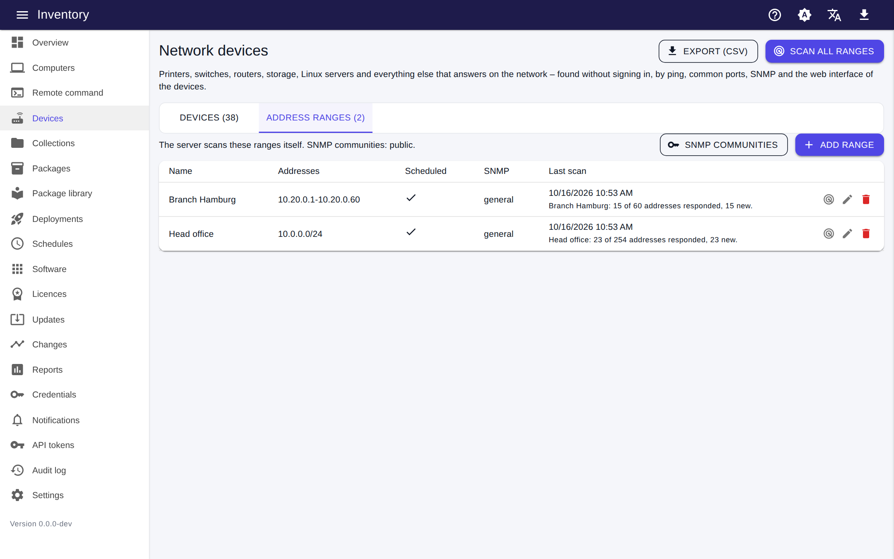

The scan contacts every address of a range on 29 ports; an intrusion detection system may report it as a port scan, so
let the network team know. Routed subnets need to be reachable from the server (ICMP, the ports above, UDP 161 for
SNMP).

### Collections and maintenance windows

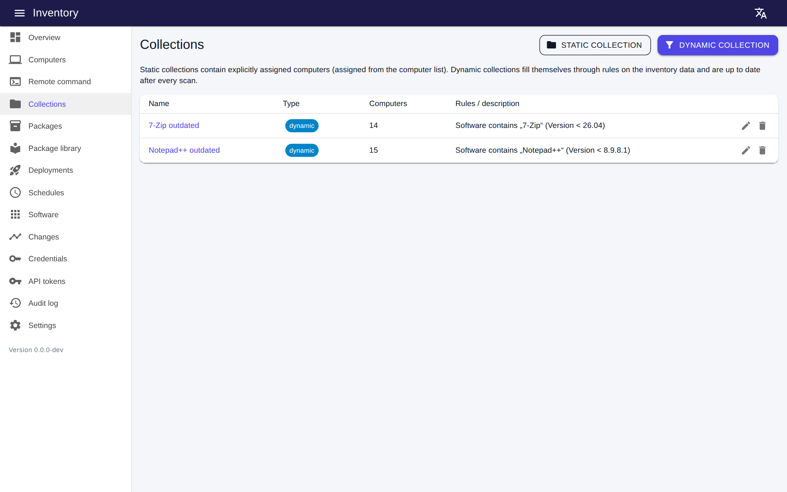

Collections are static (picked by hand) or dynamic via rules such as "Chrome installed with version below 141". Rules
exist for software, apps, hardware, security state, updates, Active Directory, asset data, services, network and scan
age; `*` works as a wildcard with "equals", and "member of collection" combines collections (up to three levels deep).

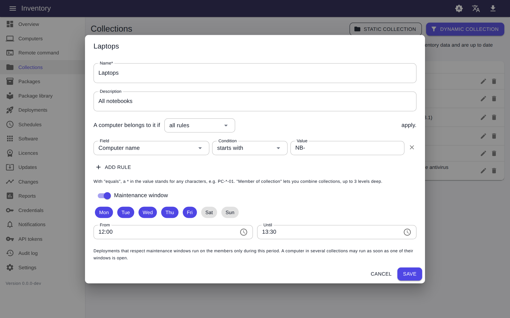

A collection can carry a **maintenance window** (weekdays and time of day); there is also a default window. Deployments
and schedules with the option "only within the maintenance window" hold back computers whose window is closed and start
them when it opens. A computer in several collections may run as soon as one of its windows is open.

### Packages and steps

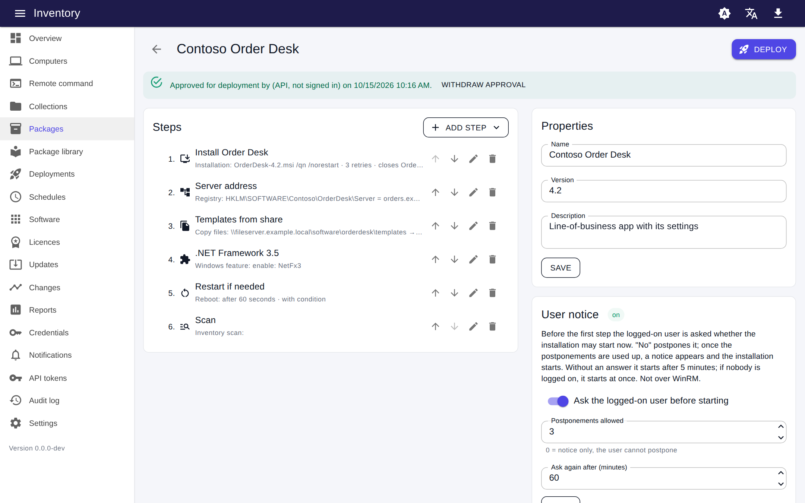

A package is a list of steps, each with conditions and error handling:

- **Installation** of an MSI or EXE from the package files, **command**, **PowerShell**, **copy files**, **service**
  (start/stop/restart), **wait**, **reboot**, **scan**, **embedded package**
- **Registry**: set or delete a value, or delete a key, without a script – typed (string, DWORD, QWORD, multi-string,
  binary), in the 64- or 32-bit view, and for `HKCU` in the settings of the logged-on user
- **Windows feature**: turn optional features on or off (DISM); a pending restart is reported
- **Copy from a share**: very large payloads are copied from a share or a path on the computer instead of passing
  through the server (the computer account needs read access to the share)
- **Uninstall**, **remove app** and **Windows Update** (see above)

Steps after a reboot continue automatically once the computer is back. Each step runs as Local System or in the session
of the logged-on user ([run context](#run-context)), and can retry with a pause (automatically when another installation
is running), check the free disk space first, and close named programs – optionally after a notice to the user.

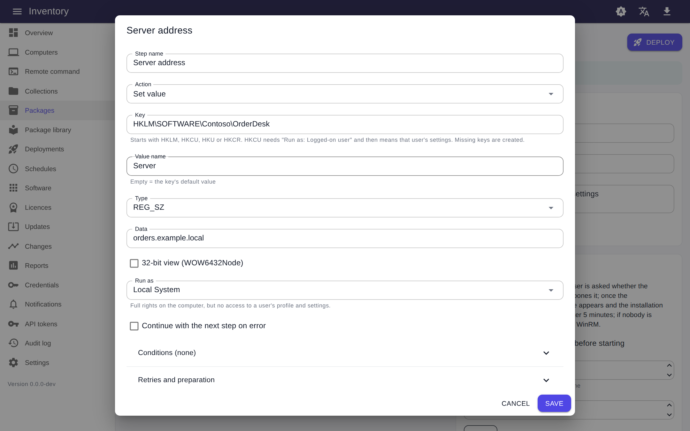

A package is "in progress" until an administrator **approves** it; operators and schedules deploy only approved
packages, and every change to steps, detection or files withdraws the approval.

### Detection, prerequisites and user notice

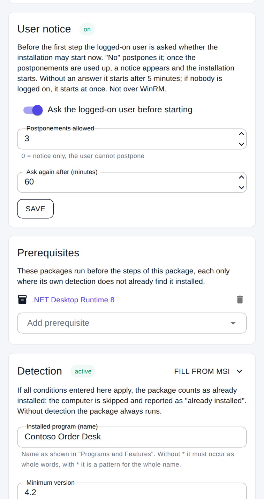

- **Detection**: how to recognise that the package is already installed (program name with minimum version, MSI
  product code, file or registry key). Such computers are skipped and reported as "already installed"; optionally the
  same check runs again after the last step, so a setup that reports success without installing fails.
- **Prerequisites**: the packages this one needs ("requires the .NET runtime"). They run before its steps, each only
  where its own detection does not already find it, and must be detectable afterwards if that package asks for
  verification.
- **User notice with postponement**: the logged-on user is asked before the package starts and may postpone a
  configurable number of times (default: three times by 60 minutes); after that only a notice appears and the
  installation starts. Without an answer it starts after five minutes, without a logged-on user at once. Works via
  SMB + service and agent, not over WinRM.

### Ready-made packages

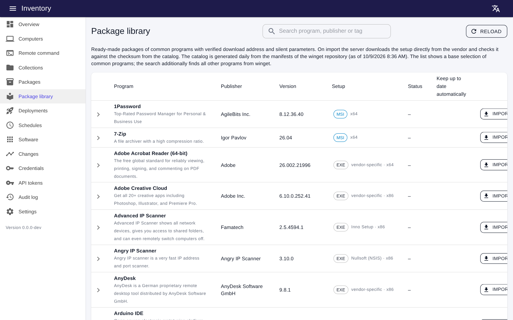

The [package library](#package-library) offers packages of common programs, generated daily from the winget manifests:
import with one click, new versions adopted automatically, and a dynamic "… outdated" collection that follows along –
so a schedule "Chrome to *Chrome outdated*" keeps every computer current.

### Deploying a package

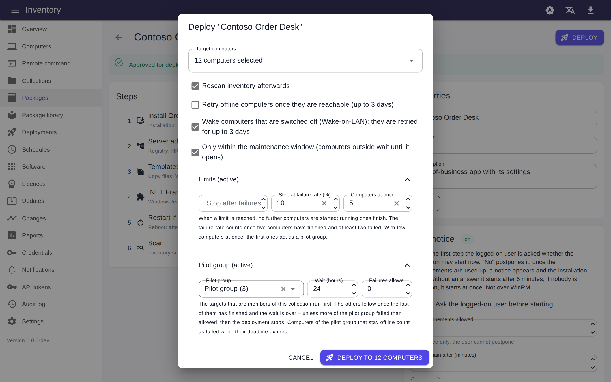

A deployment targets computers or a collection and runs in parallel. Options:

- **Rescan** afterwards, **retry offline computers** once they answer (up to three days)
- **Wake-on-LAN**: wake computers that are switched off and run them once they answer; *Wake* on the computer page
  does the same by hand ([details](#wake-on-lan))
- **Only within the maintenance window**
- **Limits**: stop starting further computers after a number or a rate of failures, and limit how many computers run
  at once – a broken package does not reach every computer
- **Pilot group** (see next section)

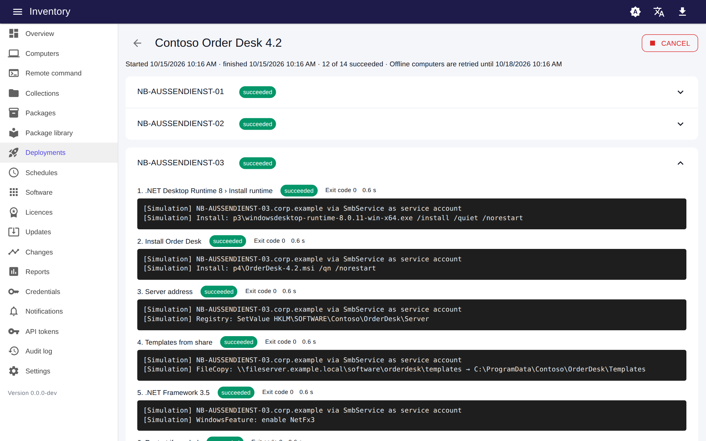

The deployment page shows the status per computer live, with the output of every step; it can be cancelled, and
failed computers can be retried. Computers that wait – offline, outside their maintenance window, rebooting or
postponed by the user – show why.

### Pilot group first

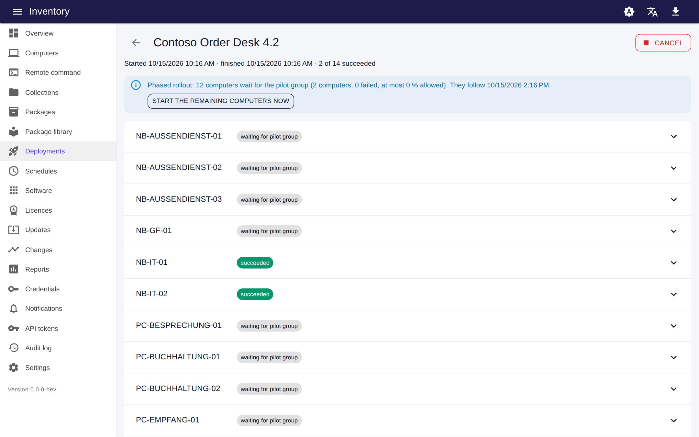

A deployment or schedule can name a pilot group. Its computers run first; the others follow after a wait – or not at
all if too many of the pilot group failed. *Start the remaining computers now* skips the wait. Details under
[Phased rollout](#phased-rollout).

### Schedules and required deployments

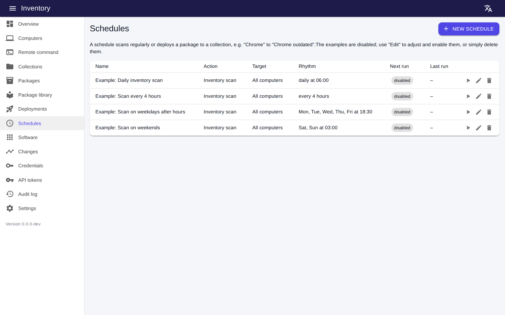

Schedules scan, deploy a package to a collection or mail a report: daily, weekly, monthly (a day of the month or e.g.
"three days after the second Tuesday"), at fixed intervals or once, optionally with an end date. A run missed while the
server was off is caught up within a day or skipped. **Required deployments** keep a collection supplied: every member
gets the package once, computers that join later follow automatically, and the schedule shows how many members already
have it.

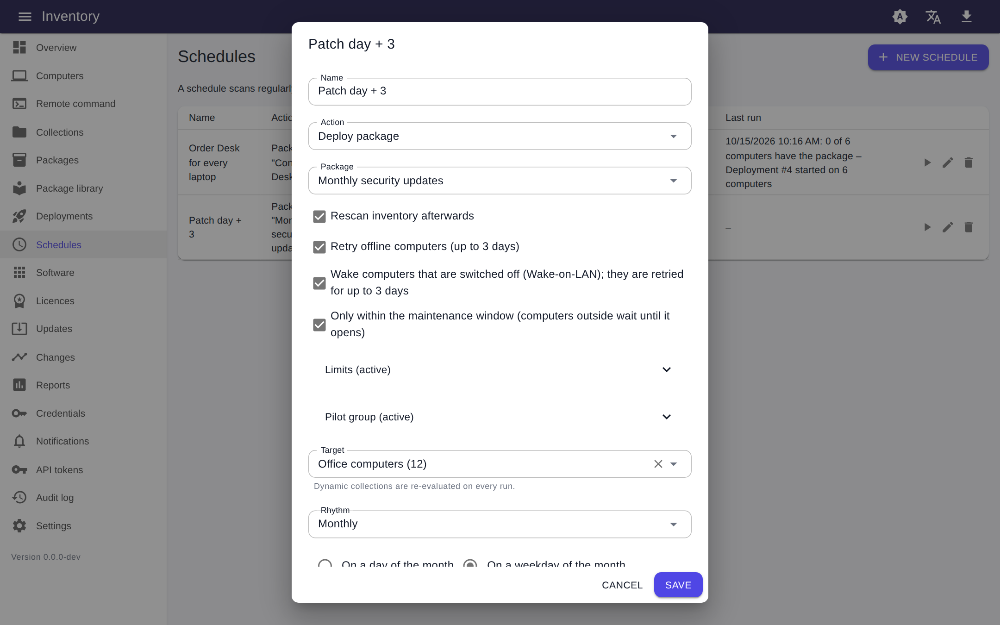

### Remote command and remote access

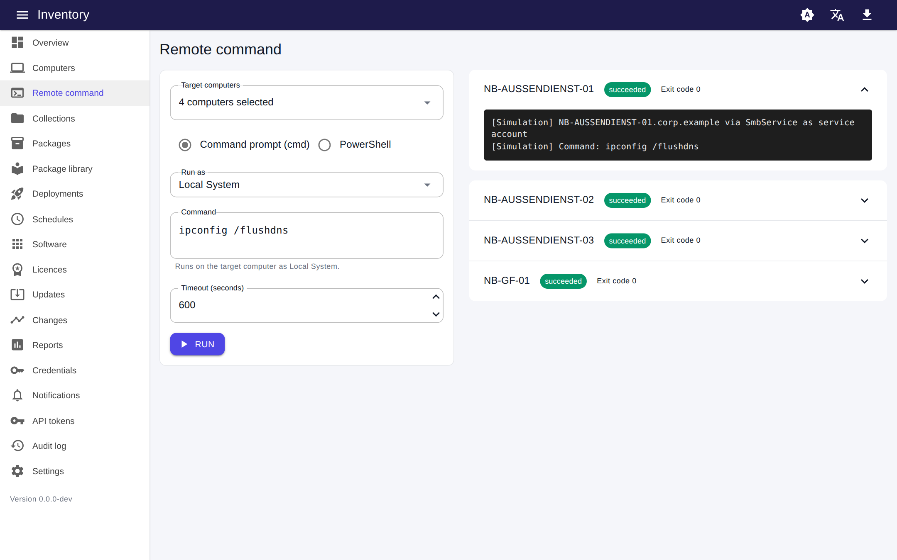

A command (cmd or PowerShell) runs on several computers at once, as Local System or as the logged-on user, with live
output per computer. Per computer the *Remote access* menu offers Remote Assistance, shadowing a session, Remote
Desktop and TeamViewer/AnyDesk ([details](#remote-access)).

### Saved reports

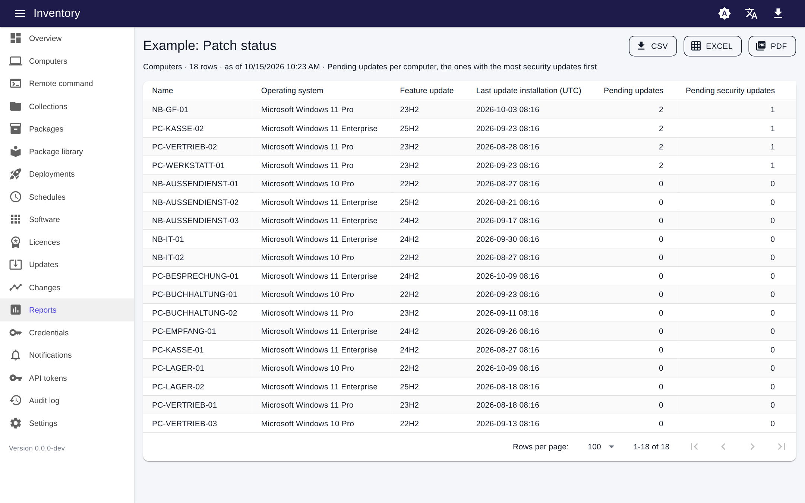

Saved lists of computers, software, pending updates, deployments or changes – limited to a collection, with chosen
columns and order; shown in the browser, as CSV, Excel or PDF, or sent by e-mail on a schedule. Ten ready-made examples
(hardware, security status, patch status, asset list …) serve as they are or as templates ([details](#reports)).

### Alerts and notification channels

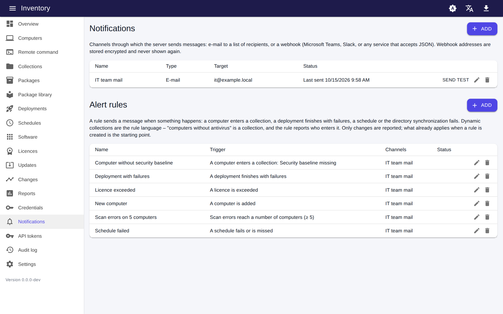

Channels for e-mail (SMTP with STARTTLS/TLS, optional sign-in with stored credentials) and webhooks (Microsoft Teams,
Slack or plain JSON), each with a test button. **Alert rules** send a message when a computer enters a collection, a
collection or the scan errors reach a number, a deployment finishes with failures, a computer is added, a licence is
exceeded, or a schedule, the directory synchronization, the backup or the server update fails – with a pause per rule
and a choice of channels ([details](#notifications)).

### Licence counting

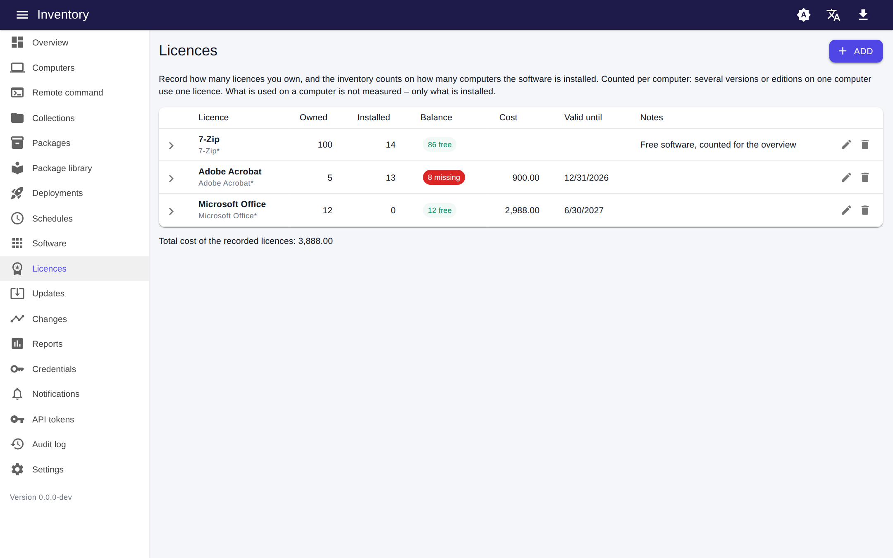

Record how many licences you own per product; the inventory counts the computers the software is installed on and
shows what is missing or free, with cost and expiry date. An alert rule reports exceeded licences.

### Audit trail

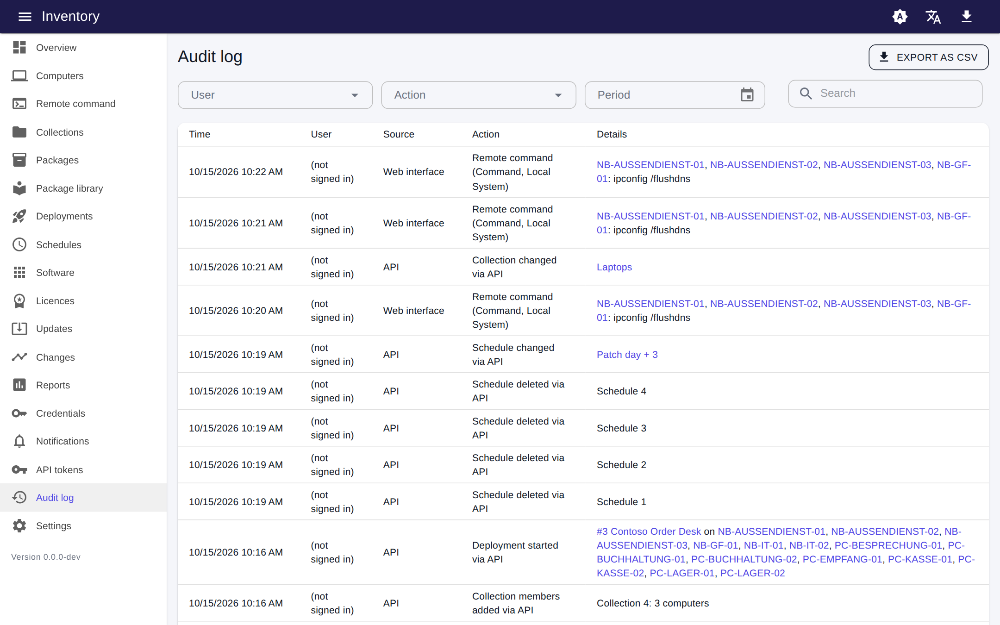

Sign-ins, commands, deployments and every change with user, role and source (web interface, API, API token); filters,
CSV export and a retention period ([details](#audit-log)). Also on board: CSV export of the computer list, a daily
backup and a REST API with interactive documentation ([API](#api)).

## How access works

On the target computer the same small **runner** (`InventoryRunner.exe`, .NET Framework 4.8) always executes a job.
How it gets there is decided by the transport – configurable globally and per computer:

| Transport | Prerequisite on the target | Job runs as |
|---|---|---|
| SMB + service (default) | `ADMIN$` share, port 445, account with local admin rights | Local System |
| WinRM | PowerShell remoting enabled, port 5985, PowerShell in full language mode | stored account |
| Agent (optional) | service "Inventory Agent", outbound connection to the server | Local System |

On the target computer `%SystemRoot%\Inventory` is created (SYSTEM and administrators only): the runner stays there
under `Runner\<version hash>`, job directories under `Jobs` are removed after every run. The SMB transport registers
the service `InventoryRunner` (manual start) once and starts it with the job ID for every job; the service ends when
the job is done. One job runs at a time per computer – a second one waits for the first.

To remove everything from a computer: `sc delete InventoryRunner` and delete `%SystemRoot%\Inventory`.

### Account for agentless access

Scans, deployments and the agent installation over SMB or WinRM connect with a stored account (*Credentials*; one is
the default, a computer can have its own). The agent needs no such account. Everything below applies to the computers
the server reaches agentlessly, not to the server itself.

**What the account needs on every target computer**

| Requirement | Why |
|---|---|
| Member of the local group *Administrators* (recommended) | Writing to `ADMIN$` (`%SystemRoot%\Inventory`) and creating, changing and starting the service `InventoryRunner` through the Service Control Manager; over WinRM creating the same folder and starting the runner. A narrower delegation through access lists (Service Control Manager, share, folder, WinRM session configuration) is conceivable, but it is not tested and has to cover all of these rights – local administrators is the supported setup. |
| Network logon allowed | "Access this computer from the network" must include it (default: *Administrators*), "Deny access to this computer from the network" must not – watch out for security baselines that deny *Local account and member of Administrators group*. |
| A full administrator token over the network | Domain accounts get it by default. For **local** accounts, Windows filters admin rights on network logons (UAC remote restrictions); they work only with `LocalAccountTokenFilterPolicy = 1` or as the built-in Administrator – both weaken the target, so use a domain account. |
| WinRM only: full language mode | PowerShell must not run in constrained language mode for this account on the target (AppLocker/WDAC), and the same applies to the server's service account on the server. |

It needs **no** domain-wide rights: not *Domain Admins*, no rights on the server, no interactive or Remote Desktop
logon, no logon as a service or batch job. Which identity runs a job depends on the transport:

- **SMB + service**: the server uses the account only for the network access (`LOGON32_LOGON_NEW_CREDENTIALS` – copying
  to `ADMIN$`, service control). On the target the runner runs as Local System; steps set to *logged-on user* run in
  the session of the user who is signed in there, never as this account.
- **WinRM**: PowerShell remoting logs on with the account, and the runner runs as this account in that remote session.

Either way the account never logs on interactively and never shows up as primary user (accounts stored as credentials
are excluded anyway).

**What the target computers need**

| Transport | Settings |
|---|---|
| SMB + service | Inbound TCP 445 from the server (firewall group *File and Printer Sharing*), the service *Server* (`LanmanServer`) running, the administrative share `ADMIN$` present (not disabled with `AutoShareWks = 0` on clients or `AutoShareServer = 0` on Windows Server). The Service Control Manager is reached over RPC: first directly (TCP 135 and dynamic ports, firewall group *Remote Service Management*), otherwise over the named pipe on port 445 – opening 445 is enough, opening the RPC group avoids a delay. |
| WinRM | PowerShell remoting enabled (`Enable-PSRemoting` or the group policy *Allow remote server management through WinRM*), inbound TCP 5985 from the server. The server connects by name with Kerberos; for addresses or computers outside the domain the server's *TrustedHosts* would be needed, which is not set up for you. |
| Both | .NET Framework 4.8 (the runner). The reachability check tries TCP 445 first and 5985 only if 445 does not answer, so "reachable" does not prove that WinRM is open. |

**Recommended setup**

1. Create a dedicated domain user, e.g. `svc-inventory-scan`, with a long random password. Do not use a personal
   account or one that other systems depend on: endpoint protection with automatic response may disable it (see
   [Endpoint protection](#endpoint-protection)).
2. Put it into a domain group, e.g. `Inventory-Clients-Admins`, and add that group to the local *Administrators* of
   the target computers by group policy (*Computer Configuration → Preferences → Control Panel Settings → Local Users
   and Groups*, action *Update*, or *Restricted Groups* / "Member of"). Link the policy only to the OUs of the computers
   that should be managed – not to domain controllers and not to the Inventory server.
3. In a second policy for the same OUs deny it what it does not need: *Deny log on locally* and *Deny log on through
   Remote Desktop Services*. Network logon stays allowed.
4. Open the firewall rules from the table above for the Inventory server only (*Remote IP address* = the server).
5. Store the account under *Credentials* as `DOMAIN\svc-inventory-scan` and make it the default. To rotate the
   password, change it in the directory and then under *Credentials* (or through the API).
6. Check with *Scan* on one computer; error messages name the cause (access denied = no local admin rights, logon
   failed = password, RPC server unreachable = firewall).

If no credential is stored at all, the server connects with its own service account. On a domain-joined server
running as Local System that is the computer account `DOMAIN\SERVER$`, which would then need the rights above; on a
server outside the domain there is no account the targets could grant rights to. In both cases store an account.

The Active Directory synchronization is separate: it reads computer accounts over LDAP with the server's service
account or the credential selected there. Reading computer objects needs no extra rights – any domain user can do it.
Wake-on-LAN, remote access (with the operator's own account from their PC) and the agent do not use this account.

### Endpoint protection

Endpoint detection products tend to rate agentless administration as lateral movement, because it looks the same on
the wire: files copied to `ADMIN$`, a service controlled remotely, PowerShell started by a service. Three things keep
the security console quiet without hiding real attacks:

1. **Prefer the agent** where alerts matter. It connects outbound and needs neither `ADMIN$` nor remote service
   control. Select the computers and choose *Install agent*; only this one installation still uses the agentless way.
   Under *Settings → Agentless access* you can enforce that: restricted to installing the agent, or switched off
   entirely, scans, deployments and schedules no longer reach computers without an agent.
2. **A stable footprint.** The service name (`InventoryRunner`), the path (`%SystemRoot%\Inventory\Runner\`) and the
   file name (`InventoryRunner.exe`) never change, and the service is created once per computer instead of once per
   job. The first job on a computer and the first one after a server update (new runner) can still raise an alert.
3. **A narrow allow rule** in your product, scoped to all of: the Inventory server as the source device, the folder
   `%SystemRoot%\Inventory\` and the service name `InventoryRunner`. In Microsoft Defender for Endpoint that is an
   alert suppression rule created from one of the alerts, with these conditions. Do not suppress remote service
   creation in general and do not exclude the folder from antivirus scanning – package files land there.

Products with an automatic response go further than alerting: they can disable the account used for the access and
isolate the computers involved. Until an allow rule is in place, do not run agentless jobs with an account that other
systems depend on, and try the tool on a few computers first.

[docs/defender.md](docs/defender.md) has the steps for Microsoft Defender for Endpoint: what the alerts mean, a
PowerShell script that allows the runner file by its hash (shown under *Settings*), and how to tune the behaviour
alerts in the portal.

Releases built with a release certificate are signed with the project's self-signed certificate (see
[Updating](#updating)); earlier ones are unsigned. A rule by certificate only works once your computers trust that
certificate; until then allow the runner by its hash.
PowerShell steps run as
`powershell.exe -ExecutionPolicy Bypass -File <script in the job directory>`; rules that flag the bypass switch will
keep reporting them.

### Agent

For computers the server cannot reach directly (notebooks on the road, other networks, no SMB/WinRM path) the same
runner is available as a permanent Windows service. It only ever talks *to* the server – the server never connects to
the agent.

A job's result is not lost when the server is unreachable at that moment: the agent keeps it and delivers it as soon
as the server answers again, for up to seven days. If the server was restarted while the job ran, the deployment shows
the computer as failed ("the server was stopped during execution") until the result arrives and replaces that.

A package with a **reboot** in the middle does not depend on the server either: the agent keeps the remaining steps and
their files, and continues by itself once the computer has restarted – also on a notebook that comes back without a
connection to the server. The deployment shows "Restarting – the agent continues …" until the result arrives. If the
deployment is cancelled in the meantime, a continuation that already ran is not undone; its result is discarded.

**How it works**

| | |
|---|---|
| Service | `InventoryAgent` ("Inventory Agent"), runs as **Local System**, start type Automatic, recovery: restart after 5 s / 60 s / 5 min |
| Files | `%ProgramFiles%\Inventory Agent` – the runner (`InventoryRunner.exe`, .NET Framework 4.8), `agent.json` (server URL + enrollment secret), `agent.key` (the agent's own key), `agent.version` (hash of the installed runner files), `agent.log`; the folder is readable by SYSTEM and administrators only |
| Enrollment | On first start the agent sends the enrollment secret and its host name to `POST /api/agent/enroll`. The server checks the secret, creates the computer if unknown (matching by short name, so an entry under its FQDN is reused), generates a random 256-bit key, stores only its SHA-256 hash and returns the key once. The agent keeps it in `agent.key` and never sends the secret again. |
| Authentication | Every further request carries the header `X-Agent-Key: <key>`. The server looks the hash up; a key it does not know (computer deleted, "Agent" removed) returns 401, the agent deletes `agent.key` and enrolls again with the secret. |
| Polling | `POST /api/agent/poll` is a long poll: the server holds the request for up to 50 s and answers `204` if no job came in; the agent asks again immediately. A job is therefore picked up within a second, with one open HTTP request per computer instead of a steady stream. Every poll updates "last contact"; the UI shows the agent as connected while the last contact is less than 5 minutes old. |
| Running a job | The job manifest arrives with the poll answer; package files are fetched one by one (`GET /api/agent/jobs/{id}/files/{n}`) into a per-job folder below the agent folder. The same `JobExecutor` as in agentless mode runs the steps as Local System (or in the logged-on user's session for steps configured that way). Progress lines are posted every second (`POST …/progress`), the result at the end (`POST …/result`, up to 64 MB for large scans), then the job folder is deleted. |
| Timeouts | If no agent picks up a job within 2 minutes the server marks the target as unreachable (deployments with "retry offline" try again later). While a job runs, the server waits for the sum of the step timeouts plus a margin. |
| Self-update | The poll request contains the hash of the installed runner files. If the server ships a different runner (after a server update), the answer is an update offer instead of a job: the agent downloads all files into a staging folder first, then swaps them (running files are renamed to `*.old`, cleaned up on the next start), writes the new hash and exits with code 3 – the service recovery restarts it with the new files within seconds. Queued jobs wait meanwhile. |
| Errors | On any error (server unreachable, invalid answer) the agent logs to `agent.log` and retries after 30 s, indefinitely. |

**What the communication needs**

- **Direction and ports:** outbound only, from the client to the server address configured under *Settings → Agents*
  (e.g. `https://inventory.example.local:5100`). No inbound port, no firewall rule and no SMB/WinRM on the client. The
  server's port (default 5100) must be reachable from the client networks (firewall rule on the server; the setup can
  create it).
- **HTTPS:** strongly recommended – over this channel the agent receives commands it executes as Local System. The
  agent uses the Windows certificate store; the server certificate must therefore be trusted by the client (internal
  CA or a public certificate), there is no "accept any certificate" switch. TLS 1.2 is enforced. Kestrel HTTPS
  configuration: see [Configuration](#configuration-cprogramdatainventoryappsettingsjson).
- **Proxy:** the agent runs as Local System and uses the WinHTTP proxy settings of the machine (`netsh winhttp set
  proxy …`), not a user's browser proxy. A direct route to the server is simplest.
- **Name resolution:** the client must resolve the host name in the server address (DNS or `hosts`). The server does
  not need to resolve the client at all.
- **Enrollment secret:** shown under *Settings → Agents*; it is written into `agent.json` by the installation job.
  *Renew secret* invalidates it for new enrollments only – already enrolled agents keep working with their keys.
  Treat `agent.json` and `agent.key` like a password; they are the reason the agent folder is locked down.
- **The agent interface ignores the user sign-in** (Windows/OIDC/API tokens): `/api/agent/*` authenticates with the
  key alone and is the only part of the API that does.

**Setup**

1. Under *Settings → Agents* enter the address under which the computers reach the server (HTTPS recommended) and
   save.
2. Under *Computers* select the targets and choose *Actions → Install agent*. The installation itself runs agentless
   (SMB or WinRM) and copies the runner, writes `agent.json` and `agent.version`, creates and starts the service.
   **Without an agentless path:** *Settings → Agents → Download agent setup* gives a ZIP with the runner, its
   configuration and `Install-Agent.cmd`. Unpack it to a share and run `Install-Agent.cmd` as a computer startup
   script of a group policy, or through an existing software distribution (as administrator or Local System). On a
   computer that already has the agent the script returns at once – the agent updates itself from the server –, so
   it can stay assigned; `Install-Agent.cmd --force` reinstalls. The ZIP contains the enrollment secret: make the
   share readable only for the computers that need it (e.g. *Domain Computers*), and renew the secret under
   *Settings* if it got into the wrong hands.
   **From the new computer itself:** under *Settings → Agents → Download page without sign-in* an administrator
   opens the page `<server address>/agent` for an hour, a day, a week or permanently. Opened in the browser of a new
   computer it offers the setup, already configured for this server, and a one-line command for an elevated
   PowerShell (`irm <server address>/agent/install.ps1 | iex`) that downloads, unpacks and installs it. Nobody has to
   sign in. While the page is open, everyone who can reach the server can fetch the setup with the enrollment secret
   and register a computer – also under the name of an existing one, which would then receive that computer's jobs.
   So: open it only as long as needed, or restrict the server port by firewall to the networks that need it; every
   download is written to the audit log with the address it came from, as is every enrollment. Closed, the page
   answers 404.
3. As soon as the service has enrolled, the computer switches to transport "Agent" (visible as a green "Agent" chip).
   Per computer the transport can be set back to SMB or WinRM; the agent keeps polling regardless.

**Removing an agent:** run `InventoryRunner.exe --uninstall-agent` from a copy outside the agent folder
(e.g. the setup share), or stop and delete the service by hand (`sc stop InventoryAgent`, `sc delete
InventoryAgent`, delete the folder), then choose *Forget agent* in *Edit computer* – that drops the key on the server
and resets the transport. The other way round, the still-running agent would simply enroll again with the secret.

Agents update themselves after a server update (see above); nothing has to be redeployed.

**Troubleshooting:** `agent.log` in the agent folder shows enrollment, errors and updates. Running
`InventoryRunner.exe --agent-console` there (as administrator, with the service stopped) prints the same loop to the
console. The server's audit log records every enrollment with host name, version and source address.

### Remote access

The computer list and the detail page have a *Remote access* menu:

| Method | What is started | Prerequisite on the computers |
|---|---|---|
| Offer Remote Assistance | `msra.exe /offerRA <computer>` | policy "Configure Offer Remote Assistance", firewall group "Remote Assistance" |
| Shadow session | `mstsc.exe /v:<computer> /shadow:<session> /control`; the session number comes from the last scan | policy "Set rules for remote control of Remote Desktop Services user sessions", firewall rules "Remote Desktop – Shadow" |
| Remote Desktop | `mstsc.exe /v:<computer>` | Remote Desktop enabled |
| TeamViewer / AnyDesk | the program via its own link with the device ID captured during the scan | program installed on both sides |

For the first three to start with one click, the admin PC needs the **launcher** once (`InventoryLauncher.exe`, a few
kilobytes): download it from the menu under "Set up the launcher", put it in a fixed place and double-click it once. It
registers itself for the user account as the handler for `inventory://` links (no admin rights). For several admin PCs
there is "Install remote access launcher" under *Computers → Actions* (into `%ProgramFiles%\Inventory Launcher`, for
all users). The launcher accepts only these three actions, validates computer name and session number and starts
nothing but `msra.exe` and `mstsc.exe` from System32 – other websites cannot trigger anything else through the link.

Without the launcher the same dialog shows the commands to copy and offers Remote Desktop as an `.rdp` file.

Every call is logged. If a different computer responds under the listed name, the menu warns.

### Active Directory

The synchronization (*Settings → Active Directory*) creates computers from computer accounts and reconciles existing ones:

- **DNS name**: every run stores the full DNS name (`dNSHostName`) of the account. Scans, the reachability check,
  deployments and remote access connect to that name – `pc-01.corp.example` – even though the entry is listed as
  `pc-01`; it also resolves where short names do not, e.g. over VPN or from the home office. Without the directory,
  the name comes from the agent (at enrollment) or from the first scan of a domain member. An entry that was entered
  as a DNS name or an address is used as entered, and a DNS name whose host part does not match the computer is
  ignored. The computer page shows the name in use as "DNS name".
- **Exclude disabled computer accounts** (default: on): disabled accounts are not created; if an existing computer is
  disabled in the directory, it counts as no longer found.
- **Directory facts**: every run also stores the organizational unit, the groups the computer account is a direct
  member of, its description and its last logon to the domain (the directory only replicates that value about every
  two weeks). They appear on the computer page and in the CSV export and can be used as collection rules, e.g.
  "AD organizational unit contains Laptops" or "AD group equals Pilot-Updates".
- **Computers no longer found** are marked "not in AD" (filter in the computer list, rule field for dynamic
  collections). Optionally the synchronization deletes them after they have been missing continuously for a
  configurable grace period – including inventory data and history.
- Manually added computers the directory never knew remain untouched. If the directory returns no accounts at all or
  conspicuously many computers would be deleted at once, the run changes or deletes nothing and reports it.

### Phased rollout

Under *Pilot group*, a deployment or schedule takes a collection, a wait in hours and the share of failures that is
still acceptable. Of the chosen targets, the members of that collection run first; the others show "waiting for
pilot group".

- **Release:** once the last computer of the pilot group has finished and the wait is over, the others start by
  themselves. Deadlines for offline computers and maintenance windows begin anew for them.
- **Stop:** if more of the pilot group failed than allowed, the deployment stops as soon as the pilot group is
  finished; the others are cancelled with that reason. An alert rule "A deployment finishes with failures" reports it.
- **Offline pilots:** the pilot group counts as finished only when none of its computers is waiting any more. One
  that stays off counts as failed when its deadline expires (three days, eight with maintenance windows) – so keep
  computers in the pilot group that are reliably on.
- **By hand:** the deployment page shows the state and offers "Start the remaining computers now", regardless of
  wait and failures; "Cancel" drops them.

If none or all of the targets belong to the pilot group, everything starts at once. A schedule whose pilot
collection was deleted does not run and reports the error, instead of deploying to everyone. Required deployments
(trigger "required for every member") do not stage. There are two stages, not more.

### Wake-on-LAN

With the option "Wake computers that are switched off", a deployment or schedule sends a magic packet to every
target that does not answer and tries it again about two minutes later, then with every regular retry (for up to
three days). A computer that stays off is woken again at most once an hour, and only while its maintenance window
is open if the deployment respects windows.

The packet goes to UDP port 9: as a broadcast into every network the server is connected to, to the broadcast
address of the computer's last known subnet and to its last known address. The MAC addresses come from the last
scan (all adapters that had an address); *Edit* on the computer page takes a fixed one, for a computer that has
never been scanned or wakes through another adapter.

**Other subnets.** A broadcast of the server usually ends at the router. The server therefore also asks computers
with an agent to send the packet in their own network: up to two per target, chosen from the agents that reported
within the last three minutes and have an address in the subnet where the target was last seen. So waking works in
every subnet in which at least one computer with an agent is switched on – a server, or a PC that stays on, is
enough. An agent that is busy with a job for more than a minute does not send; the request then lapses instead of
waking the computer later. Nothing has to be configured.

What has to be true outside Inventory:

- Wake-on-LAN is enabled in the firmware and in the adapter's driver settings. With Windows fast startup switched
  on, many devices wake from sleep or hibernate only, not after a shutdown.
- The computer is on a cable. Laptops on Wi-Fi or on battery rarely wake.
- In a subnet without a running agent, computers only receive the packet of the server if the router forwards
  directed broadcasts for that subnet (off by default on most routers), or while the router still has the
  computer's address in its ARP table. The subnet mask is known after a scan with the current runner; until then
  /24 is assumed.

Sending is not a confirmation: Wake-on-LAN has no answer. Whether the computer started shows in the reachability
check.

### Package library

The action `.github/workflows/catalog.yml` reads the manifests of the programs listed in `catalog/apps.txt` from the
[winget repository](https://github.com/microsoft/winget-pkgs) every day and writes `catalog.json` to the `catalog`
branch: per program the current version, the vendor's download address, SHA-256 and silent parameters. The server
loads this file (`Inventory:Catalog:Url`), shows it under *Package library* and downloads the setup directly from the
vendor on import; if the checksum does not match, nothing is adopted.

`catalog/apps.txt` is the base selection of common programs that install for all users. In addition the action
generates `winget.json`, a search index over the whole winget repository with all programs that have an unattended
MSI or EXE installer (`Inventory:Catalog:IndexUrl`). The library's search shows matches from it under "More results
from winget"; they can be imported and kept up to date the same way. These entries are taken unchanged from the
manifests – test on a single computer before deploying. Setups that only install into the user profile get the
context "logged-on user" on import.

Older versions: the import dialog offers all versions the winget repository still lists (at most the 60 newest per
program, `Inventory:Catalog:VersionsUrl`). An older version is created as a separate package "Name Version" that is
never updated automatically and can exist next to the current package. If the vendor removes an old setup from the
server, the download fails.

- More programs in the base selection: add the winget ID to `catalog/apps.txt`.
- Own catalog: point `Inventory:Catalog:Url` to your own file or address (same format).
- Keep programs up to date automatically: have the "… outdated" collection created on import and set up a schedule
  that regularly deploys the package to this collection.

### Run context

Commands, PowerShell scripts and installations run as **Local System** by default. For everything that concerns the
user profile (HKCU, AppData, network drives) **Logged-on user** can be chosen per step: the runner then starts the
process in the active session with that user's rights. If nobody is logged on, the step is skipped. This requires the
runner to run as Local System (SMB + service or agent, not WinRM). For the duration of the run, script and package
files are placed in a folder readable by users under `%ProgramData%\InventoryRunner` – such steps must therefore not
contain secrets.

## Languages

The interface follows the browser language (English or German) and can be switched in the top bar; the choice is
kept in a cookie. `Inventory:Language` sets the server's default language, which is also used for entries written by
background jobs (audit log). The runner and agent only speak English – their messages are technical and stored as data.

**Adding a translation:** all texts are English in the source code and are translated through
`IStringLocalizer<SharedResource>` (Microsoft.Extensions.Localization). To add a language, copy
`src/Inventory.Core/Resources/SharedResource.de.resx` to `SharedResource.<culture>.resx` (e.g. `SharedResource.fr.resx`),
translate the `<value>` elements and keep the `name` attributes (the English texts) and the `{0}` placeholders as they
are. The new language appears in the switcher automatically after a build. `tests/Inventory.Tests/LocalizationTests.cs`
checks that every text used in the code has a German translation and that placeholders survive; extend it for your
language if you want the same safety net.

## Structure

| Project | Content |
|---|---|
| `Inventory.Contracts` | job manifest and result format (used by server and runner) |
| `Inventory.Core` | model, rules, interfaces, translations (`Resources`) |
| `Inventory.Data` | EF Core/SQLite, services (scan, packages, deployments, schedules …) |
| `Inventory.Remoting` | transports (SMB, WinRM, simulation), reachability, LDAP |
| `Inventory.Runner` | program for the target computer (net48) |
| `Inventory.Launcher` | launcher for the admin PC: opens remote access from `inventory://` links (net48) |
| `Inventory.Server` | ASP.NET Core: Blazor UI, REST API under `/api`, scheduler |

## Development under WSL2

The .NET 10 SDK is installed per user under `~/.dotnet` (`export PATH="$HOME/.dotnet:$PATH"`).

```bash
dotnet build && dotnet test          # also builds the net48 runner
dotnet run --project src/Inventory.Server --launch-profile http   # simulation, http://localhost:5101
./scripts/run-win.sh                 # real Windows process with real transports
```

- On Linux the server automatically runs in **simulation mode**: transports, reachability and AD return sample
  data. Steps whose name contains "fail" fail in the simulation.
- Real access (SMB, service control, Kerberos) only works as a Windows process. `run-win.sh` publishes to
  `%LOCALAPPDATA%\InventoryDev` and starts there; database and package files are then on NTFS.
- Environment-specific values (e.g. the allowed group) belong in `scripts/local.env`, which is not checked in;
  `run-win.sh` reads the file. Example: `Inventory__AllowedGroups__0='COMPANY\Domain Admins'`
- The server itself is no good as an SMB test target: local access always uses the account of the server process.

## Installation

1. Download `Inventory-Setup-x.y.z.exe` from the [releases page](https://github.com/erSitzt/inventory/releases/latest).
2. Run it as administrator on the Windows server. The wizard asks for port, allowed Windows groups and service
   account, creates the service "Inventory" and optionally opens the port in the firewall.
3. Open the interface at `http://<server>:5100`.

Program files live under `C:\Program Files\Inventory`, data and settings under `C:\ProgramData\Inventory`. Nothing
else needs to be installed on the server (.NET is included).

Unattended:

```
Inventory-Setup-x.y.z.exe /VERYSILENT /SUPPRESSMSGBOXES /NORESTART /PORT=5100 /GROUPS="COMPANY\Domain Admins"
```

More switches: `/SERVICEACCOUNT="COMPANY\svc-inventory" /SERVICEPASSWORD=…`, `/NOFIREWALL`, `/LOG=setup.log`.
The SHA-256 checksum of every release file is listed in `SHA256SUMS.txt`.

## Updating

- **In the interface:** the server checks GitHub every few hours. If there is a newer version, a notice appears at the
  top; *Settings → Updates* shows the changes and the "Update now" button. Automatic updates in a nightly maintenance
  window can be enabled there as well (default: off).
- **Manually:** run the new setup over the existing installation. Settings and data are kept.

Before every update through the interface the database is backed up, running deployments are awaited, and the result
is written to the audit log. Agents update themselves afterwards. Going back to an older version is only possible via
the backup (`backups`), because newer versions extend the database schema.

Self-update requires the service to run as Local System or with local administrator rights. The update check can be
disabled with `Inventory:Update:Enabled = false`.

> **About the chain of trust:** updates bring new program code onto the server and, through the agents, onto all
> managed computers. Releases are signed with the project's own, self-signed certificate as soon as one is committed
> under `installer/signing`; its public part is then shipped with every version. Such a version only installs a setup whose signature is
> intact and comes from one of the certificates of the *installed* version – a tampered or differently signed file is
> discarded. *Settings → Updates* shows whether your version checks signatures; a version built without a
> certificate (before one existed, or from a fork) only checks the checksum, which secures the transfer, not the origin.
>
> Self-signed means: the signature proves that an update comes from the same key as the version you already run, not
> who that is. Windows, SmartScreen and endpoint protection do not trust the certificate by themselves. If you want
> them to, distribute the `.cer` file to *Trusted Root Certification Authorities* and *Trusted Publishers* of your
> computers (group policy) – only after you have decided to trust the releases.
>
> `Inventory:Update:TrustedThumbprints` adds certificates (own builds), `Inventory:Update:RequiredPublisher` also
> accepts a publisher that Windows trusts, `Inventory:Update:AllowUnsigned` switches the check off.

### Creating a release (for maintainers)

A tag `vX.Y.Z` starts the pipeline (`.github/workflows/release.yml`): tests, publish, setup, ZIP, checksums, GitHub
release with automatically generated notes. Tags with a suffix (`v1.2.0-rc1`) are marked as pre-release and ignored
by the update check.

Signing: `scripts/new-signing-cert.sh --set-secrets` creates a self-signed code-signing certificate, stores it as the
secrets `SIGNING_CERT_PFX` (Base64 of the PFX file) and `SIGNING_CERT_PASSWORD` and writes the public certificate to
`installer/signing/`, which is committed. The pipeline then signs server, runner, launcher and setup, and refuses to
build a release whose signing certificate is not among the committed ones – servers could not install it. To change
the certificate, add the new one and keep the old one for one more release (see `installer/signing/README.md`).

### Configuration (`C:\ProgramData\Inventory\appsettings.json`)

| Key | Meaning |
|---|---|
| `Urls` | addresses of the web interface, e.g. `http://*:5100` |
| `Inventory:DataDirectory` | database, keys, package files (`repository`), backups (`backups`) |
| `Inventory:Language` | default language of the interface and of background jobs (`en` or `de`); users can switch in the top bar |
| `Inventory:Authentication` | `Windows` (default on Windows), `Oidc`, both (`Windows,Oidc`) or `None` |
| `Inventory:AllowedGroups` | Windows groups of the **administrators**, as name (`COMPANY\IT-Admins`) or SID. Default: local administrators (`S-1-5-32-544`) |
| `Inventory:Roles:Admin`, `Operator`, `Viewer` | Windows groups per role (see [Roles](#roles)); `Roles:Admin` adds to `AllowedGroups` |
| `Inventory:Oidc:TenantId` | Entra tenant (GUID or domain); for other providers use `Inventory:Oidc:Authority` instead |
| `Inventory:Oidc:ClientId`, `ClientSecret` | from the app registration |
| `Inventory:Oidc:AllowedGroups` | object IDs of the administrator groups or names of app roles |
| `Inventory:Oidc:Roles:Admin`, `Operator`, `Viewer` | groups or app roles per role; without any entry here or in `AllowedGroups` the server does not start |
| `Inventory:Update:Enabled`, `Repository`, `RequiredPublisher`, `TrustedThumbprints`, `AllowUnsigned` | update check, source of the releases, expected publisher of the signature |
| `Inventory:Catalog:Url` | address or path of the package library's `catalog.json` |
| `Inventory:Catalog:VersionsUrl` | folder with the version lists (`<winget-ID>.json`); empty = offer only the current version |
| `Inventory:Catalog:IndexUrl` | address or path of the search index `winget.json`; empty = disable the search over all of winget |
| `Inventory:Simulate` | `true` = no real access |

### Sign-in

Windows sign-in and OIDC can be enabled individually or together. If both are active, a chooser page appears; both
paths lead to the same session. The agent interface is independent of this (own keys).

#### Roles

Every sign-in gets the highest role its groups grant; an account without any role is rejected.

| Role | May |
|---|---|
| **Viewer** | see everything: computers, software, changes, deployments, packages, collections, schedules, reports |
| **Operator** | additionally scan and check reachability, deploy approved packages, cancel and retry deployments, use remote access, read the audit log |
| **Administrator** | everything else: create and edit packages (they run as Local System on every computer), package library, uninstall, remote commands, collections, schedules, computers, credentials, API tokens, settings |

Groups are configured per sign-in method (`Inventory:Roles:…` for Windows, `Inventory:Oidc:Roles:…` for OIDC). The
existing `AllowedGroups` settings keep their meaning as administrators, so an installation without `Roles` behaves as
before. API tokens carry a role of their own, chosen when the token is created; tokens created before roles existed
are administrator tokens. The same rules apply to the interface and the API: without the role, buttons are not
offered and API calls answer `403`.

```json
"Inventory": {
  "AllowedGroups": [ "COMPANY\\IT-Admins" ],
  "Roles": { "Operator": [ "COMPANY\\Helpdesk" ], "Viewer": [ "COMPANY\\IT-Audit" ] }
}
```

**Operator areas.** An operator can be limited to the computers of certain collections ("may only act on Site B"):
`Inventory:OperatorScopes` lists groups (Windows groups, or for OIDC the group IDs or app roles) and the collections
their members may act on. Such operators still *see* everything, but scanning, waking, deploying, cancelling, retrying
and remote access only work on computers that are currently members of those collections – dynamic collections count
as they are at that moment. Several matching entries add up; an operator without a matching entry is not limited, and
administrators never are. A collection name that does not exist grants nothing. The areas are read at sign-in, so a
change applies with the next sign-in. API tokens are not limited (only administrators create them). Remote access is
started from the operator's own PC with their own Windows rights; the area only decides what Inventory offers.

```json
"Inventory": {
  "Roles": { "Operator": [ "COMPANY\\Helpdesk" ] },
  "OperatorScopes": [
    { "Groups": [ "COMPANY\\Helpdesk-SiteB" ], "Collections": [ "Site B" ] },
    { "Groups": [ "COMPANY\\Field-Service" ], "Collections": [ "Laptops" ] }
  ]
}
```

**Setting up Microsoft Entra ID**

1. In the Entra admin center under *App registrations* create a new registration, platform **Web**, redirect URI
   `https://<server>:<port>/signin-oidc`. Entra only accepts HTTPS (exception: `http://localhost`).
2. Under *Certificates & secrets* create a client secret.
3. Get the authorization into the token – one of the two options:
   - *Token configuration → Add groups claim → Security groups* (ID token, group ID). `Inventory:Oidc:AllowedGroups`
     then takes the **object IDs** of the groups. For users with more than 200 groups Entra omits the claim; use the
     second option then.
   - Create *app roles* and assign them to users or groups (enterprise application → users and groups).
     `AllowedGroups` then takes the **value** of the role.
4. Add the configuration (the secret does not belong in the repository but in `C:\ProgramData\Inventory\appsettings.json`
   on the server, or in `scripts/local.env` for development):

```json
{
  "Inventory": {
    "Authentication": "Windows,Oidc",
    "Oidc": {
      "TenantId": "<tenant ID>",
      "ClientId": "<application ID>",
      "ClientSecret": "<secret>",
      "AllowedGroups": [ "<object ID of the group or name of the app role>" ]
    }
  }
}
```

HTTPS for Kestrel: `"Kestrel": { "Endpoints": { "Https": { "Url": "https://*:5100", "Certificate": { "Subject": "<server>", "Store": "My", "Location": "LocalMachine" } } } }`.

**API tokens** for scripts are created in the interface under *API tokens* and work in every sign-in mode:

```bash
curl -H "Authorization: Bearer inv_…" https://<server>:<port>/api/computers
```

With Windows sign-in enabled, `curl --negotiate -u : …` works as well.

### Notifications

Under *Notifications* administrators set up the channels the server sends messages through.

| Channel | Settings |
|---|---|
| E-mail | Mail server and port, encryption (STARTTLS on 587, SSL/TLS on 465, or none for a relay in your own network on 25), optional sign-in with one of the stored credentials, sender address and recipients (several, separated by comma or line break). Messages are plain text; the subject starts with `[Inventory]`. |
| Webhook | Address and format: *Microsoft Teams* (an adaptive card, for a webhook created with a Teams workflow), *Slack* (blocks, also understood by compatible services) or *Generic* – a JSON object `{"source":"Inventory","title":…,"text":…,"severity":"info"\|"warning"\|"error","link":…,"timeUtc":…}`. |

A webhook address usually contains the secret that allows posting, so it is stored encrypted like passwords and never
shown again; error messages do not repeat it. *Send test* delivers a sample message through one channel, also through
a disabled one. The outcome of the last delivery is shown per channel.

**Alert rules** on the same page decide what is reported:

| Trigger | Reports |
|---|---|
| A computer enters a collection | the computers that are new in the collection since the last check. Dynamic collections are the rule language: "antivirus off", "not seen in AD for 60 days" or "disk nearly full" are collections, the rule reports who enters them. |
| A collection reaches a number of members / scan errors reach a number of computers | once when the number reaches the threshold, and again only after it had dropped below. |
| A deployment finishes with failures | every finished deployment with failed computers, with a link to it. |
| A licence is exceeded | a licence for which more installations are found than licences are recorded, once when that happens. |
| A computer is added | new computers, however they arrive (by hand, import, directory synchronization, agent). |
| A schedule fails or is missed, the Active Directory synchronization, the database backup or the server update fails | the failure with its reason. |

Only changes are reported: what already applies when a rule is created is its starting point, and earlier deployments
are not reported afterwards. Collections and the inventory are checked every five minutes, failures of services are
reported within a minute. *Pause after a message* keeps a rule quiet for a while; what happens during the pause is
not reported later. If no channel accepts a message (mail server down), nothing is lost:
the rule finds the change again at the next check, and failures of services are retried for about ten minutes. A rule
sends to all enabled channels or to the ones chosen. Links in messages use the address
from *Settings → Agents* (the address under which the server is reached).

The server needs an outbound connection to the mail server or the webhook service. Webhooks use the proxy from the
system settings of the service account; mail is sent directly.

### Reports

A report is a saved list. Administrators set it up under *Reports*; everyone who may use the interface can open it.

| Setting | Meaning |
|---|---|
| Source | *Computers* (one row per computer, about 60 columns from inventory, security, directory and asset data), *Installed software* and *Pending updates* (one row per computer and entry), *Deployments* (one row each with the numbers of succeeded, failed, cancelled and open computers) or *Changes* (the inventory history) |
| Collection | limits the rows to the computers of a collection – dynamic collections are evaluated every time the report runs |
| Period | for deployments and changes: the number of days back (default 30) |
| Columns and order | which columns appear, and the column to sort by. Numbers sort as numbers; empty values come last. |

Every report can be opened in the browser and downloaded in three formats, also through the API
(`/api/reports/saved`). A report returns at most 100,000 rows.

| Format | |
|---|---|
| CSV | semicolon-separated, UTF-8 with BOM |
| Excel | one sheet with a fixed, filterable header row; numeric columns are numbers, everything else is text, so nothing is ever evaluated as a formula |
| PDF | A4 landscape with title, date and page numbers, the header row on every page. A table too wide for one page continues on further pages with the first column repeated; long values are shortened. At most 5,000 rows – for longer lists use Excel. Characters outside the Western European character set appear as `?`. |

**Examples:** on first start the server adds ten reports named "Example: …": hardware overview, security status,
patch status, asset list, operating systems, Windows 11 requirements, installed software, pending updates,
deployments of the last 30 days and changes of the last 7 days. Use them as they are, or *Duplicate* one and adjust
the copy. Deleted examples do not come back. Their names follow the server language (`Inventory:Language`).

**By e-mail on a schedule:** a schedule with the action *Send report* runs the report daily, weekly, monthly or at
intervals and sends it through one notification channel or all enabled ones. E-mail channels get it as an
attachment in the chosen format (Excel, PDF or CSV), webhooks a note with the number of rows and a link. If no channel accepts it, the schedule shows the
reason and an alert rule for failed schedules reports it. Deleting a report or a channel also deletes the schedules
that send through it.

### Audit log

Every entry records the user, the role at that moment and the source (web interface, API, API token, agent or server).
Sign-ins, sign-outs and rejected sign-ins are logged as well. The direct Windows sign-in authenticates every connection
anew, so it produces one entry per user every ten hours instead of one per request. Requests with an unknown API token
are not written to the audit log (they appear in the server log).

Entries are kept for 730 days by default; the period is set under *Settings* (0 keeps everything). The page filters by
user, action, period and text and exports the result as CSV – the export itself is logged.

### API

The REST interface is documented at `/api/docs` (interactive, with example calls for curl and other clients); the
OpenAPI description is at `/api/openapi.json` and can be imported into Postman, PowerShell or code generators. Both
addresses require the same sign-in as the rest of the API.

| Area | Endpoints |
|---|---|
| Computers | create, query, delete, check reachability, wake (Wake-on-LAN), inventory scan, installed software, hardware details, RDP file, run command or PowerShell script |
| Packages | list, create, change, delete; add, change, move and delete steps; upload and delete files (`curl -T setup.msi …/api/packages/<id>/files/setup.msi`); set the detection (`detection`, `verifyAfterInstall`) and read name, version and product code of an uploaded MSI (`…/api/packages/<id>/msi/setup.msi`) |
| Deployments | start (also with a pilot group), list, query progress per computer, cancel, release the computers waiting for the pilot group |
| Collections | list, create, change, delete; add and remove members of static collections; maintenance window per collection (`maintenanceWindow`) and the default window (`/api/settings/maintenance-window`) |
| Schedules | list, create, change, delete, run now |
| API tokens | list, create with a role (the secret is shown once), delete – administrators only |
| Credentials | list (never with the password), create, change (e.g. rotate the password), make default, delete – administrators only |
| Reports | computers and software as CSV or JSON |
| Audit log | entries as JSON (`/api/audit`) or CSV (`/api/audit/export.csv`), filtered by user, action, period and text – operators and administrators |

The protocol between agent and server (`/api/agent/…`) is not part of the documented API.

**Backup and housekeeping.** Once a day the server writes a consistent copy of the database to `backups` and, next
to it, the keys as `…-keys.zip` – without them the stored passwords of a backup are unreadable; 14 copies are kept.
On Windows the keys are bound to the server (DPAPI), so they restore on the same machine. Package files
(`repository`) are not part of the backup: include that folder in the backup of the server if you need them.

After the backup the server removes what has outlived its retention – audit entries and finished deployments
(*Settings*, 730 days each by default, 0 = keep everything), inventory changes after two years – and tidies the
database; if a large share of the file has become free, it is rewritten once no deployment is running. Deployments
of required schedules stay, because the schedule recognises by them where the package already is.

## Roadmap

[ROADMAP.md](ROADMAP.md) lists what is planned for the next releases – more robust deployments (reboot and resume, detection rules, uninstall, maintenance windows), roles, deeper inventory and compliance, alerts and reports – with the reasoning behind each item and what is deliberately left out. Every item is a GitHub issue in the milestones [v0.2](https://github.com/erSitzt/inventory/milestone/1), [v0.3](https://github.com/erSitzt/inventory/milestone/2) and [v0.4](https://github.com/erSitzt/inventory/milestone/3).

## License

[MIT](LICENSE). Inventory uses, among others, MudBlazor (MIT), Entity Framework Core and ASP.NET Core (MIT) and
SQLite (public domain).
